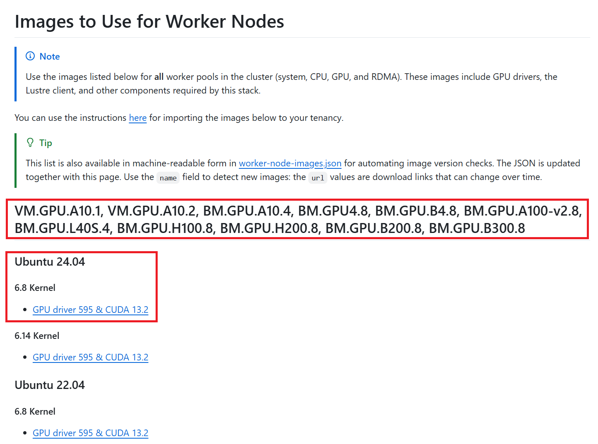
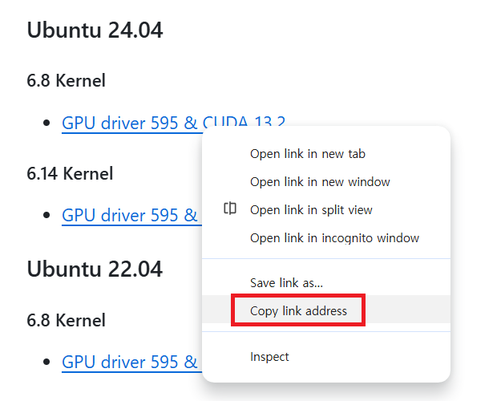
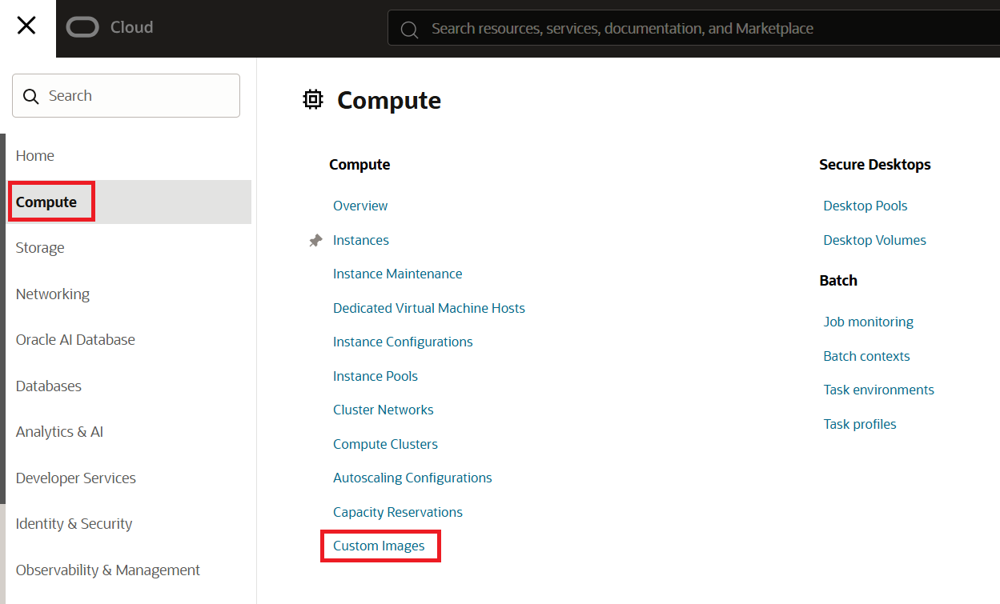
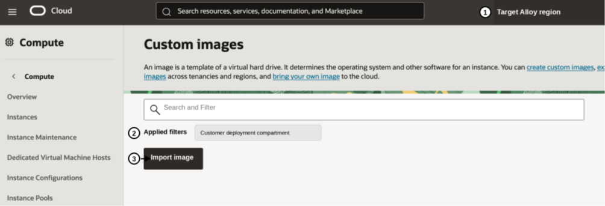
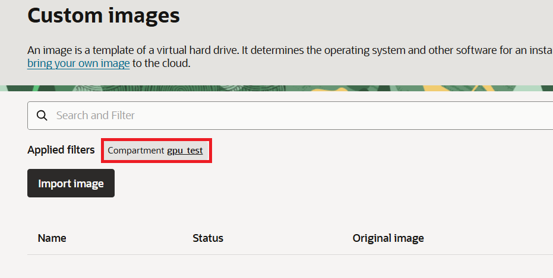
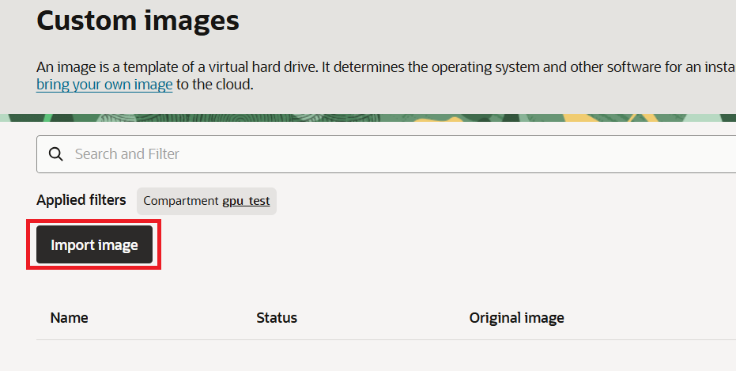
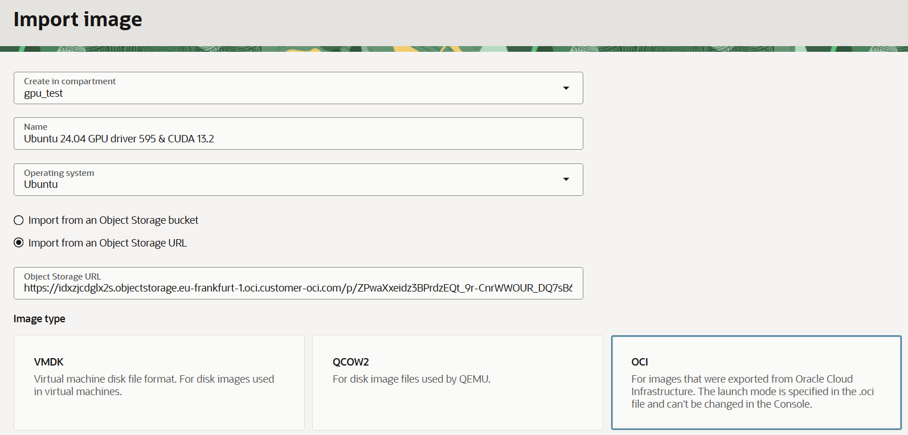
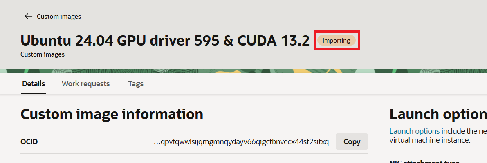

# 2. URL을 사용하여 Custom Image를 준비하고 가져오기

OCI HPC OKE woker node 이미지 카탈로그에 게시된, 해당 릴리스에서 공식 승인된 `.oci` 이미지 링크를 HTTPS를 통해 가져운 Custom Image만 사용해야 합니다. 이 작업 절차에서는 이미지 파일을 사용자 PC나 관리용 워크스테이션에 다운로드 하지 않으며, 고객의 OCI Object Storage 버킷에 임시로 저장하는 과정 또한 수행히지 않습니다.

> [!WARNING]
> **Direct URL 요구사항**: 승인된 이미지 링크에 연결된 실제 URL을 복사해야 하며, Github 페이지 URL을 복사해서는 안됩니다. 이미지 카탈로그의 링크는 변경될 수 있으므로 이미지 이름, 운영체제, 커널 버전, 복사한 URL, 출처 확인 날짜, 대상 리전, 이미지가 저장될 Compartment 및 Import된 이미지의 OCID를 기록해야 합니다.

## 2.1 승인된 이미지 URL 복사.

여기에서는 승인된 이미지 URL을 복사합니다. 아래 절차에 따릅니다.

1. 웹 브라우저를 열고 아래 웹 사이트에 접속합니다.

    https://github.com/oracle-quickstart/oci-hpc-oke/blob/main/docs/worker-node-images.md

2. 페이지에서, 아래 항목들을 확인합니다.

    

    1. `BM.GPU.B200.8`을 포함하는 Shape 그룹을 찾습니다.
    2. 배포용으로 승인된 운영체제, 커널, GPU 드라이버, CUDA 및 RDMA 빌드에 해당하는 운영체제를 선택합니다.
    3. 링크를 마우스 오른쪽 클릭하고 **Copy link address**를 클릭하여 링크를 복사합니다.

        

## 2.2 커스텀 이미지를 열고 목적지 선택

해당 리전에서, OCI 콘솔을 사용하여 작업을 수행합니다. 이 작업을 위해서는 해당 Alloy에서 작업을 수행할 수 있는 권한을 가진 사용자로 로그인 해야 합니다.

1. OCI 콘솔에서, 오른쪽 위의 햄버거 메뉴를 클릭하고, **Compute**를 클릭한 후 Compute 구역에서 **Custom Images**를 클릭합니다.

    

2. 오른쪽 위에서, **Target Alloy Region**을 확인합니다. 선택된 리전에 가져올 이미지의 이미지의 OCID가 생성됩니다.

    

3. 이미지가 위치할 컴파트먼트를 선택합니다.

    

4. **Import image** 버튼을 클릭합니다.

    

## 2.3 이미지 가져오기

1. **Image** 페이지에서, 아래와 같이 값을 입력합니다.

    |입력 필드|설명|
    |--------|---|
    |Create in compartment|Custom Image를 소유하게 될 컴파트먼트를 선택합니다. 리소스 관리자 주체(Resource Manager principal)는 이 컴파트먼트의 이미지를 읽을 수 있어야 합니다.|
    |Name|역할, 운영 체제, 커널 및 릴리스를 식별할 수 있도록 버전 정보가 포함된 고객 승인 명칭을 사용하십시오. 기밀 정보나 고객 데이터를 포함하지 마십시오.|
    |Operating System|Ubuntu를 선택하여 운영 체제 계열이 카탈로그 이미지의 운영 체제 계열과 일치하도록 설정합니다.|
    |Import from an... 옵션|**Import from an Object Storage URL**을 선택합니다. 이 가이드에서는 버킷이나 객체의 경로를 사용하지 않습니다.|
    |Object Image URL|2.1 단계 에서 복사한 링크를 붇여 넣습니다. 이 링크는 Oracle 공식 저장소의 PAR 링크를 가리킵니다. GitHub 페이지의 URL을 사용하지 마십시오.|
    |Image Type|**OCI** 를 선택합니다. worker-image 카탈로그에 게시된 .oci 이미지의 경우 VMDK 또는 QCOW2를 선택하지 마십시오.|

    

2. 오른쪽 아래의 **Import Image**를 클릭합니다.
3. 가져오기가 시작됩니다. 상태가 Available이 될 때까지 기다립니다.

    

## 2.4 Resource Manager(Terraform)에서 가져온 이미지의 사용

가져온 이미지의 정보는 다음 단계에서 수행할 Resource Manager의 Stack 구성에 사용됩니다. Stack에서는 여기서 가져온 Custom Image를 선택하야 하며, 이미지를 다시 가져와서는 안됩니다.

|Stack 입력 필드|필수 설정|목적|
|--------------|-------|---|
|Image Type|Custom|배포 시 OCI 플랫폼 이미지 또는 사전 빌드 이미지가 사용되지 않도록 합니다.|
|Import custom image from URL|Disable|이 단계에서 승인된 URL을 사용하여 이미지를 수동으로 가져왔으므로 비활성화(사용하지 않음)합니다.|
|Image compartment|이미지를 가져온 대상 컴파트먼트|가져온 이미지가 이미지 선택 목록에 표시되도록 합니다.|
|Image|승인된 가져온 이미지|이미지 가져오기 후 기록한 이미지 이름과 해당 리전의 OCID에 일치하는 이미지를 선택합니다.|

> [!NOTE]
> Custom Image의 OCID는 리전별로 고유합니다. 각 대상 리전에서 URL을 사용하여 이미지를 가져오고, Terraform 및 Terraform apply를 실행하기 전에 기록된 OCID를 확인해야 합니다.

---

이전: [1. 배포 프로파일과 사전 요구사항](./01_deployment_profile_and_prerequisites.md) | 다음: [3. Resource Manager 스택을 생성하고 로드](./03_create_resource_manager_stack_load.md)