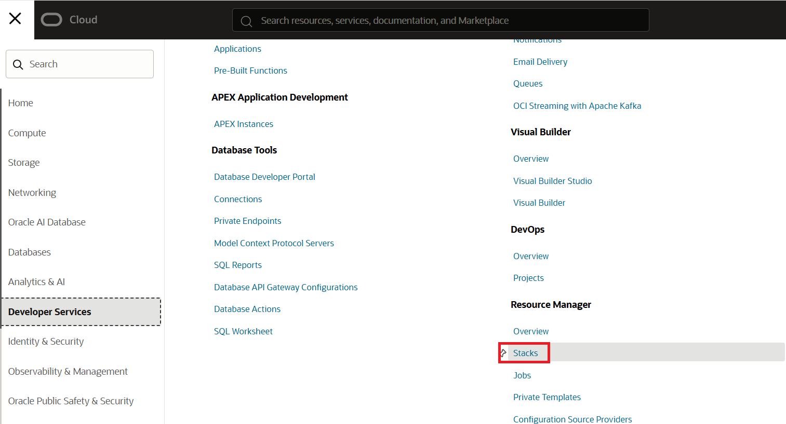
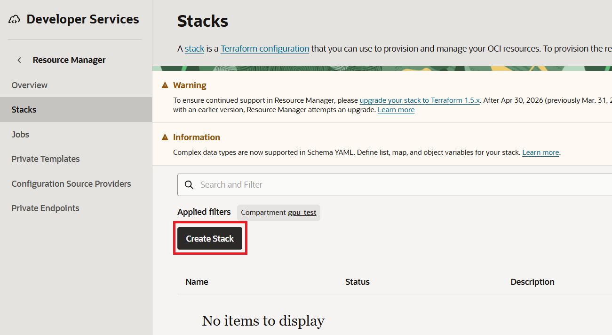
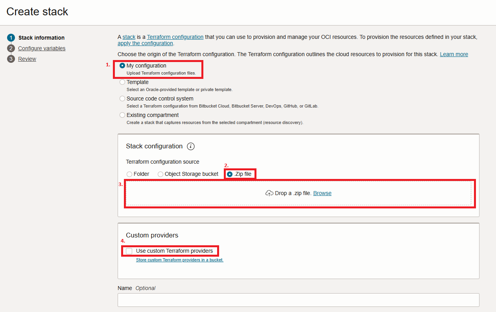
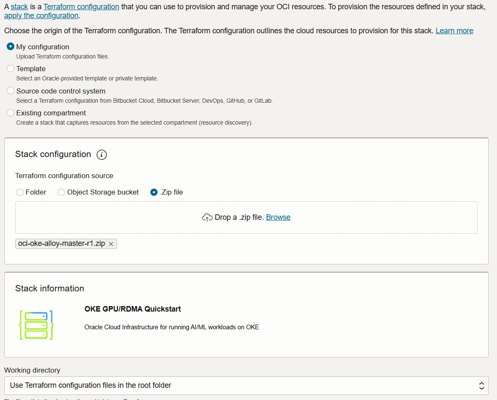

# 3. Resource Manager 스택을 생성하고 로드

Stack 변수를 구성하기 전에 먼저 배포 패키지를 사용하여 Resource Manager Stack을 생성합니다. 대상 Alloy 리전과 Resource Manager Stack을 소유하게 될 컴퍼트먼트를 선택합니다.

> [!WARNING]
> 배포용으로 승인된 oci-oke-alloy-master-r2.zip 파일을 사용해야 합니다. 다른 압축 파일로 대체하지 마십시오.

## 3.1 Resource Manager를 열고 Stack 생성

이 단계에서는 Resource Manager를 사용하여 Stack을 생성합니다.

1. OCI 콘솔에서 왼쪽 위의 햄버거 메뉴를 클릭하고 **Developer Services** 를 클릭합니다.
2. **Developer Services** 에서, **Resource Manager** 구역의 **Stacks**를 클릭합니다.

    

3. Stacks 페이지에서, **Create Stack** 버튼을 클릭합니다.

    

## 3.2 배포 패키지 업로드

이 단계에서는 승인된 .zip 파일을 Terraform 구성을 위한 소스로 업로드 합니다. 아래와 같이 설정합니다.

1. 라디오 버튼 선택에서, **My Configuration**을 선택합니다. 제공된 Terraform 패키지를 사용하려면 이 옵션을 선택해야 합니다.
2. **Stack Configuration** 에서 **.Zip File** 을 선택합니다.
3. 업로드 구역(Drop a .zip file)에 oci-oke-alloy-master-r1.zip 파일을 업로드합니다. 업로드가 완료될 때 까지 기다리고, 패키지가 로드되었는지 확인한 후 다음 단계로 진행합니다.
4. Use custom Terraform providers 옵션을 선택하지 않습니다. 고객용 릴리스 지침에서 Custom Provider 패키지를 명시적으로 제공하고 사용을 요구하는 경우에만 선택할 수 있습니다.
5. 왼쪽 아래의 **Next** 버튼을 클릭합니다.

## 3.3 Stack 변수 구성 단계로 진행

패키지가 로드되면 **Configuration variables** 단계로 진행합니다. 4장에서 필요한 배포 프로파일을 선택한 후, 5장부터 입력 항목을 구성하고 Terraform Plan 및 Terraform Apply를 실행합니다.

---

이전: [2. URL을 사용하여 Custom Image를 준비하고 가져오기](./02_prepare_custom_image.md) | 다음: [4. 배포 프로파일 선택](./04_select_deployment_profile.md)