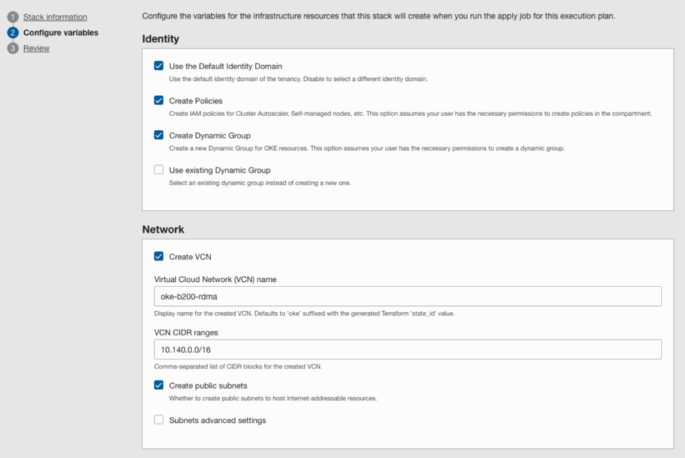

# 5. Identity와 Network

태넌시 ID 통합과 배포에 사용할 VCN을 구성합니다.

|입력 항목|제어 항목|설명|
|--------|--------|---|
|Use the Default Identity Domain|Stack에서 생성하는 리소스 태넌시의 기본 ID 도메인을 사용합니다.|다른 ID 도메인이 필요한 경우를 제외하고 활성화합니다.|
|Create Policies|클러스터 및 노드 자동화에 필요한 IAM 정책을 생성합니다.|Stack을 사용하는 사용자에게 정책 생성 권한이 있는 경우에만 활성화합니다.|
|Create Dynamic Group|OKE 배포 리스소를 위한 Dynamic Group을 생성합니다.|신규 배포 시 필요한 IAM 권한이 있는 경우 활성화합니다.|
|Use existing Dynamic Group|새로 생성하는 대신 미리 생성된 Dynamic Group을 사용합니다.|Create Dynamic Group 대신 사용합니다. 두 옵션을 동시에 활성화하지 마십시오.|
|Create VCN|OKE, Bastion, Operator, Worker 및 Load Balancer에서 사용할 VCN을 생성합니다.|새 네트워크를 생성하는 경우 활성화합니다.|
|Virtual Cloud Network (VCN) name|생성할 VCN의 표시 이름을 설정합니다.|명명 규칙을 적용합니다.|
|VCN CIDR ranges|VCN의 주소 공간을 정의합니다. 여러 CIDR 대역은 쉼표로 구분합니다.|다른 네트워크와 중복되지 않는 고객 CIDR 대역을 지정합니다.|
|Create public subnets|Bastion, Public OKE Endpoint 및 Public Load Balancer와 같이 인터넷에서 접근할 수 있는 리소스를 위한 서브넷을 생성합니다.|Public 배포 프로파일에서는 활성화합니다.|
|Subnet advanced settings|서브넷, 라우딩 및 보안의 세부 구성 항목을 표시합니다.|사용자 지정 네트워크 설계가 필요한 경우에만 활성화합니다.|

---

[이전: 4.3 CPU 및 RDMA 지원 GPU Worker를 사용하는 OKE 구성](./07_profile_3.md) | [다음: 6. 클러스터 액세스와 배스천](./09_cluster_access_and_bastion.md)
