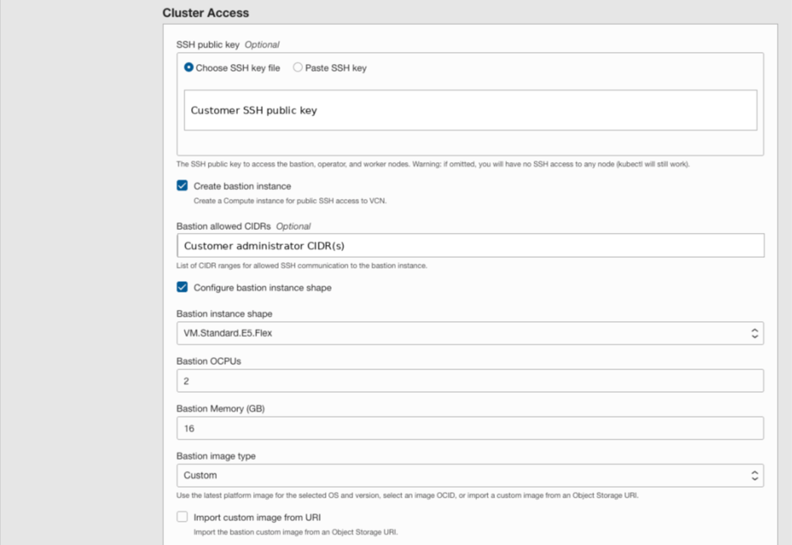

# 6. 클러스터 액세스와 배스천

SSH 접근과 Public 관리 호스트를 구성합니다. 스크린샷의 허용 CIDR 값은 안전하도록 구성된 예시 값입니다.

|입력 항목|제어 항목|설명|
|--------|--------|---|
|SSH public key|Bastion, Operator 및 Worker 노드에 대한 Public SSH 키를 할당합니다.|SSH 공개 키를 입력합니다.|
|SSH Key input method|파일 업로드 또는 키 텍스트 붙여 놓기 방식을 선택합니다.|한 가지 방식을 선택합니다.|
|Create bastion instance|VCN 내부로 SSH 접근하기 위한 Public 관리 호스트를 생성합니다.|직접적인 관리 접근이 필요한 경우 활성화합니다.|
|Bastion allowed CIDRs|인바운드 SSH 트래픽을 승인된 소스 네트워크로 제한합니다.|VPN 및 관리자 네트워크의 CIDR 대역을 사용합니다. 0.0.0.0/0을 사용하지 마십시오.|
|Configure bastion instance Shape|Bastion의 Compute 리소스 크기를 설정합니다.|아래 값들을 사용하려면 활성화합니다.|
|Bastion instance shape|Bastion의 Compute Shape를 선택합니다.|예: VM.Standard.E5.Flex|
|Bastion OCPUs|Flex Shape에서 Bastion에 할당할 OCPU 수를 설정합니다.|예: 2|
|Bastion Memory (GB)|Bastion에 할당할 메모리를 설정합니다.|예: 16 GB|
|Import custom image from URI|기존 Custom Image를 선택하는 대신, Terraform Apply 중에 URL에서 이미지를 직접 가져옵니다.|비활성화상태로 유지합니다. Section 2에서 승인된 Custom Image를 수동으로 가져온 후, 고객 이미지 컴파트먼트에서 해당 이미지를 선택합니다.|

---

[이전: 5. Identity와 Network](./08_identity_network.md) | [다음: 7. 배스천과 Operator Compute](./10_bastion_operator_compute.md)