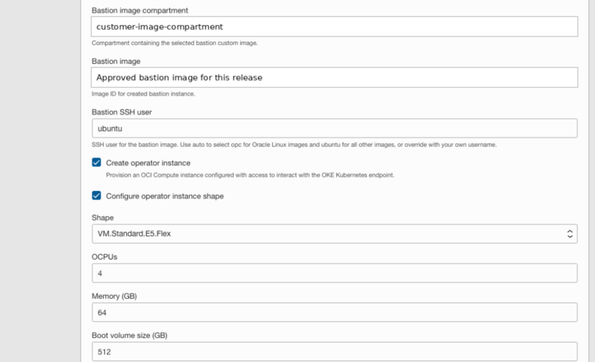

# 7. 배스천과 Operator Compute

승인된 배스천 이미지를 선택하고, Terraform, Helm 및 Kubectl 자동화에 사용할 Operator 인스턴스의 크기를 설정합니다.

|입력 항목|제어 항목|설명|
|--------|--------|---|
|Bastion image compartment|승인된 bastion 이미지가 저장된 Compartment를 지정합니다.|[2장, 'URL을 사용하여 Custom Image를 준비하고 가져오기'](./02_prepare_custom_image.md)에서 사용한 대상 리전의 고객 이미지 Compartment를 선택합니다.|
|Bastion image|Bastion 인스턴스를 생성할 때 사용할 Custom Image를 선택합니다.|가져오기가 완료된 릴리스 승인 이미지를 선택하고, 해당 리전의 OCID를 확인합니다.|
|Bastion SSH user|SSH 접속에 사용할 운영체제 사용자 계정을 설정합니다.|승인된 Ubuntu 이미지를 사용하는 경우 ubuntu를 입력합니다.|
|Create operator instance|kubectl, Helm, OCI CLI 및 배포 자동화 도구를 실행할 Operator 인스턴스를 생성합니다.|검증된 배포 프로파일에서 활성화합니다.|
|Configure operator instance shape|Operator 인스턴스의 Compute 리소스 크기를 명시적으로 설정할 수 있도록 합니다.|아래 설정값을 사용하려면 활성화합니다.|
|Shape|Operator 인스턴스에 사용할 Compute Shape을 선택합니다.|예: VM.Standard.E5.Flex|
|OCPUs|Operator 인스턴스에 할당할 CPU 리소스를 설정합니다.|예: 4 OCPU|
|Memory (GB)|Operator 인스턴스에 할당할 메모리 용량을 설정합니다.|예: 64 GB|
|Boot Volume size (GB)|Operator 인스턴스의 루트 볼륨 용량을 설정합니다.|예: 512 GB (워크로드 요구사항에 따라 조정)|

---

[이전: 6. 클러스터 액세스와 배스천](./09_cluster_access_and_bastion.md) | [다음: 8. Operator 이미지, 도구와 Alloy 메타데이터](./11_operator_image_tools_alloy_metadata.md)
