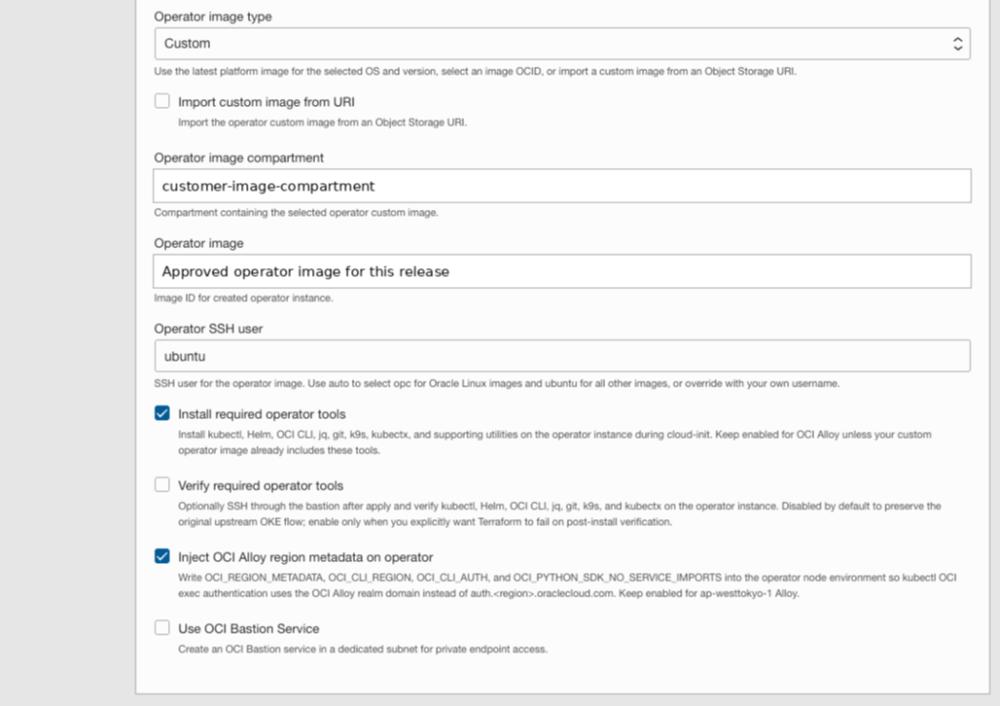

# 8. Operator 이미지, 도구와 Alloy 메타데이터

승인된 Operator 이미지를 선택하고, 배포에 필요한 도구 및 Alloy 메타데이터를 활성화합니다.

|입력 항목|제어 항목|설명|
|--------|--------|---|
|Operator image type|Operator에 플랫폼 이미지, OCID 또는 Custom Image를 사용하는 방식을 선택합니다.|Custom을 선택하고 [2장, 'URL을 사용하여 Custom Image를 준비하고 가져오기'](./02_prepare_custom_image.md)에서 준비한 이미지를 선택합니다.|
|Import custom image from URI|기존 Custom Image를 선택하는 대신, Terraform Apply 중에 URL에서 이미지를 직접 가져옵니다.|비활성화 상태로 유지합니다. Section 2에서 승인된 Custom Image를 수동으로 가져온 후, 고객 이미지 컴파트먼트에서 해당 이미지를 선택합니다.|
|Operator image compartment|Operator 이미지가 포함된 컴파트먼트를 지정합니다.|2장, 에서 사용한 대상 리전의 고객 이미지 컴파트먼트를 선택합니다.|
|Operator SSH user|SSH에 사용할 운영 체제 계정을 설정합니다.|Ubuntu 이미지에는 ubuntu를 사용합니다.|
|Install required operator tools|cloud-init 실행 중에 kubectl, Helm, OCI CLI, jq, Git, k9s, kubectx 및 지원 유틸리티를 설치합니다.|이미지에 해당 도구가 이미 포함된 경우를 제외하고 활성화합니다.|
|Verify required operator tools|Terraform Apply 후 도구의 사용 가능 여부를 확인합니다. 검증에 실패하면 Terraform 실행이 실패할 수 있습니다.|정식 검증에서는 활성화합니다. 초기 테스트에서는 선택 사항입니다.|
|Inject OCI Alloy region metadata on operator|OCI 도구에 필요한 Alloy 리전, Realm, 엔드포인트 및 SDK 메타데이터를 기록합니다.|대상 Alloy 리전에 대해 활성화합니다.|
|Use OCI Bastion Service|Private Endpoint 접근을 위한 OCI Bastion 서비스를 생성합니다.|Public Endpoint 프로파일에서는 비활성화 상태로 유지합니다.|

---

[이전: 7. 배스천과 Operator Compute](./10_bastion_operator_compute.md) | [다음: 9. OKE Cluster 구성](./12_configure_oke_cluster.md)