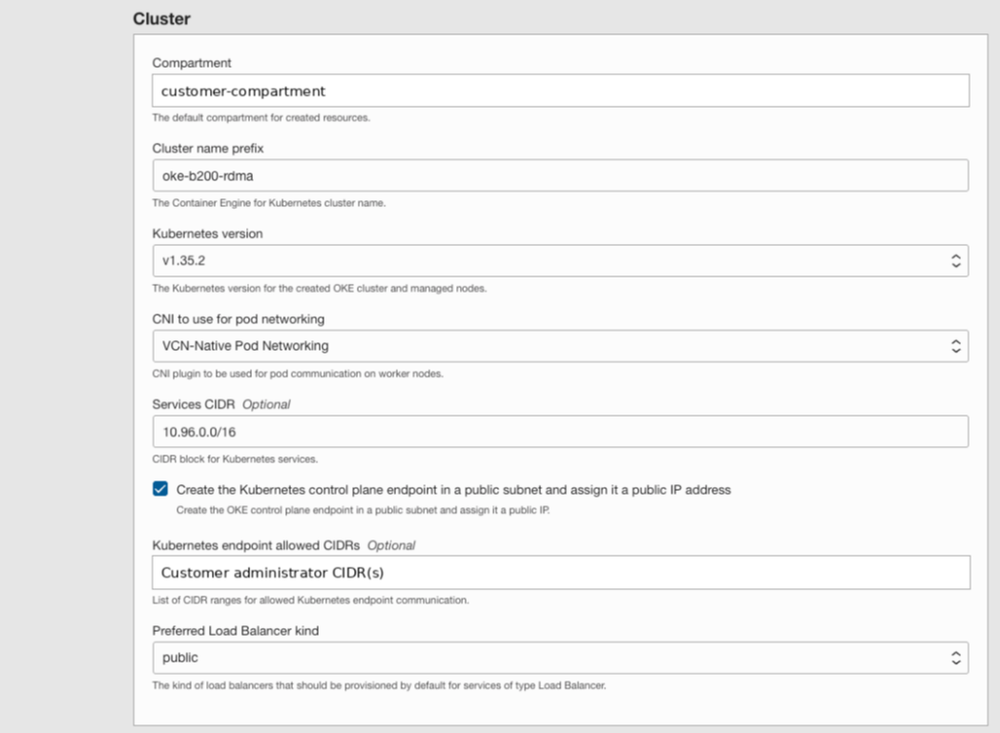

# 9. OKE Cluster 구성

클러스터 배치, 버전, 네트워킹, API Endpoint 노출 방식 및 기본 Load Balancer 동작을 구성합니다.

|입력 항목|제어 항목|설명|
|--------|--------|---|
|Compartment|클러스터 리소스의 기본 컴파트먼트를 설정합니다.|배포할 컴파트먼트를 선택합니다.|
|Cluster name prefix|OKE 클러스터 및 관련 리소스의 이름 접두사를 설정합니다.|명명 규칙을 적용합니다.|
|Kubernetes version|OKE Control Plane 및 관리형 노드의 Kubernetes 버전을 선택합니다.|해당 릴리스에서 승인된 버전을 사용합니다.|
|CNI to use for pod networking|Kubernetes Pod 네트워킹 구현 방식을 선택합니다.|이 프로파일에서는 VCN-Native Pod Networking을 사용합니다.|
|Services CIDR|Kubernetes Service에서 사용할 가상 IP 주소 대역을 정의합니다.|다른 네트워크와 중복되지 않는 CIDR 대역을 사용합니다. 예시: 10.96.0.0/16|
|Create the Kubernetes control plane endpoint in a public subnet and assign it a public IP address|배포 및 검증을 위해 인터넷에서 접근할 수 있는 Public OKE API Endpoint를 생성합니다.|권장되는 Public 배포 절차에서는 활성화합니다.|
|Kubernetes endpoint allowed CIDRs|Public Kubernetes API Endpoint에 대한 접근을 제한합니다.|승인된 관리자 및 VPN 네트워크의 CIDR 대역을 사용합니다. 0.0.0.0/0을 사용하지 마십시오.|
|Preferred Load Balancer Kind|Load Balancer 유형의 Kubernetes Service에 대한 기본 노출 방식을 설정합니다.|Private 전용 구성이 필요한 경우를 제외하고, 초기 배포에서는 Public을 사용합니다.|

---

[이전: 8. Operator 이미지, 도구와 Alloy 메타데이터](./11_operator_image_tools_alloy_metadata.md) | [다음: 10. 클러스터 구성요소](./13_cluster_compoments.md)
