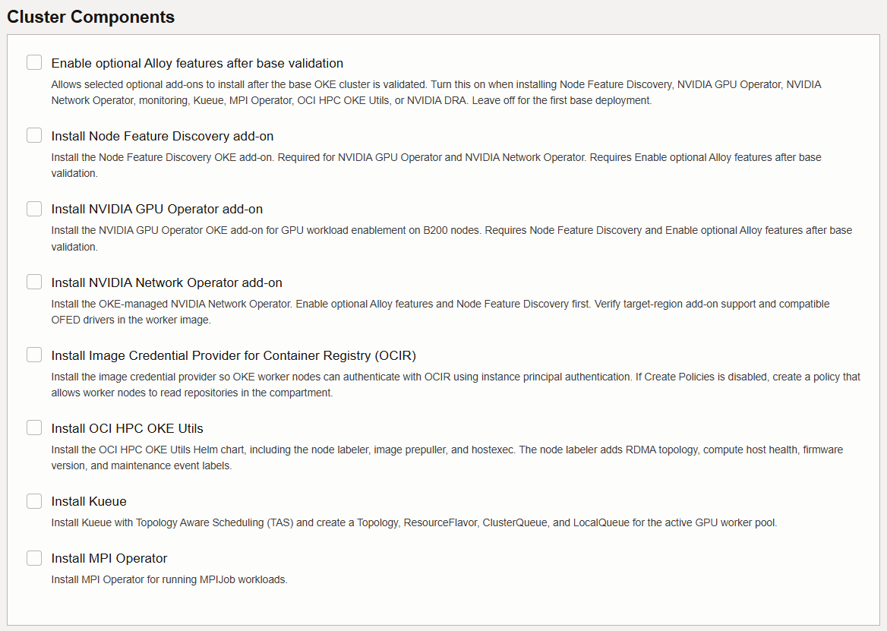
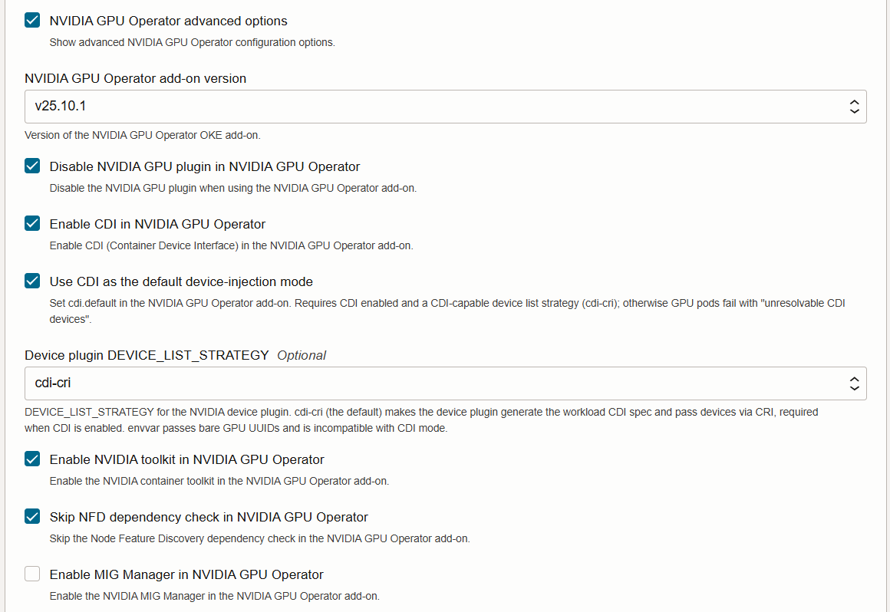
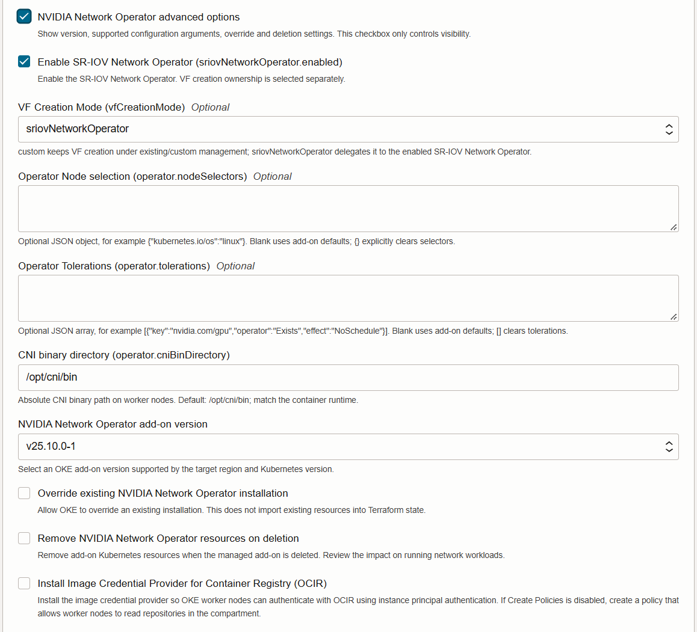

# 10. Cluster Components

고객의 워크로드와 운영 요구사항에 필요한 구성요소만 활성화합니다. 관리형 NFD, NVIDIA GPU Operator 및 NVIDIA Network Operator는 선택한 프로파일과 설치 조건에 따라 설치할 수 있습니다.

|입력 항목|제어 항목|설명|
|--------|--------|---|
|Enable optional Alloy features after base validation|기본 배포 검증 후 선택적 기능을 추가할 수 있도록 허용합니다. NFD, NVIDIA GPU Operator, NVIDIA Network Operator 등의 관리형 애드온을 설치할 때는 해당 설치 조건에 따라 활성화합니다.|- 프로파일 1: 비활성화합니다. - 프로파일 2, 3: 기본 클러스터와 워커 노드의 검증을 완료한 후, 선택한 관리형 NFD·GPU Operator·Network Operator의 설치 조건에 따라 활성화합니다.  이 항목만 켜도 애드온이 자동으로 설치되지는 않으며, 개별 Install 항목을 별도로 선택해야 합니다.|
|Install Node Feature Discovery add-on|OKE 관리형 Node Feature Discovery(NFD) 애드온을 설치합니다.|- 프로파일 1: 비활성화합니다. - 프로파일 2, 3: 관리형 NFD를 사용하거나, 선택한 관리형 GPU Operator 또는 Network Operator의 NFD 설치 조건을 충족해야 하는 경우 활성화합니다.|
|Install NVIDIA GPU Operator add-on|OKE 관리형 NVIDIA GPU Operator 애드온의 설치 여부를 제어합니다.|- 프로파일 1: 비활성화합니다. - 프로파일 2, 3: 관리형 NVIDIA GPU Operator를 사용하고자 하는 경우 활성화합니다. 상위 기능 허용 항목과 NFD 설치 조건도 충족해야 합니다.|
|Install NVIDIA Network Operator add-on|OKE 관리형 NVIDIA Network Operator 애드온의 설치 여부를 제어합니다.|- 프로파일 1, 2: 비활성화합니다. - 프로파일 3: 관리형 NVIDIA Network Operator를 사용하고자 하는 경우 활성화합니다. 상위 기능 허용 항목과 NFD 설치 조건도 충족해야 합니다.|
|Install Image Credential Provider for Container Registry (OCIR)|Worker 노드가 인스턴스 주체(Instance Principal) 자격 증명을 사용하여 OCIR에 인증할 수 있도록 합니다.|워크로드가 OCIR에서 비공개 이미지를 가져오는 경우 활성화합니다.|
|Install OCI HPC OKE Utils|RDMA 토폴로지 레이블러, 이미지 사전 가져오기 도구, 호스트 실행 도구 및 관련 유틸리티를 설치합니다.|- 프로파일 1: 비활성화합니다.  - 프로파일 2: 기본적으로 비활성화하며, 승인된 유틸리티 기능에 대해서만 활성화합니다. - 프로파일 3: RDMA 토폴로지 레이블 지정, 이미지 사전 가져오기 또는 호스트 유틸리티가 필요한 경우 사용을 권장합니다.|
|Install Kueue|Kueue 및 토폴로지 인식 스케줄링 리소스를 설치합니다.|- 프로파일 1: 비활성화합니다. - 프로파일 2 및 3: 큐잉 및 토폴로지 인식 스케줄링이 필요한 경우에만 활성화합니다.|
|Install MPI Operator|MPIJob 워크로드를 실행하는 데 사용하는 Operator를 설치합니다.|프로파일 1: 비활성화합니다. - 프로파일 2 및 3: MPIJob 워크로드에 대해서만 활성화합니다.|

## 10.1 NVIDIA GPU Operator advanced options 하위 항목 (Install NVIDIA GPU Operator add-on 선택 시)

해당 Install 항목을 선택하면 advanced options 항목이 표시됩니다. advanced options를 선택하면 아래 상세 설정 입력란이 표시됩니다. advanced options 자체는 설치 여부를 결정하지 않습니다.

|항목|설명|
|---|----|
|NVIDIA GPU Operator add-on version|설치할 OKE 관리형 GPU Operator의 버전을 지정합니다.|
|Disable NVIDIA GPU plugin in NVIDIA GPU Operator|기존에 별도로 설치된 OKE NVIDIA GPU 플러그인을 비활성화합니다. GPU Operator가 관리하는 Device Plugin과 중복 실행되는 것을 방지하기 위한 설정입니다.|
|Enable CDI in NVIDIA GPU Operator|CDI(Container Device Interface) 방식으로 컨테이너에 GPU 접근을 제공하는 기능을 활성화합니다.|
|Use CDI as the default device-injection mode|컨테이너에 GPU를 연결할 때 CDI를 기본 방식으로 사용하도록 지정합니다.|
|Device plugin DEVICE_LIST_STRATEGY|GPU Device Plugin이 할당된 GPU 정보를 컨테이너 런타임에 전달하는 방법을 설정합니다.|
|Enable NVIDIA toolkit in NVIDIA GPU Operator|GPU Operator가 NVIDIA Container Toolkit 구성요소를 관리하도록 설정합니다.|
|Skip NFD dependency check in NVIDIA GPU Operator|OKE 애드온 측에서 NFD 의존성 검사를 건너뛰도록 요청합니다. 기존에 호환되는 NFD가 설치된 경우 등에 사용하는 설정입니다.|
|Enable MIG Manager in NVIDIA GPU Operator|MIG 관리자를 설치할지 여부를 결정합니다.|

## 10.2 NVIDIA Network Operator advanced options 하위 항목 (Install NVIDIA Network Operator add-on 선택 시)

해당 Install 항목을 선택하면 advanced options 항목이 표시됩니다. advanced options를 선택하면 아래 상세 설정 입력란이 표시됩니다. advanced options 자체는 설치 여부를 결정하지 않습니다.

|항목|설명|
|---|----|
|Enable SR-IOV Network Operator|Network Operator와 함께 SR-IOV Network Operator를 활성화할지 결정합니다.|
|VF Creation Mode|VF를 어떤 방식으로 생성·관리할지 선택합니다. - custom: OKE의 custom VF 생성 경로 사용. 환경에서 제공하는 VF 생성 설정과 기존 구성 확인 필요  - sriovNetworkOperator: SR-IOV Network Operator가 VF 생성을 관리하는 방식 사용. sriovNetworkOperator를 선택하는 경우 Enable SR-IOV Network Operator도 활성화합니다.|
|Operator Node selection|Network Operator 자체의 Pod를 어느 노드에 배치할지 라벨로 지정합니다.|
|Operator Tolerations|Network Operator Pod가 지정된 노드 taint를 허용하도록 설정합니다. Toleration 자체가 해당 노드에 대한 배치를 보장하지는 않습니다.|
|CNI binary directory|Network Operator가 관리하는 CNI 실행 파일을 노드에 배치할 디렉터리를 지정합니다. 워커의 컨테이너 런타임이 사용하는 경로와 일치해야 합니다.|
|NVIDIA Network Operator add-on version|설치할 OKE 관리형 Network Operator 애드온 버전을 선택합니다. 대상 리전과 Kubernetes 버전에서 지원되는 버전을 사용합니다.|
|Override existing NVIDIA Network Operator installation|기존 NVIDIA Network Operator 설치가 있는 경우 OKE가 해당 설치를 덮어쓰도록 허용할지 지정합니다. 기존 Kubernetes 리소스를 Terraform 상태로 가져오는 기능은 아닙니다.|
|Remove NVIDIA Network Operator resources on delete|관리형 애드온을 삭제할 때 관련 Kubernetes 리소스도 제거할지 지정합니다. 활성화하기 전에 실행 중인 네트워크 워크로드에 미칠 영향을 검토합니다.|

---

[이전: 9. OKE Cluster 구성](./12_configure_oke_cluster.md) | [다음: 11. System Worker Pool](./14_system_worker_pool.md)
