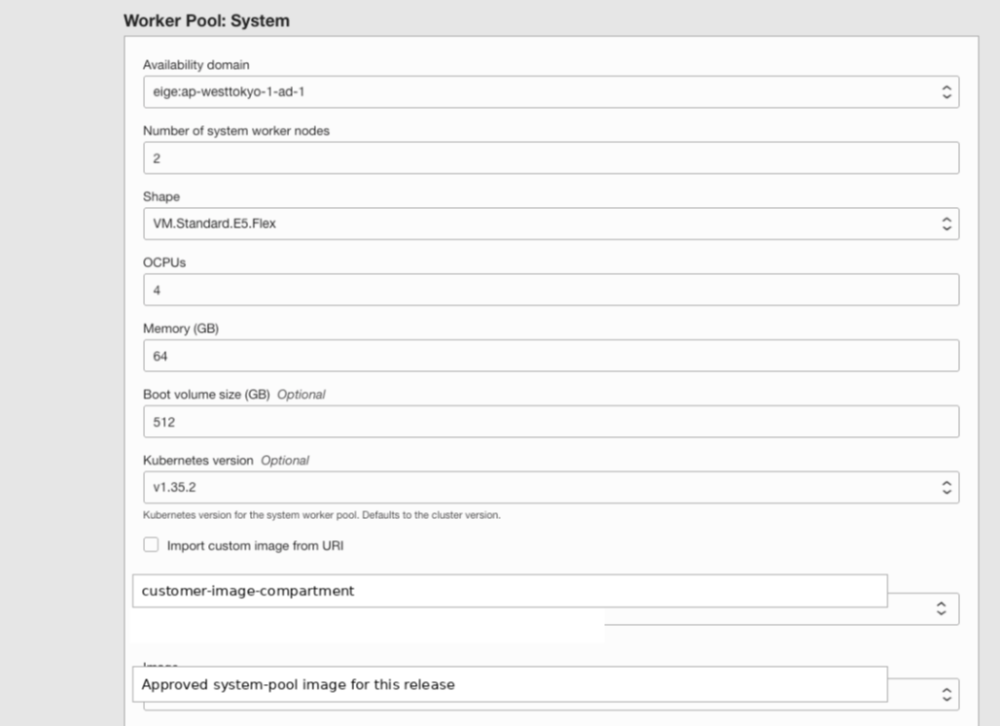

# 11. System worker pool

클러스터 서비스와 운영 워크로드를 실행할 OKE 시스템 노드 풀을 구성합니다.

|입력 항목|제어 항목|설명|
|--------|--------|---|
|Availability domain|시스템 worker 노드를 배치할 가용성 도메인을 선택합니다.|검증된 Alloy 가용성 도메인(AD)을 사용합니다.|
|Number of system worker Nodes|시스템 노드 풀의 노드 수를 설정합니다.|예: 2|
|Shape|시스템 노드의 Compute Shape를 선택합니다.|예: VM.Standard.E5.Flex|
|OCPUs|시스템 노드별로 할당할 OCPU 수를 설정합니다.|예: 4|
|Memory (GB)|시스템 노드별 메모리를 설정합니다.|예: 64 GB|
|Boot volume size (GB)|시스템 노드별 루트 볼륨 크기를 설정합니다.|예: 512 GB|
|Kubernetes version|시스템 노드 풀의 Kubernetes 버전을 지정하거나 클러스터 버전을 상속합니다.|클러스터용으로 승인된 버전을 사용합니다.|
|Import custom image from URI|기존 Custom Image를 선택하는 대신, Terraform Apply 중에 URL에서 이미지를 직접 가져옵니다.|비활성화 상태로 유지합니다.  Section 2에서 승인된 Custom Image를 수동으로 가져온 후, 고객 이미지 컴파트먼트에서 해당 이미지를 선택합니다.|
|Operational worker pool image compartment|시스템 노드 풀 이미지가 포함된 컴파트먼트를 지정합니다.|Section 2에서 사용한 대상 리전의 이미지 컴파트먼트를 선택합니다.|
|Image|시스템 노드에서 사용할 Custom Image를 선택합니다.|가져온 이미지 중 해당 릴리스에서 승인된 이미지를 선택하고, 해당 리전의 OCID를 확인합니다.|

---

[이전: 10. Cluster Components](./13_cluster_compoments.md) | [다음: 12. CPU worker pool – compute 설정](./15_cpu_worker_pool_compute.md)
