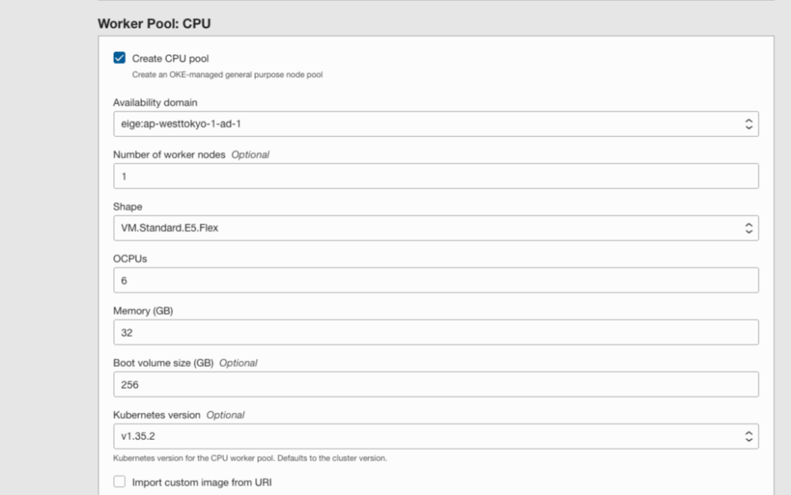

# 12. CPU worker pool – compute 설정

범용 CPU 노드 풀을 생성하고 규모를 설정합니다.

|입력 항목|제어 항목|설명|
|--------|--------|---|
|Create CPU pool|OKE에서 관리하는 범용 CPU 워커 풀(Worker Pool)을 생성합니다.|CPU 워크로드를 위한 리소스가 필요한 경우 활성화합니다.|
|Availability domain|CPU 워커 노드가 배치될 가용성 도메인(AD)을 선택합니다.|검증된 Alloy AD를 사용합니다.|
|Number of worker nodes|CPU 워커 풀의 노드 수를 설정합니다.|예: 1  가용성 향상이 필요한 경우 노드 수를 늘립니다.|
|Shape|CPU 워커 노드에 사용할 Compute Shape을 선택합니다.|예: VM.Standard.E5.Flex|
|OCPUs|CPU 워커 노드당 할당할 OCPU 수를 설정합니다.|예; 6|
|Memory (GB)|CPU 워커 노드당 할당할 메모리 용량을 설정합니다.|예: 32|
|Boot volume size (GB)|CPU 워커 노드당 루트 볼륨(Boot Volume) 크기를 설정합니다.|예; 256|
|Kubernetes version|CPU 워커 풀의 Kubernetes 버전을 지정하거나 클러스터 버전을 상속하도록 설정합니다.|클러스터에서 승인된 Kubernetes 버전을 사용합니다.|
|Import custom image from URI|기존 Custom Image를 선택하는 대신, Stack 적용(Apply) 과정에서 URL을 통해 이미지를 직접 가져옵니다.|비활성화 상태로 유지합니다. 섹션 2에서 승인된 Custom Image를 수동으로 가져온 후, 고객 이미지 Compartment에서 해당 이미지를 선택합니다.|

---

[이전: 11. System worker pool](./14_system_worker_pool.md) | [다음: 13. CPU worker pool – image 설정](./16_cpu_worker_pool.md)
