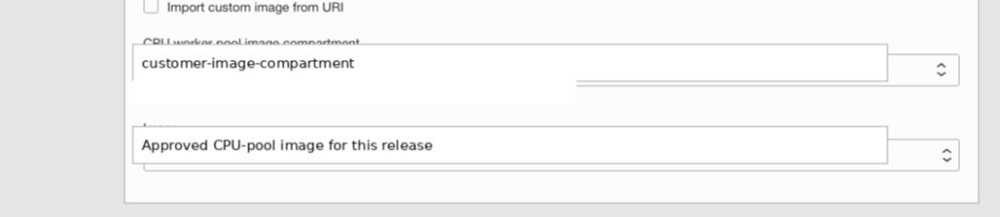

# 13. CPU worker pool – image 설정

이미지 컴파트먼트에서 해당 릴리스용으로 승인된 CPU Worker Pool 이미지를 선택합니다.

|입력 항목|제어 항목|설명|
|--------|--------|---|
|CPU worker pool image Compartment|CPU worker 이미지가 포함된 컴파트먼트를 지정합니다.|[2장, 'URL을 사용하여 Custom Image를 준비하고 가져오기']에서 사용한 대상 리전의 이미지 컴파트먼트를 지정합니다.|
|Image|CPU worker에서 사용할 Custom Image를 선택합니다.|가져온 이미지 중 해당 릴리스에서 승인된 이미지를 선택하고, 해당 리전의 OCID를 확인합니다.|

---

[이전: 12. CPU worker pool – compute 설정](./15_cpu_worker_pool_compute.md) | [다음: 14. B200 GPU/RDMA worker pool](./17_b200_gpu_rdma_worker_pool.md)