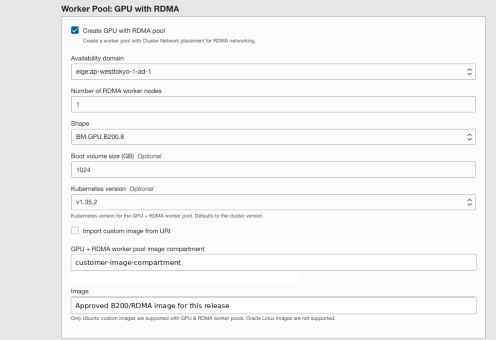

# 14. B200 GPU/RDMA worker pool

BM.GPU.B200.8 worker pool을 생성하고, 검증된 GPU, CUDA 및 RDMA 소프트웨어 스택이 포함된 승인된 Ubuntu 이미지를 선택합니다.

|입력 항목|제어 항목|설명|
|--------|--------|---|
|Create GPU with RDMA pool|클러스터 네트워크 배치를 사용하여 RDMA 지원 GPU worker pool을 생성합니다.|B200 프로파일에서는 활성화합니다.|
|Availability domain|GPU/RDMA worker를 배치할 가용성 도메인을 선택합니다.|리소스 가용 용량(Capacity)이 확보된 검증된 Alloy 가용성 도메인(AD)을 사용합니다.|
|Number of RDMA worker nodes|GPU/RDMA 노드 풀의 노드 수를 설정합니다.|기본 동작 확인에는 1개, 다중 노드 검증에는 2개 이상의 노드를 사용합니다.|
|Shape|베어메탈 GPU 셰이프를 선택합니다.|이 프로파일에서는 BM.GPU.B200.8을 사용합니다.|
|Boot volume size (GB)|GPU 노드별 루트 볼륨 용량을 설정합니다.|예: 1024 GB|
|Kubernetes version|GPU 노드 풀의 Kubernetes 버전을 지정하거나 클러스터 버전을 상속합니다.|클러스터용으로 승인된 버전을 사용합니다.|
|Import custom image from URI|기존 Custom Image를 선택하는 대신, Terraform Apply 중에 URL에서 이미지를 직접 가져옵니다.|비활성화 상태로 유지합니다. Section 2에서 승인된 Custom Image를 수동으로 가져온 후, 고객 이미지 컴파트먼트에서 해당 이미지를 선택합니다.|
|GPU + RDMA worker pool image compartment|B200/RDMA 이미지가 포함된 컴파트먼트를 지정합니다.|Section 2에서 사용한 대상 리전의 고객 이미지 컴파트먼트를 선택합니다.|
|Image|승인된 GPU, CUDA 및 RDMA 소프트웨어 스택이 포함된 Ubuntu 이미지를 선택합니다.|가져온 이미지 중 해당 릴리스에서 승인된 이미지를 선택하고, 해당 리전의 OCID를 확인합니다.|

---

[이전: CPU worker pool – image 설정](./16_cpu_worker_pool.md) | [다음: 15. GPU Memory 클러스터와 Storage](./18_gpu_memory_cluster_storage.md)
