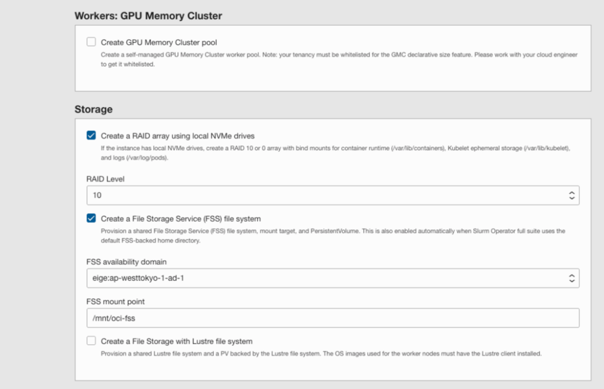

# 15. GPU Memory 클러스터와 Storage

필요한 경우 GPU Memory Cluster 용량, 로컬 NVMe RAID, FSS 및 Lustre 스토리지를 구성합니다.

|입력 항목|제어 항목|설명|
|--------|--------|---|
|Create GPU Memory Cluster pool|자체 관리형 GPU Memory Cluster 노드 풀을 생성합니다.|테넌시에서 해당 기능이 활성화되어 있고 설계상 필요한 경우를 제외하고, 비활성화 상태로 유지합니다.|
|Create a RAID array using local NVMe drives|로컬 RAID를 구성하고 컨테이너, Kubelet 및 Pod 로그 경로를 바인드 마운트합니다.|- 프로파일 1: 기본적으로 비활성화합니다. - 프로파일 2: 선택한 셰이프와 워크로드에 따라 활성화합니다. - Profile 3: 검증된 B200 프로파일에서는 RAID 10으로 활성화합니다.|
|RAID Level|로컬 NVMe 장치에 사용할 RAID 10 또는 RAID 0을 선택합니다.|중복성이 필요한 경우 10을, 최대 처리량이 필요한 경우 0을 사용합니다.|
|Create a File Storage Service (FSS) file system|공유 FSS 스토리지, 마운트 대상 및 Kubernetes 영구 볼륨(PV)을 생성합니다.|- Profile 1 및 2: 공유 영구 스토리지가 필요한 경우 선택적으로 활성화합니다. - Profile 3: 검증된 B200/RDMA 프로파일에서는 활성화합니다.|
|FSS availability domain|FSS 리소스의 가용성 도메인을 설정합니다.|검증된 Alloy 가용성 도메인(AD)을 사용합니다.|
|FSS mount point|Worker 노드에서 FSS를 마운트할 경로를 설정합니다.|예: /mnt/oci-fss|
|Create a File Storage with Lustre file system|Lustre 기반 공유 파일 시스템과 Kubernetes StorageClass 및 영구 볼륨(PV)을 생성합니다.|Lustre가 필요하고 이미지에 Lustre 클라이언트가 포함된 경우를 제외하고, 비활성화 상태로 유지합니다.|

---

[이전: 14, B200 GPU/RDMA worker pool](./17_b200_gpu_rdma_worker_pool.md) | [다음: 16. Monitoring과 observability](./19_monitoring_observability.md)
