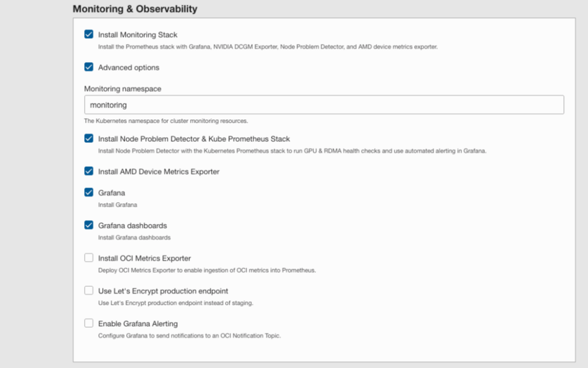

# 16. Monitoring과 observability

고객이 요구하는 모니터링과 관측 구성요소만 설치합니다. 운영 환경의 엔드포인트 또는 알림 기능을 활성화하기 전에 DNS, 인증서 및 알림 대상을 구성합니다.

|입력 항목|제어 항목|설명|
|--------|--------|---|
|Install Monitoring Stack|클러스터 모니터링 Stack과 지원 Exporter를 설치합니다.|- 프로파일 1: 선택 사항이며, 엄격한 최소 구성 프로파일에서는 일반적으로 비활성화합니다. - 프로파일 2 및 3: GPU 상태 확인과 워크로드 검증을 위해 사용을 권장합니다.|
|Advanced options|모니터링 구성요소의 세부 제어 항목을 표시합니다.|아래 항목의 선택 상태를 사용자 지정하려면 활성화합니다.|
|Monitoring namespace|모니터링 리소스에 사용할 Kubernetes 네임스페이스를 설정합니다.|기본값/예시: monitoring|
|Install Node Problem Detector & Kube Prometheus Stack|노드 상태 감지 기능, Prometheus 및 관련 모니터링 리소스를 설치합니다.|상태 점검과 메트릭 수집을 위해 활성화합니다.|
|Install AMD Device Metrics Exporter|해당 노드에서 지원되는 AMD 장치의 메트릭을 수집합니다.|Profile 1과 BM.GPU.B200.8을 포함한 NVIDIA GPU 프로파일에서는 비활성화합니다. 지원되는 AMD GPU 프로파일에 대해서만 활성화합니다.|
|Grafana|대시보드와 시각화를 위한 Grafana를 설치합니다.|대화형 대시보드가 필요한 경우 활성화합니다.|
|Grafana dashboards|패키지에 포함된 Grafana 대시보드를 설치합니다.|Grafana와 함께 활성화합니다.|
|Install OCI Metrics Exporter|OCI 서비스 메트릭을 Prometheus로 수집합니다.|선택 사항이며, OCI 메트릭이 필요한 경우 활성화합니다.|
|Use Let's Encrypt production endpoint|스테이징 엔드포인트 대신 운영 엔드포인트를 사용하여 인증서를 발급받습니다.|고객의 DNS 구성이 준비된 후에만 활성화합니다.|
|Enable Grafana Alerting|OCI Notifications 토픽을 통해 Grafana 알림을 구성합니다.|알림 대상을 구성한 후 활성화합니다.|

---

[이전: 15. GPU Memory 클러스터와 Storage](./18_gpu_memory_cluster_storage.md) | [다음: 17. Stack 동작, 미리 보기 기능 및 기본 모드](./20_stack_behavior.md)
