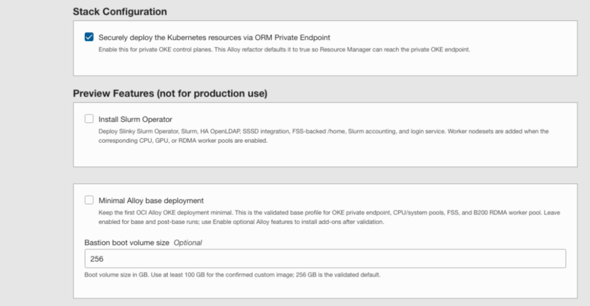

# 17. Stack 동작, 미리 보기 기능 및 기본 항목

선택한 엔드포인트 모델에 맞게 Resource Manager 연결 방식과 기능 모드를 구성합니다. 미리 보기 서비스는 명시적으로 승인된 경우를 제외하고 비활성화 상태로 유지합니다.

## 17.1 Stack Configuration

|입력 항목|제어 항목|설명|
|--------|--------|---|
|Securely deploy the Kubernetes resources via ORM Private Endpoint|이 가이드의 Public OKE Endpoint 배포에서는 비활성화합니다.|Resource Manager가 Private OKE Endpoint에 접근해야 하는 별도로 검증된 구성에서 활성화합니다.|

## 17.2 Preview Features (not for production use)

|입력 항목|제어 항목|설명|
|--------|--------|---|
|Install Slurm Operator|Slinky Slurm Operator 및 관련 Slurm 서비스를 설치합니다.|미리 보기 기능으로, 운영 환경 배포 대상에서 제외합니다. 별도로 승인된 미리 보기 검증 환경에서만 활성화합니다.|

## 17.3 기본 항목

|입력 항목|제어 항목|설명|
|--------|--------|---|
|Minimal Alloy base deployment|선택적 HPC, 스케줄링, 모니터링 또는 GPU 활성화 서비스가 없는 기본 OKE 프로파일을 배포합니다.|- 프로파일 1: 모든 선택적 서비스가 비활성화된 엄격한 CPU 전용 기본 OKE 구성에 대해서만 활성화하며, 그 외에는 비활성화합니다. - 프로파일 2 및 3: 서비스를 사용하는 GPU 배포에서는 비활성화합니다. 선택적 서비스는 개별적으로 제어합니다.|
|require_ready_region_subscription|더 이상 사용되지 않는 호환성 입력 항목입니다.|무시하십시오.|

--

[이전: 16. Monitoring과 observability](./19_monitoring_observability.md) | [다음: 18. Plan, apply, 검증](./21_plan_apply_validation.md)
