# 부록:: Stack 생성 항목

여기에서는 Softbank Alloy에서 HPC-OKE 스택 생성시 선택하거나 입력할 수 있는 항목들에 대해 설명합니다.

## 1. Identity

|항목|설명|
|---|----|
|Use the Default Identity Domain|테넌시의 기본 Identity Domain 사용를 사용할 것인지의 여부를 결정합니다. 체크하면 태넌시의 기본 Identity 도메인을 사용하도록 설정되며, 새로운 Identity Domain을 생성하지 않습니다|
|Create Policies|OKE 관련 리소스가 OCI 서비스를 호출할 수 있도록 IAM 정책을 생성 합니다. 이 패키지는 설정에 따라 다음과 같은 권한을 설정합니다.  - OKE 클러스터·노드 풀	클러스터와 워커 관리 Compute·볼륨	인스턴스 및 스토리지 관리 - 네트워크	서브넷·VNIC·NSG 사용 - File Storage	공유 파일 시스템 관리 - Monitoring	GPU·RDMA 등의 지표 조회·전송 - 특정 Kubernetes 워크로드	서비스 계정 조건에 따른 OCI API 접근|
|Create Dynamic Group|OCI 인스턴스들을 인증 주체로 묶는 Dynamic Group을 새로 생성합니다. 이 배포로 생성한 OKE 인스턴스만 포함하는 것이 아니라, 해당 컴파트먼트에 있는 모든 Compute 인스턴스가 조건에 포함됩니다.|
|Use existing Dynamic Group|새 그룹을 생성하는 대신, 관리자가 이미 만들어 둔 Dynamic Group을 사용합니다.|

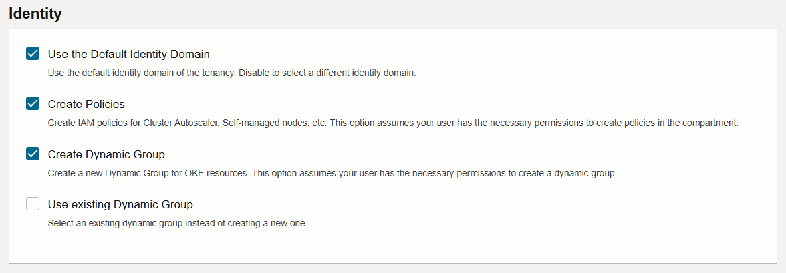

## 2. Network

|항목|설명|
|---|----|
|Create VCN|새 가상 네트워크를 만들지, 기존 네트워크를 사용할지 결정합니다.   - 체크: Terraform이 새 VCN과 관련 네트워크 리소스를 구성합니다.   - 체크 해제: 기존 VCN을 선택하는 항목이 나타납니다.|
|Virtual Cloud Network (VCN) name|Terraform이 생성할 VCN의 표시 이름을 지정합니다. 형식은 일반 텍스트입니다.|
|VCN CIDR ranges|VCN 안에서 사용할 사설 IPv4 주소 대역을 지정합니다.|
|Create public subnets|퍼블릭 IP를 사용하는 리소스를 배치할 수 있도록 퍼블릭 서브넷 구성을 허용할지를 설정합니다. 다만 이 항목을 체크해도 모든 워커나 Kubernetes API가 퍼블릭으로 바뀌지는 않습니다.|
|Subnets advanced settings|서브넷별 주소 대역이나 기존 서브넷 사용 여부를 직접 지정할 때 사용하는 옵션입니다.   - 체크 안 함: 패키지의 기본 분할 로직에 따라 필요한 서브넷을 구성합니다.   - 체크: 다른 선택 조건에 따라 서브넷별 CIDR 또는 기존 서브넷 선택 항목이 표시됩니다.|

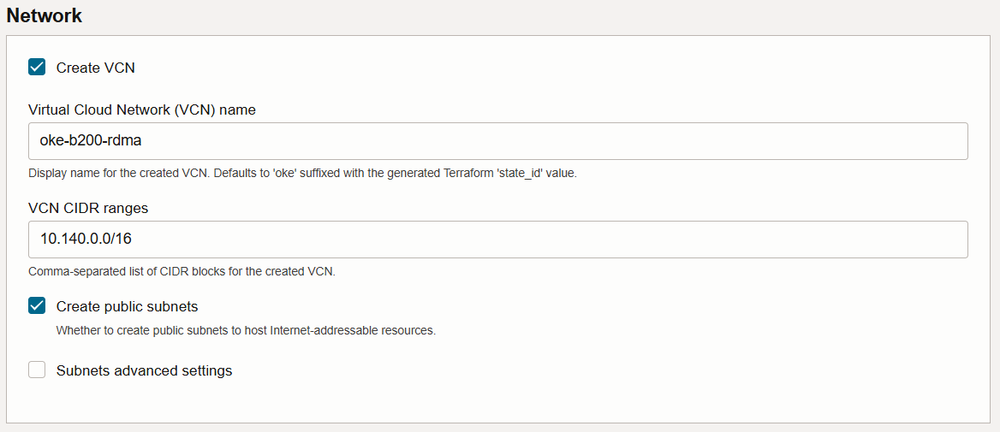

### 2-1 Subnets advanced settings 하위 항목 (Subnets advanced settings 선택시)

|항목|설명|
|---|----|
|Subnet CIDR for the bastion subnet|직접 생성하는 Bastion VM을 배치할 서브넷입니다.|
|Subnet CIDR for the bastion service subnet|OCI 관리형 Bastion Service의 프라이빗 엔드포인트에 사용할 서브넷입니다. Bastion VM용과 별개입니다.|
|Subnet CIDR for the operator subnet|kubectl·Helm 등을 실행하는 관리용 Operator VM의 서브넷입니다. GPU·Network Operator Pod 전용 서브넷을 뜻하지 않습니다.|
|Subnet CIDR for the internal load balancer subnet|내부 서비스용 Load Balancer의 사설 IP가 배치되는 서브넷입니다.|
|Subnet CIDR for the public load balancer subnet|외부에 서비스를 공개하는 Load Balancer용 서브넷입니다.|
|Subnet CIDR for the OKE control plane subnet|Kubernetes API 엔드포인트가 연결되는 서브넷입니다. Oracle이 관리하는 컨트롤 플레인 서버 전체를 여기에 배치한다는 뜻은 아닙니다.|
|Subnet CIDR for the workers subnet|System·CPU·GPU·RDMA 워커 노드의 기본 VNIC와 IP에 사용하는 서브넷입니다.|
|Subnet CIDR for the FSS subnet|FSS에 접근하기 위한 Mount Target을 배치하는 서브넷입니다.|
|Subnet CIDR for the Lustre subnet|Lustre 파일 시스템의 네트워크 연결에 사용할 서브넷입니다.|
|Subnet CIDR for the pods subnet|VCN-Native Pod Networking에서 Pod IP를 할당하는 서브넷입니다. 워커 노드 IP 대역과 구분됩니다.|

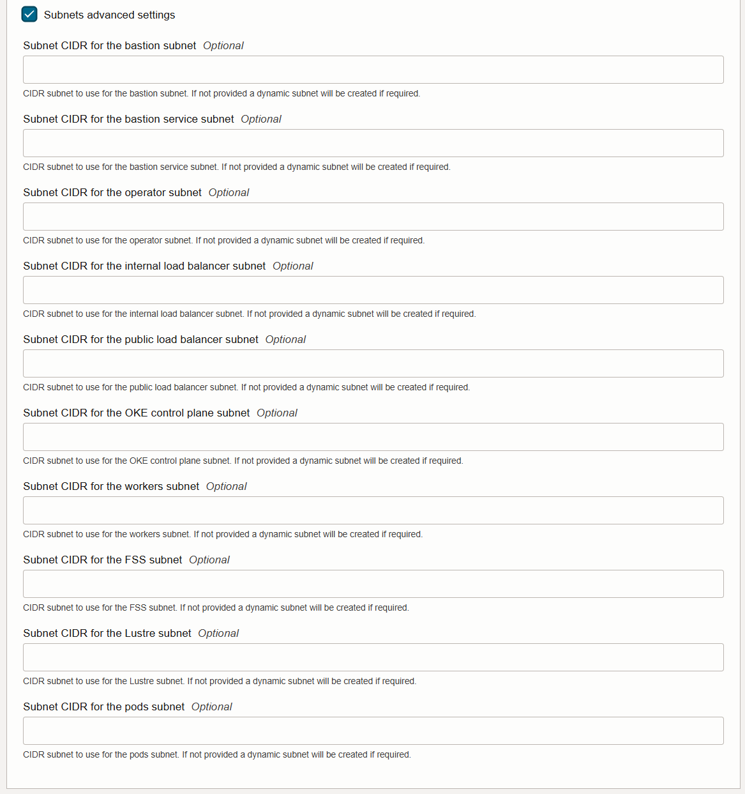

## 3. Cluster Access

|항목|설명|
|---|----|
|SSH Public Key|Bastion, Operator, 워크 노드에 SSH로 로그인할 때 사용할 공개키를 등록합니다.   - Choose SSH key file	PC에 있는 공개키 파일, 보통 `.pub` 파일 업로드   - Paste SSH key	공개키 문자열을 직접 붙여넣기|
|Create Bastion Instance|VCN 내부에 접근할 때 중계 서버로 사용할 Bastion VM을 생성할 지 여부를 결정합니다. Network 설정의 **Create public subnets** 옵션을 활성화하고 Bastion 퍼블릭 설정을 유지하면, Public IP가 있는 Bastion을 구성할 수 있습니다.|
|Bastion allowed CIDRs|어떤 출발지 IP에서 Bastion에 SSH로 접속할 수 있는지를 지정합니다. `0.0.0.0`으로 지정하면 모든 IP에서 접속할 수 있습니다. 이 값은 Bastion VM용이며, OCI Bastion Service에는 별도의 CIDR 지정값이 있습니다.|
|Configure bastion instance shape|Bastion의 Shape, CPU, 메모리를 선택하는 상세 항목을 표시합니다.  현재 체크되어 있으므로 다음 항목을 직접 지정할 수 있습니다.  - Bastion instance shape  - Bastion OCPUs  - Bastion Memory 이 체크박스를 해제하는 것은 Bastion 생성 자체를 취소하는 것과 다릅니다. Bastion 생성 여부는 Create bastion instance에서 결정합니다.|
|Bastion instance shape|생성될 Bastion VM의 Shape를 지정합니다.|
|Bastion OCPUs|Bastion VM의 OCPU 수를 지정합니다.|
|Bastion Memory|Bastion VM의 메모리 용량을 지정합니다.|
|Bastion image type|Bastion VM의 부팅 이미지를 어떤 방식으로 선택할 지 지정합니다. 이것은 Bastion용 이미지로, GPU 드라이버나 OFED가 들어있는 이미지를 사용할 필요는 없습니다.|
|Import custom image from URI|Object Storage에 저장된 이미지 파일을 가져와 Custom 이미지로 사용하도록 지정합니다.  - 체크: 이미지 파일을 가리키는 Object Storage URI를 지정합니다. - 체크 해제: 대상 환경에 이미 등록된 Custom 이미지를 선택합니다. 이 URI는 일반 설치 ISO나 컨테이너 이미지 주소가 아니라, OCI가 가져올 수 있는 형식의 머신 이미지를 가리켜야 합니다. 체크하지 않으면 아래 목록에서 기존 이미지를 선택해야 합니다.|
|Bastion image compartment|Custom image 리소스가 있는 컴파트먼트를 지정합니다. 이 설정은 이미지 목록을 조회할 위치를 뜻하며, Bastion VM 자체를 어디에 생성할지 정하는 설정은 아닙니다.|
|Bastion image|사용할 Custom 이미지를 지정합니다. 이미지는 다음 조건을 확인해야 합니다.   - 대상 리전에서 사용 가능 - `VM.Standard.E5.Flex`와 아키텍처 및 Shape 호환 - SSH 접속과 공개키 설정을 지원 - 아래에서 지정한 SSH 계정이 존재|
|Bastion SSH User|Bastion 운영체제에 로그인 할 Linux 사용자 이름을 지정합니다.  - Ubuntu:ubuntu / Oracle Linux:	opc / 회사 Custom 이미지: 이미지에 실제로 설정된 계정  이 ZIP은 auto도 지정할 수도 있습니다. 이미지 OS가 Oracle Linux이면 opc, 그 외에는 ubuntu를 선택합니다.|
|Create operator instance|OKE를 관리하는 별도 Compute VM을 생성할지 여부를 결정합니다. 이 옵션을 선택하면, Bastion과는 별도로 내부에서 클러스터 관리 옵션과 설치 작업을 실행하는 VM을 생성하며, 생성을 위한 옵션이 표시됩니다.|
|Use OCI Bastion Service|직접 관리하는 Bastion VM과 별도로, OCI의 관리형 접속 서비스를 생성합니다.|

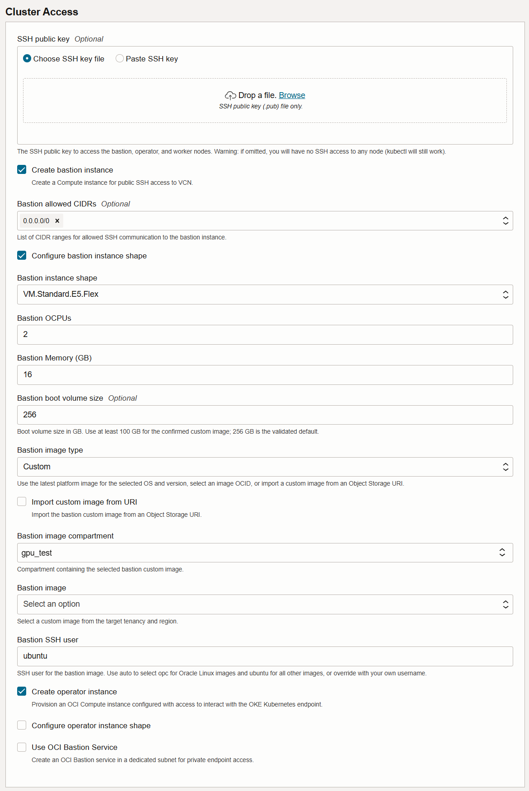

### 3-1 Import custom image from URI 하위 항목 (Import custom image from URI 선택시)

Import custom image from URI 항목을 선택하면 Bastion image compartment 항목과 Bastion image 항목이 사라지고, 아래 항목들이 표시됩니다.

|항목|설명|
|---|----|
|Bastion image URI|Bastion 생성에 사용될 이미지의 URI를 표시합니다.|

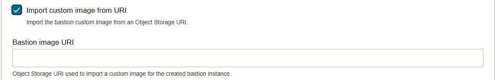

### 3-2 Create operator instance 하위 항목 (Create operator instance 선택시)

|항목|설명|
|---|----|
|Configure operator instance shape|Operator VM의 Shape·CPU·메모리 등 상세 사양 입력란을 표시할지 여부를 설정합니다. Create operator instance 항목을 선택하면, 이 항목이 선택되어 operator instance 상세 설정 항목들을 표시합니다.|
|Shape|Operator VM의 인스턴스 종류를 지정합니다.|
|OCPUs|Operator VM 한 대에 할당할 OCPU의 개수를 지정합니다.|
|Memory (GB)|Operator VM의 Memory 용량을 지정합니다.|
|Boot volume size|Operator VM의 운영체제 디스크 크기를 지정합니다.|
|Operator image type|Operator VM의 부팅 이미지를 선택하는 방식을 지정합니다.  - `Platform`:선택한 OS·버전에 해당하는 OCI 플랫폼 이미지 사용  - `Custom`: 기존 Custom 이미지를 선택하거나 URI에서 가져와 사용|
|Import custom image from URI|Object Storage의 이미지 파일을 가져와 Operator VM에 사용할지 결정합니다.|
|Operator image compartment|선택할 Custom 이미지가 저장된 컴파트먼트를 지정합니다.|
|Operator image|실제로 사용할 Custom 이미지를 지정합니다.|
|Operator SSH user|Operator Linux VM에 로그인할 Linux 계정을 지정합니다.  - Ubuntu:ubuntu / Oracle Linux:	opc / 회사 Custom 이미지: 이미지에 실제로 설정된 계정  이 ZIP은 auto도 지정할 수도 있습니다. 이미지 OS가 Oracle Linux이면 opc, 그 외에는 ubuntu를 선택합니다.|
|Install required operator tools|Operator VM의 cloud-init 과정에서 관리 도구 설치를 활성화합니다. - `kubectl`: Kubernetes 리소스 조회·관리 - `Helm`:Kubernetes 애플리케이션 설치 - `OCI CLI`:OCI 서비스 API 호출 - `jq`:JSON 처리 - `Git`:코드·설정 다운로드와 관리 - `k9s`:터미널 기반 Kubernetes 관리 화면 - `kubectx`:Kubernetes 접속 컨텍스트 전환|
|Verify required operator tools|Operator VM 생성 후 Terraform이 Bastion을 경유해 SSH로 접속하여 관리 도구를 검사하도록 합니다.|
|Inject OCI Alloy region metadata on operator|Operator VM에 대상 Alloy 리전·Realm 정보를 환경변수로 설정합니다.|

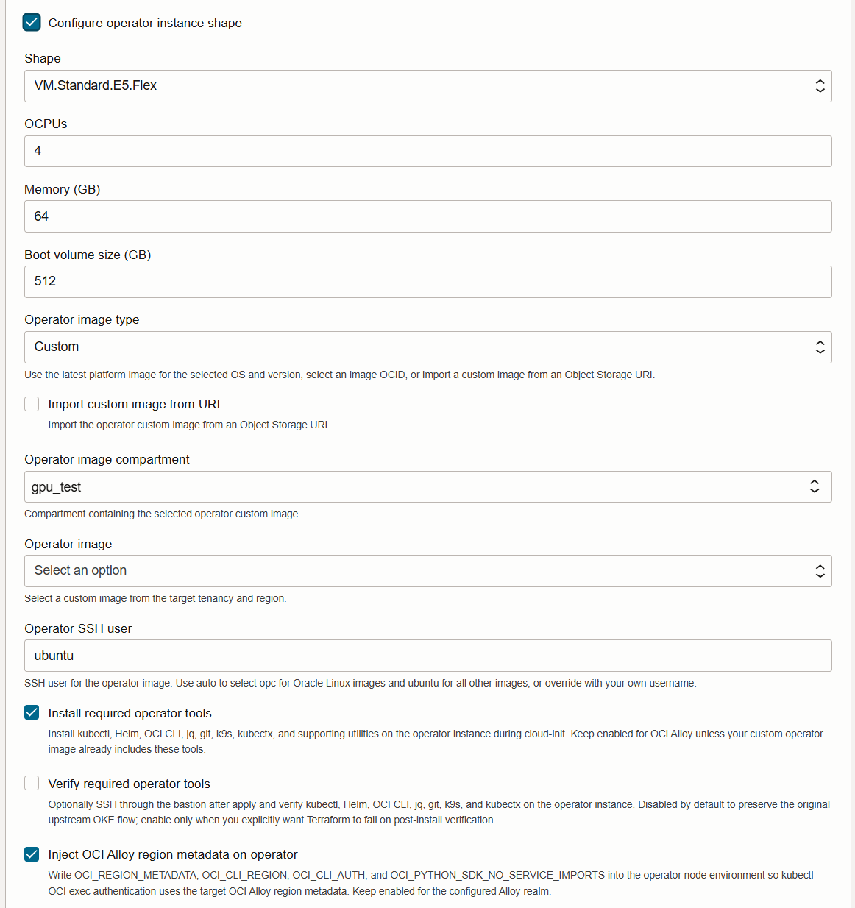

## 4. Cluster

|항목|설명|
|---|----|
|Compartment|OKE 클러스터와 워커 등 생성 리소스의 기본 위치가 될 컴파트먼트를 지정합니다. 다만 모든 리소스가 반드시 여기에 생성되는 것은 아닙니다. 예를 들어 앞서 설명한 IAM 정책은 코드상 테넌시 루트에 생성되며, 기존 VCN이나 이미지는 다른 컴파트먼트의 것을 사용할 수 있습니다.|
|Cluster name prefix|OKE 클러스터의 이름 접두사(name prefix)를 지정합니다.|
|Kubernetes version|클러스터에 사용할 Kubernetes 버전을 지정합니다. 이 패키지에서는 워크 풀별 버전을 따로 지정하지 않으면 클러스터 버전을 사용합니다.|
|CNI to use for pod networking|CNI는 Pod의 네트워크 인터페이스와 IP 연결을 구성하는 플러그인으로, 아래 값 중 하나를 지정할 수 있습니다.  VCN-Native Pod Networking:VCN 안의 Pod 서브넷에서 IP 할당 Flannel:VCN 주소와 별도의 오버레이 Pod 네트워크 사용|
|Service CIDR|Kubernetes Service IP 대역을 지정합니다.|
|Create the Kubernetes control plane endpoint in a public subnet and assign it a public IP address|Kubernetes API 엔드포인트를 퍼블릭으로 만들지 결정합니다. 체크되지 않으면 다음과 같은 점근 경로가 필요합니다: - VCN에 연결된 VPN·FastConnect - Bastion을 통한 터널 - VCN 내부의 관리용 Operator VM - Resource Manager의 Private Endpoint|
|Kubernetes endpoint allowed CIDRs|Kubernetes API 통신을 허용할 출발지 IP 대역을 지정합니다. 0.0.0.0/0 으로 지정된다고 해서 API가 프라이빗인 현재 상태에서 이 값이 클러스터를 인터넷에 공개하지는 않습니다. API까지 도달할 수 있는 네트워크 경로가 먼저 있어야 합니다.|
|Preferred Load Balancer kind|애플리케이션을 Kubernetes Service의 type: LoadBalancer 등으로 노출할 때 사용할 기본 선호 방식을 지정합니다.|

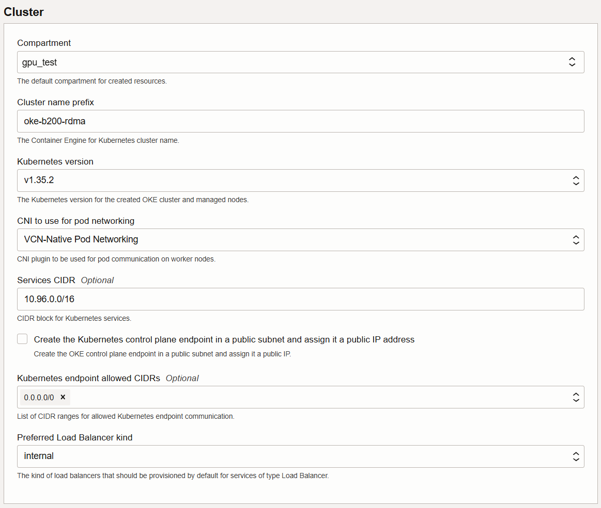

## 5. Cluster Components

|항목|설명|
|---|----|
|Enable optional Alloy features after base validation|기본 클러스터와 시스템 워커의 정상 동작을 확인한 뒤 선택 기능을 추가하도록 허용합니다. NFD·GPU Operator 등의 설치 조건을 충족하려면 이 옵션을 켜야 합니다.  - 기본 클러스터 구축 단계로 사용합니다. - 선택 기능을 추가로 활성화할 수 있습니다. 이 항목을 켜도 NFD, GPU Operator, Kueue 등이 자동으로 모두 설치되지는 않습니다. 각 설치 항목을 별도로 선택해야 합니다.|
|Install Node Feature Discovery add-on|Node Feature Discovery, NFD의 설치 여부를 결정합니다.|
|Install NVIDIA GPU Operator add-on|관리형 GPU Operator 설치 여부를 결정합니다. 이 패키지를 설치하기 위해서는 NFD(Node Feature Discovery) 옵션을 활성화해야 합니다. 이 옵션을 활성화하면 NVIDIA GPU Operator를 설치하며, NVIDIA GPU Operator advanced options 옵션이 보입니다.|
|Install NVIDIA Network Operator add-on|OKE 관리형 NvidiaNetworkOperator 애드온을 설치 여부를 결정합니다. 이 패키지를 설치하기 위해서는 NFD(Node Feature Discovery) 옵션을 활성화해야 합니다.  이 옵션을 활성화하면 NVIDIA Network Operator를 설치하며, NVIDIA Network Operator advanced options 옵션이 보입니다.|
|Install Image Credential Provider for Container Registry (OCIR)|워커가 Instance Principal 인증으로 비공개 OCIR 이미지를 다운로드 할 수 있도록 워크 초기화 스크립트에서 Credeitnal Provider의 설치 여부를 결정합니다.|
|Install OCI HPC OKE Utils|OCI HPE OKE utils Helm 차트의 설치 여부를 결정합니다.|
|Install Kueue|Kueue Helm 차트 설치 여부를 결정합니다.|
|Install MPI Operator|MPI Operator 설치 여부를 결정합니다.|

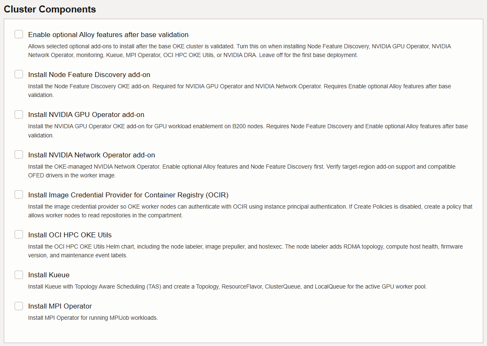

### 5.1 NVIDIA GPU Operator advanced options 하위 항목 (Install NVIDIA GPU Operator add-on 선택시)

|항목|설명|
|---|----|
|NVIDIA GPU Operator add-on version|설치할 OKE 관리형 GPU Operator의 버전을 지정합니다.|
|Disable NVIDIA GPU plugin in NVIDIA GPU Operator|기존에 별도로 설치된 OKE NVIDIA GPU 플러그인을 비활성화 합니다. GPU Operator가 관리하는 Device Plugin과 중복 실행되는 것을 방지하기 위한 설정입니다.|
|Enable CDI in NVIDIA GPU Operator|CDI(Container Device Interface) 방식으로 컨테이너에 GPU 접근을 제공하는 기능을 활성화합니다.|
|Use CDI as the default device-injection mode|컨테이너에 GPU를 연결할 때 CDI를 기본 방식으로 사용하도록 지정합니다.|
|Device plugin DEVICE_LIST_STRATEGY|GPU Device Plugin이 할당된 GPU 정보를 컨테이너 런타임에 전달하는 방법을 설정합니다.|
|Enable NVIDIA toolkit in NVIDIA GPU Operator|GPU Operator가 NVIDIA Container Toolkit 구성요소를 관리하도록 설정합니다.|
|Skip NFD dependency check in NVIDIA GPU Operator|OKE 애드온 측에서 NFD 의존성 검사를 건너뛰도록 요청합니다. 기존에 호환되는 NFD가 설치된 경우 등에 사용하는 설정입니다.|
|Enable MIG Manager in NVIDIA GPU Operator|MIG 관리자를 설치할지 여부를 결정합니다.|

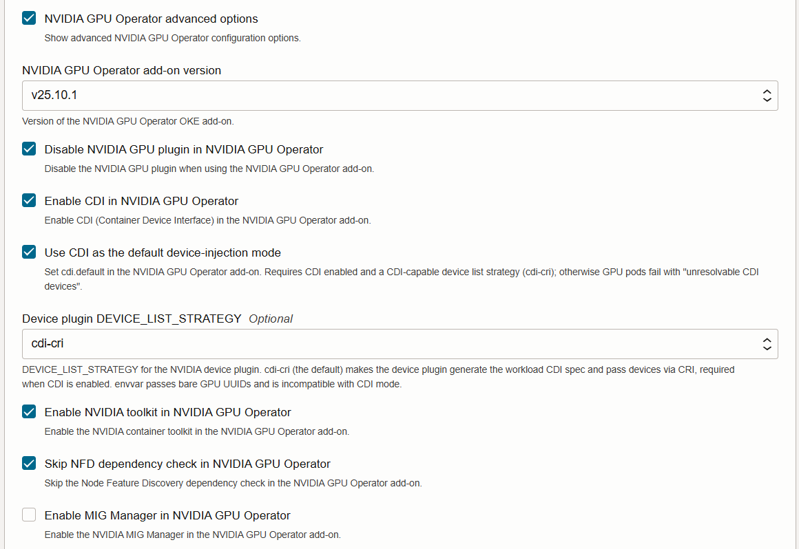

### 5.2 NVIDIA Network Operator advanced options 하위 항목 (Install NVIDIA Network Operator add-on 선택시)

|항목|설명|
|---|----|
|Enable SR-IOV Network Operator|Network Operator와 함께 SR-IOV Network Operator를 활성화할지 결정합니다.|
|VF Creation Mode|VF를 어떤 방식으로 생성·관리할지 선택합니다. - custom: OKE의 custom VF 생성 경로 사용. 환경에서 제공하는 VF 생성 설정과 기존 구성 확인 필요  - sriovNetworkOperator: SR-IOV Network Operator가 VF 생성을 관리하는 방식 사용|
|Operator Node selection|Network Operator 자체의 Pod를 어느 노드에 배치할지 라벨로 지정합니다.|
|Operator Tolerations|노드에 taint가 있어 일반 Pod의 배치를 제한하더라도, Network Operator Pod가 그 제한을 허용하고 해당 taint를 허용하도록 설정합니다.|
|CNI binary directory|Network Operator가 관리하는 CNI 실행 파일을 노드에 배치할 디렉터리를 지정합니다. 워커의 컨테이너 런타임이 사용하는 경로와 일치해야 합니다.|
|NVIDIA Network Operator add-on version|설치할 OKE 관리형 Network Operator 애드온 버전을 선택합니다. 대상 리전과 Kubernetes 버전에서 지원되는 버전을 사용합니다.|
|Override existing NVIDIA Network Operator installation|기존 NVIDIA Network Operator 설치가 있는 경우 OKE가 해당 설치를 덮어쓰도록 허용할지 지정합니다. 기존 Kubernetes 리소스를 Terraform 상태로 가져오는 기능은 아닙니다.|
|Remove NVIDIA Network Operator resources on delete|관리형 애드온을 삭제할 때 관련 Kubernetes 리소스도 제거할지 지정합니다. 활성화하기 전에 실행 중인 네트워크 워크로드에 미칠 영향을 검토합니다.|

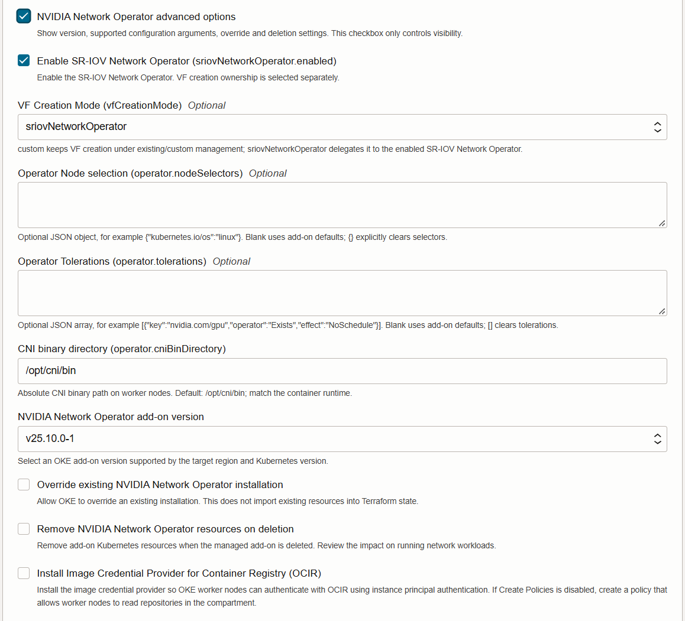

## 6. Worker Pool: System

클러스터 운영용 CPU 워커 풀인 oke-system의 사양과 이미지를 설정합니다.

|항목|설명|
|---|----|
|Availability domain|시스템 워커를 생성할 **AD(Availability Domain)**를 선택합니다.|
|Number of system worker nodes|생성할 시스템 워커의 개수를 지정합니다.|
|Shape|시스템 워커 노드의 shape를 지정합니다. 이 Shape에는 GPU가 없습니다. GPU 작업용 노드는 별도의 GPU·RDMA 워커 풀에서 설정합니다.|
|OCPUs|각 시스템 워커 노드의 OCPU 수를 지정합니다. 합계가 아닌 각 노드의 OCPU 수입니다.|
|Memory (GB)|각 시스템 워커의 메모리 용량을 지정합니다. 합계가 아닌 각 노드의 Memory 용량입니다.|
|Boot volume size (GB)|노드의 운영체제가 설치되는 디스크 크기를 지정합니다.|
|Kubernetes version|시스템 워커의 Kubernetes 버전을 지정합니다.|
|Import custom image from URI|시스템 워커용 Custom 이미지를 Object Storage URI에서 가져올지 결정합니다.|
|Operational worker pool image compartment|시스템 워커용 이미지가 저장된 컴파트먼트를 지정합니다.|
|Image|시스템 워커 VM의 운영체제와 초기 소프트웨어 구성을 담은 Custom 이미지를 선택합니다. 가능한 이미지의 조건은 다음과 같습니다: - 패키지가 대상으로 하는 Ubuntu 22.04 등 호환되는 Ubuntu 버전 - VM.Standard.E5.Flex에 맞는 x86-64 이미지 - cloud-init이 정상 동작하는 이미지 - 선택한 Kubernetes 버전에 맞는 OKE 패키지를 설치할 수 있는 이미지·네트워크 환경|

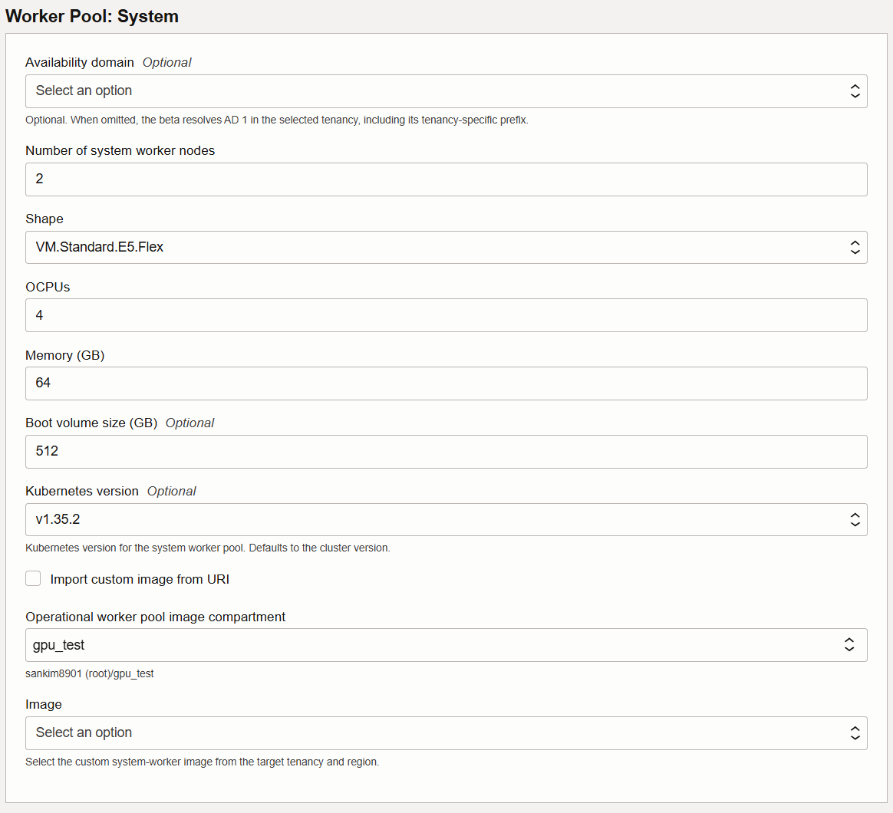

### 6.1 Import custom image from URI 하위 항목 (Import custom image from URI 선택시)

Import custom image from URI 항목을 선택하면 Operational worker pool image compartment 항목과 image 항목이 사라지고, 아래 항목들이 표시됩니다.

|항목|설명|
|---|----|
|image URI|시스템 워커 생성에 사용될 이미지의 URI를 표시합니다.|

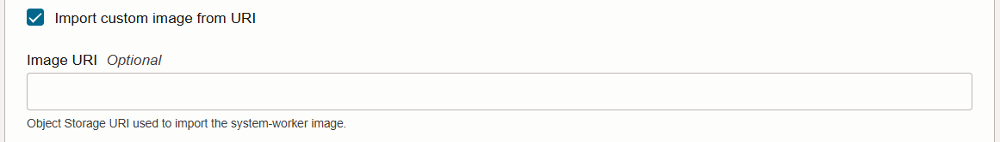

## 7. Worker Pool: CPU

|항목|설명|
|---|----|
|Create CPU pool|일반 CPU 작업을 실행할 추가 OKE 관리형 워커 풀 `oke-cpu`를 생성합니다.|

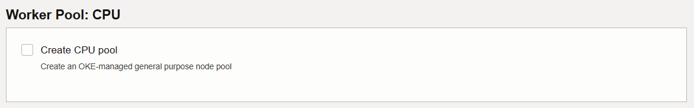

### 7.1 Create CPU Pool 하위 항목 (Create CPU Pool 선택시)

|항목|설명|
|---|----|
|Availability domain|CPU 워커를 배치할 AD를 지정합니다.|
|Number of worker nodes|CPU 풀에 생성할 노드 수를 결정합니다.|
|Shape|CPU 워커의 Compute 인스턴스 종류를 결정합니다.|
|OCPUs|CPU 워커 한 대에 할당할 OCPU 개수를 지정합니다.|
|Memory (GB)|CPU 워커 한 대의 시스템 메모리 용량을 지정합니다.|
|Boot volume size (GB)|CPU 워커 한 대의 부팅 디스크 크기를 지정합니다.|
|Kubernetes version|CPU 워커 풀에 적용할 Kubernetes 버전을 지정합니다.|
|Import custom image from URI|CPU 워커용 VM 이미지를 Object Storage에서 가져올지 결정합니다. - `해제`: 이미 등록된 Custom 이미지를 아래 목록에서 선택 - `체크`: 이미지 파일의 Object Storage URI 입력|
|CPU worker pool image compartment|CPU 워커용 Custom 이미지가 저장된 컴파트먼트를 지정합니다.|

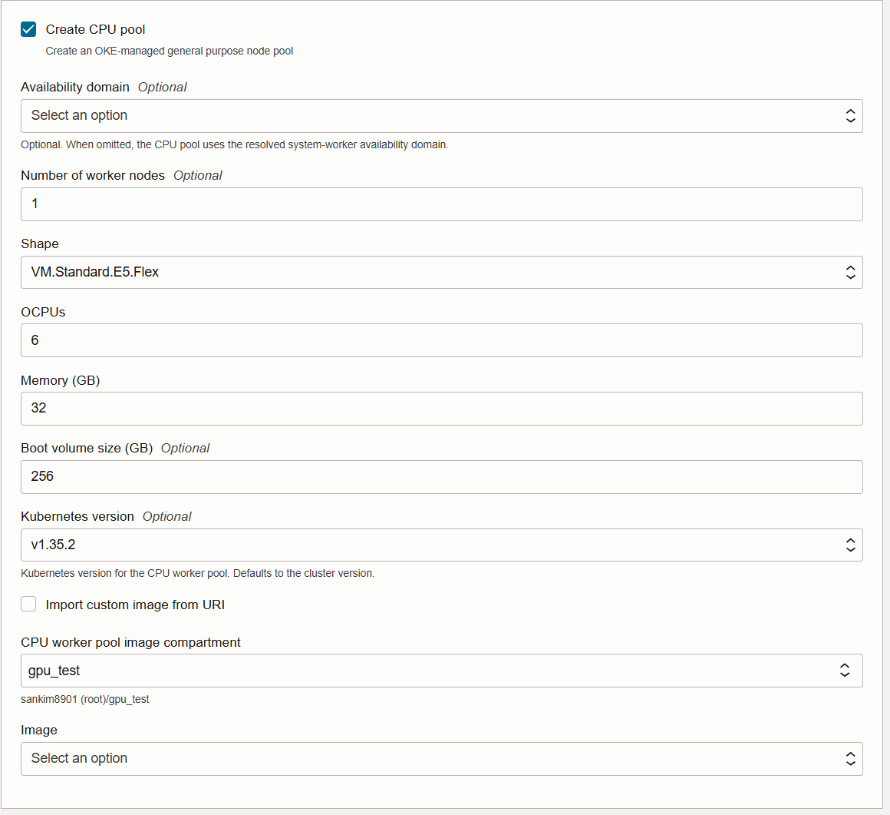

#### 7.1.1 Import custom image from URI 하위 항목 (Import custom image from URI 선택시)

Import custom image from URI 항목을 선택하면 CPU worker pool image compartment 항목과 image 항목이 사라지고, 아래 항목들이 표시됩니다.

|항목|설명|
|---|----|
|image URI|CPU Workder 생성에 사용될 이미지의 URI를 표시합니다.|

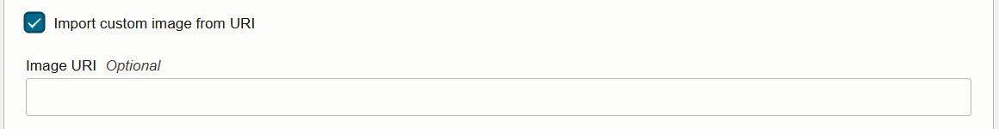

## 8. Worker Pool: GPU

|항목|설명|
|---|----|
|Create GPU Pool|GPU가 있는 OKE 관리형 워크 풀 `oke-gpu`를 생성합니다.|

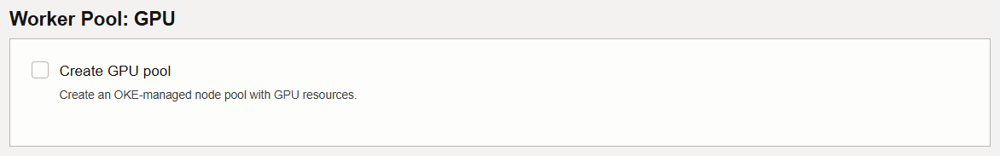

### 8.1 Create GPU pool 하위 항목 (Create GPU pool 선택시)

|항목|설명|
|---|----|
|Availability domain|CPU 워커를 배치할 AD를 지정합니다.|
|Number of worker nodes|CPU 풀에 생성할 노드 수를 결정합니다.|
|Shape|CPU 워커의 Compute 인스턴스 종류를 결정합니다.|
|OCPUs|CPU 워커 한 대에 할당할 OCPU 개수를 지정합니다.|
|Memory (GB)|CPU 워커 한 대의 시스템 메모리 용량을 지정합니다.|
|Boot volume size (GB)|CPU 워커 한 대의 부팅 디스크 크기를 지정합니다.|
|Kubernetes version|CPU 워커 풀에 적용할 Kubernetes 버전을 지정합니다.|
|Import custom image from URI|CPU 워커용 VM 이미지를 Object Storage에서 가져올지 결정합니다. - `해제`: 이미 등록된 Custom 이미지를 아래 목록에서 선택 - `체크`: 이미지 파일의 Object Storage URI 입력|
|CPU worker pool image compartment|CPU 워커용 Custom 이미지가 저장된 컴파트먼트를 지정합니다.|

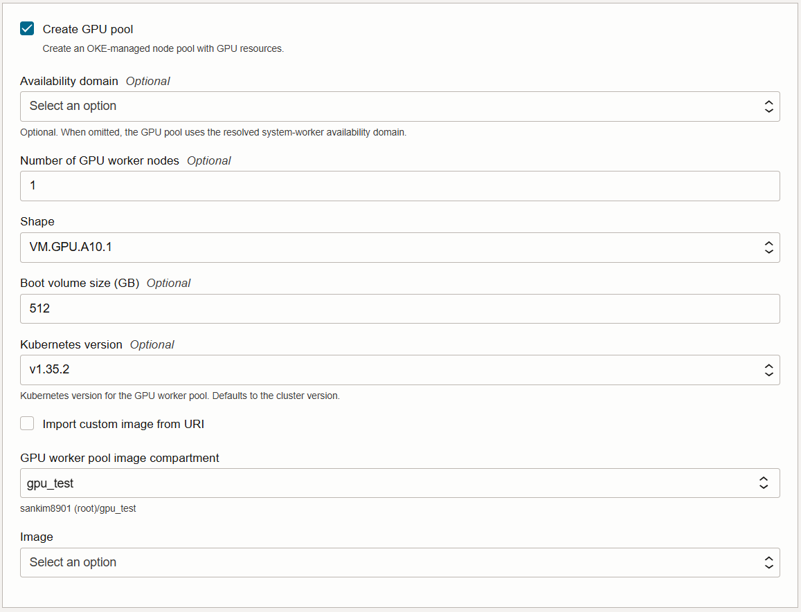

#### 8.1.1 Import custom image from URI 하위 항목 (Import custom image from URI 선택시)

Import custom image from URI 항목을 선택하면 GPU worker pool image compartment 항목과 image 항목이 사라지고, 아래 항목들이 표시됩니다.

|항목|설명|
|---|----|
|image URI|GPU Workder 생성에 사용될 이미지의 URI를 표시합니다.|

## 9. Worker Pool: GPU with RDMA

|항목|설명|
|---|----|
|Create GPU with RDMA Pool|GPU 노드 사이에 고속 RDMA 통신을 사용하는 워커 풀 `oke-rdma`를 생성합니다.|

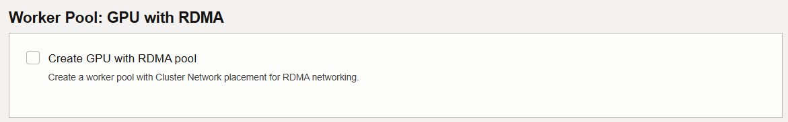

### 9.1 Create GPU with RDMA Pool 하위 항목 (Create GPU with RDMA Pool 선택시)

|항목|설명|
|---|----|
|Availability domain|RDMA 워커를 배치할 AD를 설정합니다. System·CPU 풀과 달리 반드시 직접 선택해야 하며, 자동으로 AD 1을 사용하지 않습니다.|
|Shape|RDMA 워커의 서버 종류를 지정합니다. 기본 값은 `BM.GPU.B200.8` 입니다.|
|Boot volume size (GB)|RDMA 워커 한 대당 부팅 디스크 크기를 설정합니다.|
|Kubernetes version|GPU+RDMA 워커 풀에 적용할 Kubernetes 버전을 지정합니다.|
|GPU + RDMA worker pool image compartment|Custom 이미지가 저장된 컴파트먼트를 지정합니다.|
|Image|GPU+RDMA 워커에서 실제로 사용할 Custom 이미지를 지정합니다.|

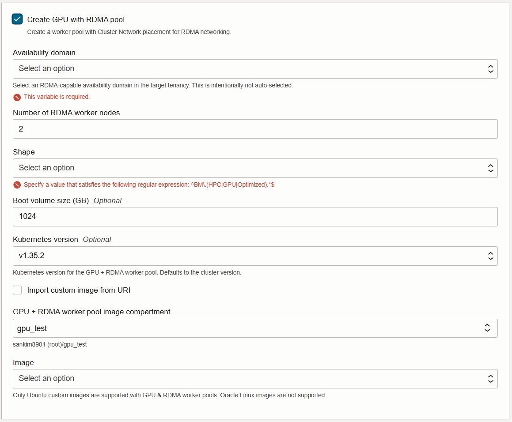

#### 9.1.1 Import custom image from URI 하위 항목 (Import custom image from URI 선택시)

Import custom image from URI 항목을 선택하면 GPU + RDMA worker pool image compartment 항목과 image 항목이 사라지고, 아래 항목들이 표시됩니다.

|항목|설명|
|---|----|
|image URI|GPU + RDMA Workder 생성에 사용될 이미지의 URI를 표시합니다.|

## 10. Workers: GPU Memory Cluster

|항목|설명|
|---|----|
|Create GPU Memory Cluster pool|GPU Memory Fabric을 사용하는 자가 관리형 `oke-gmc`를 생성합니다.|

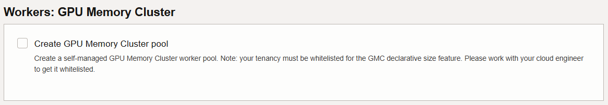

### 10.1 Create GPU Memory Cluster pool 하위 항목 (Create GPU Memory Cluster pool 선택시)

|항목|설명|
|---|----|
|Availability domain|GMC 워커를 배치할 AD를 지정합니다. System·CPU 풀과 달리 반드시 직접 선택해야 하며, 자동으로 AD 1을 사용하지 않습니다.|
|Shape|RDMA 워커의 서버 종류를 지정합니다. 기본 값은 `BM.GPU.B200-v3.4` 입니다.|
|GPU Memory Fabric OCIDs|GMC를 구성할 기반인 GPU Memory Fabric의 OCID를 입력합니다.|
|Boot volume size (GB)|GMC 워커 한 대당 부팅 디스크 크기를 지정합니다.|
|Kubernetes version|GMC 워커에 사용할 Kubernetes 버전을 지정합니다.|
|Image|GMC 워커에 사용할 Custom 이미지를 지정합니다.|
|GPU Memory Cluster advanced options|GMC의 크기 조절 설정을 화면에 표시합니다.|

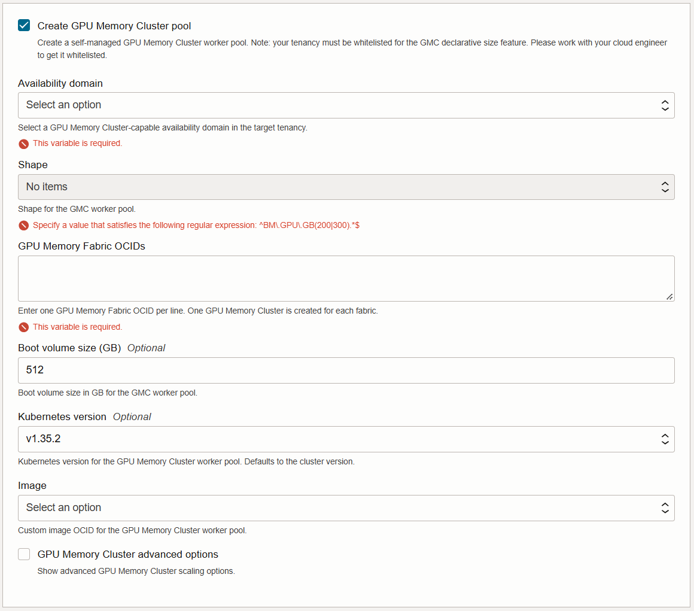

#### 10.1.1 GPU Memory Cluster advanced options 하위 항목 (GPU Memory Cluster advanced options 선택시)

|항목|설명|
|---|----|
|Target size|GPU Memory Cluster 하나가 목표로 하는 노드 수를 지정합니다.|
|Enable upsizing|OCI가 GMC의 크기를 늘리는 동작을 허용할지 결정합니다.|
|Enable downsizing|OCI가 GMC의 크기를 줄이는 동작을 허용할지 결정합니다.|

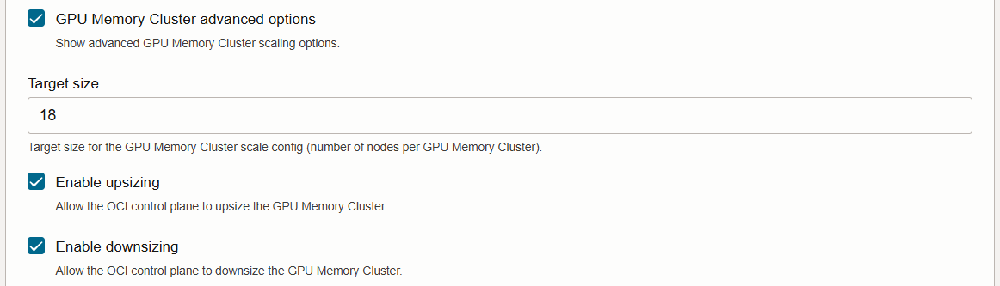

## 11. Storage

|항목|설명|
|---|----|
|Create a RAID array using local NVMe drives|워크에 로컬 NVMe 디스크가 있으면 RAID로 붂어 사용하는 초기화 작업을 활성화합니다. 이 패키지는 기본적으로 RAID를 `/mnt/home`에 마운트하고, 다음 경로를 그 공간에 연결합니다. `/var/lib/containers`: 컨테이너 런타임 데이터 `/var/lib/kubelet`: kubelet 데이터·Pod 임시 저장 공간 `/var/log/pods`: Pod 로그|
|RAID Level|NVMe 디스크를 묶는 방식을 선택합니다. 디스크가 한 개 뿐이면 선택값과 관계없이 RAID 0으로 전환합니다.|
|Create a File Storage Service (FSS) file system|여러 노드가 함께 사용하는 OCI File Storage 공유 파일 시스템을 생성합니다.|
|Create a File Storage with Lustre file system|고성능 병렬 파일 시스템인 Lustre 공유 스토리지를 생성합니다.|

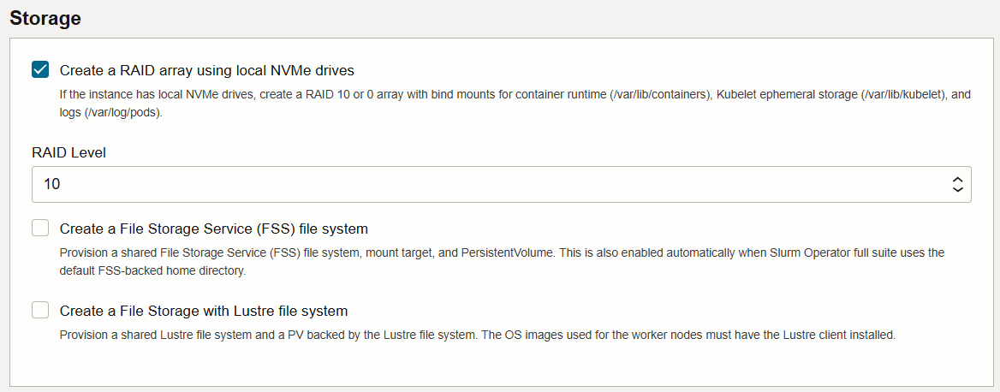

### 11.1 Create a File Storage Service (FSS) file system 하위 항목 (Create a File Storage Service (FSS) file system 선택시)

|항목|설명|
|---|----|
|FSS availability domain|FSS 파일 시스템과 Mount Target을 생성할 AD를 결정합니다. 선택하지 않으면 System 워커 AD를 따라갑니다.|
|FSS mount point|워커의 운영체제에서 FSS를 연결할 로컬 디렉토리 경로를 설정합니다. 정상 마운트되면 워커에서 이 경로로 공유 파일에 접근합니다.|

### 11.2 Create a File Storage with Lustre file system 하위 항목 (Create a File Storage with Lustre file system 선택시)

|항목|설명|
|---|----|
|Create Lustre PV|생성한 Lustre를 Kubernetes에서 사용할 수 있도록 PersistentVolume(PV) lustre-pv를 생성할지 여부를 결정합니다.|
|Availability domain|Lustre 파일 시스템을 생성할 AD를 지정합니다.|
|Lustre file system size in TB|생성할 파일 시스템 전체 용량을 지정합니다. 노드 한 대당 용량이 아닙니다.|
|Lustre Performance Tier|용량 1TB당 처리량 등급을 지정합니다.|
|Lustre mount path|워커 운영체제에서 Lustre를 연결할 로컬 디렉터리를 지정합니다.|

## 12. Monitoring & Observability

|항목|설명|
|---|----|
|Install Monitoring Stack|모니터링 구성요소를 설치하는 상위 활성화 옵션입니다.|
|Advanced options|모니터링의 세부 설정을 표시합니다.|

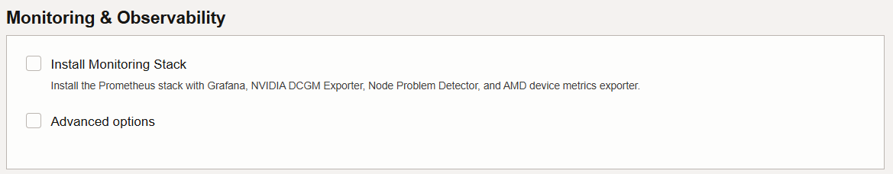

## 13. Stack Configuration

|항목|설명|
|---|----|
|Securely deploy the Kubernetes resources via ORM Private Endpoint|OCI Resource Manager가 프라이빗 OKE API에 접속해 Kubernetes 리소스를 배포하도록 할지 여부를 결정합니다.|

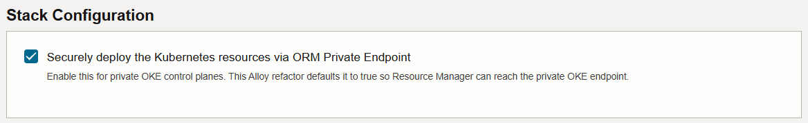

## 14. Preview Features (not for production use)

|항목|설명|
|---|----|
|Install Slurm Operator|Slinky를 이용한 Slurm 작업 관리 환경을 설치합니다. 이 패키지는 Operator만이 아니라 Slurm, 사용자 인증, FSS 기반 홈, Accounting, 로그인 서비스 등을 함께 구성하는 경로를 포함합니다.|

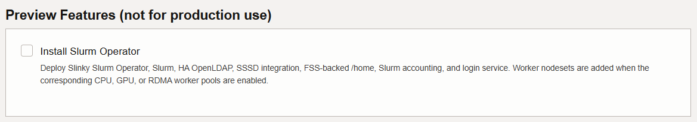

## 15. 기타 (분류 없음)

|항목|설명|
|---|----|
|Minimal Alloy base deployment|기본 Alloy 배포에서 선택 기능을 제한하는 기준입니다. 완성된 구성 전체를 한 번에 선택하는 프리셋은 아닙니다.|
|require_ready_region_subscription|Deprecated compatibility input; ignored.|

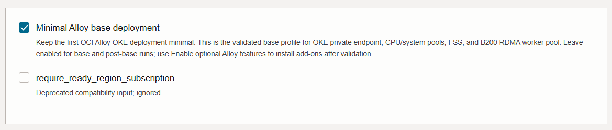