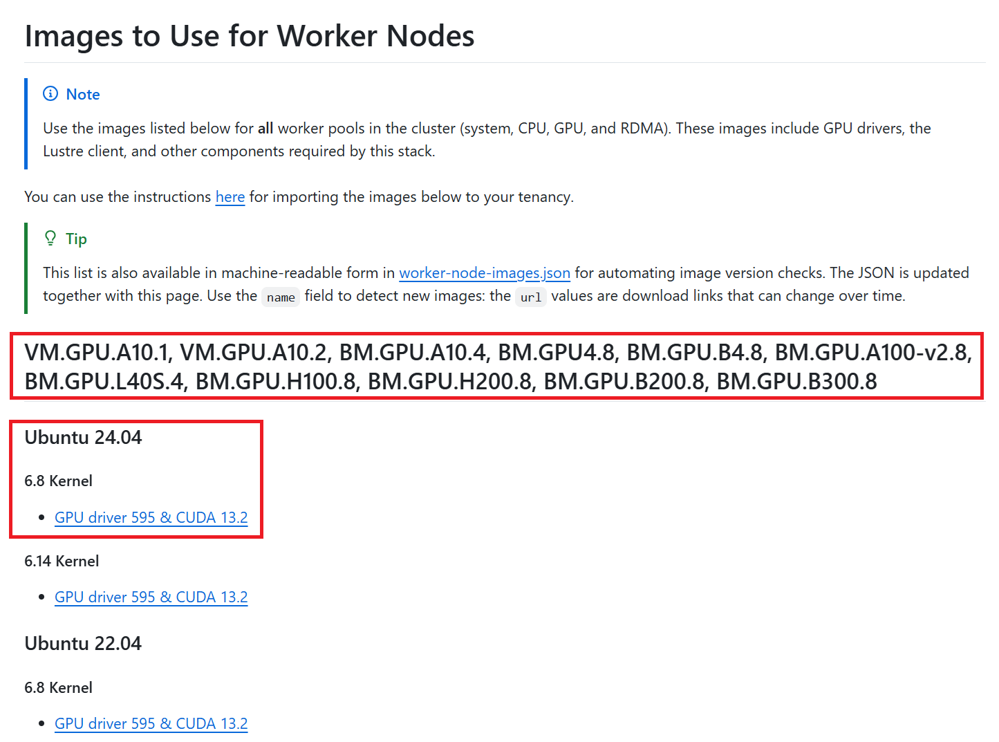
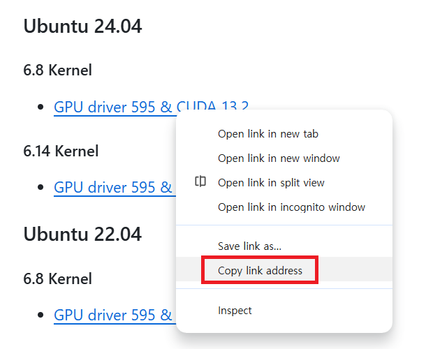
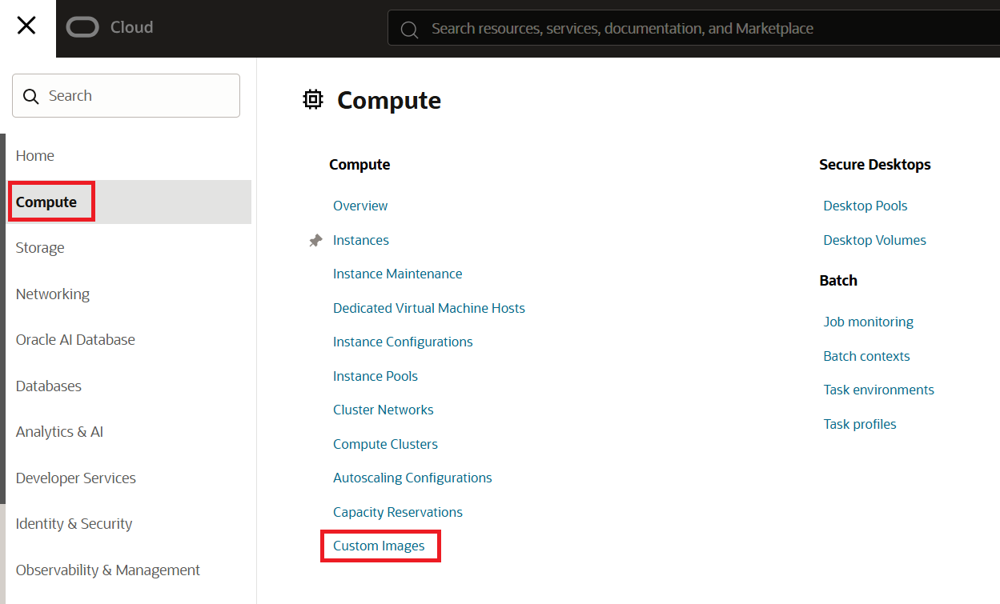
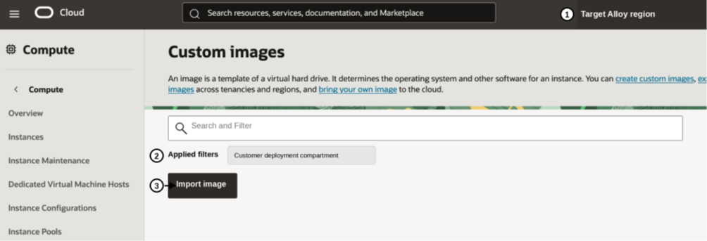
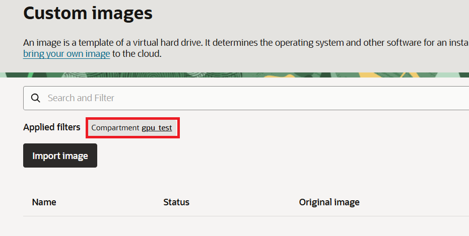
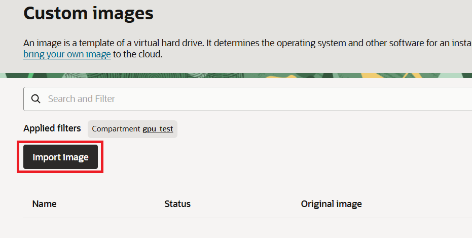
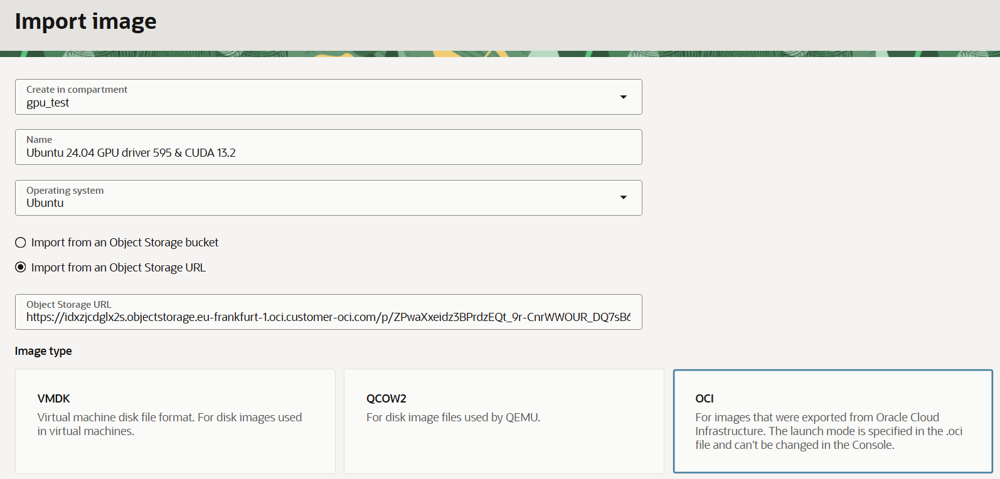
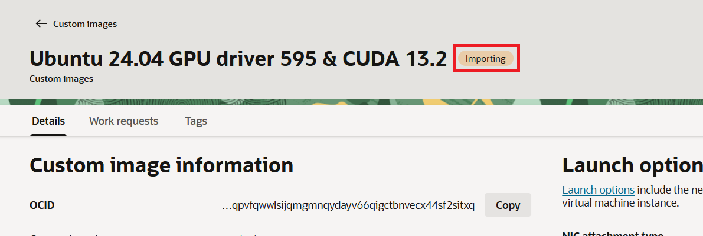

# 2. Preparing and Importing Custom Images by URL

Use only Custom Images imported over HTTPS from the release-approved `.oci` image links published in the OCI HPC OKE worker node image catalog. This procedure does not download image files to a user PC or administrative workstation and does not temporarily store them in the customer's OCI Object Storage bucket.

> [!WARNING]
> **Direct URL requirement**: Copy the actual URL behind the approved image link, not the GitHub page URL. Catalog links can change. Record the image name, operating system, kernel version, copied URL, source verification date, target region, image compartment, and imported image OCID.

## 2.1 Copy the Approved Image URL

Copy the approved image URL as follows.

1. Open a web browser and navigate to:

    https://github.com/oracle-quickstart/oci-hpc-oke/blob/main/docs/worker-node-images.md

2. Check the following items on the page.

    

    1. Locate the shape group that includes `BM.GPU.B200.8`.
    2. Select the operating system corresponding to the operating system, kernel, GPU driver, CUDA, and RDMA build approved for deployment.
    3. Right-click the link and select **Copy link address**.

        

## 2.2 Open Custom Images and Select the Destination

Perform this procedure in the OCI Console in the target region. Sign in as a user authorized to work in that Alloy environment.

1. In the OCI Console, open the navigation menu at the upper right, select **Compute**, and then select **Custom Images** in the Compute section.

    

2. Confirm the **Target Alloy Region** at the upper right. The OCID of the imported image is created in the selected region.

    

3. Select the compartment in which the image will reside.

    

4. Select **Import image**.

    

## 2.3 Import the Image

1. On the **Image** page, enter the following values.

    |Input Field|Description|
    |---|---|
    |Create in compartment|Select the compartment that will own the Custom Image. The Resource Manager principal must be able to read images in this compartment.|
    |Name|Use a customer-approved, versioned name that identifies the role, operating system, kernel, and release. Do not include confidential information or customer data.|
    |Operating System|Select Ubuntu so that the operating system family matches the catalog image.|
    |Import from an... option|Select **Import from an Object Storage URL**. This guide does not use a bucket or object path.|
    |Object Image URL|Paste the link copied in step 2.1. This link points to a PAR link in Oracle's official repository. Do not use the GitHub page URL.|
    |Image Type|Select **OCI**. Do not select VMDK or QCOW2 for a .oci image published in the worker image catalog.|

    

2. Select **Import Image** at the lower right.
3. Wait for the import to complete and the status to become Available.

    

## 2.4 Use the Imported Image in Resource Manager Terraform

Use the imported image information when configuring the Resource Manager stack in the next stage. Select the Custom Image imported here; do not import the image again.

|Stack Input|Required Setting|Purpose|
|---|---|---|
|Image Type|Custom|Prevents the deployment from using an OCI platform image or prebuilt image.|
|Import custom image from URL|Disable|Leave disabled because the image has already been imported manually using the approved URL.|
|Image compartment|The destination compartment used for the import|Makes the imported image appear in the image selection list.|
|Image|The approved imported image|Select the image matching the image name and regional OCID recorded after import.|

> [!NOTE]
> Custom Image OCIDs are region-specific. Import the image by URL in each target region and verify the recorded OCID before running Terraform and Terraform Apply.

---

Previous: [1. Deployment Profiles and Prerequisites](./01_deployment_profile_and_prerequisites.md) | Next: [3. Creating a Resource Manager Stack and Loading the Configuration](./03_create_resource_manager_stack_load.md)
