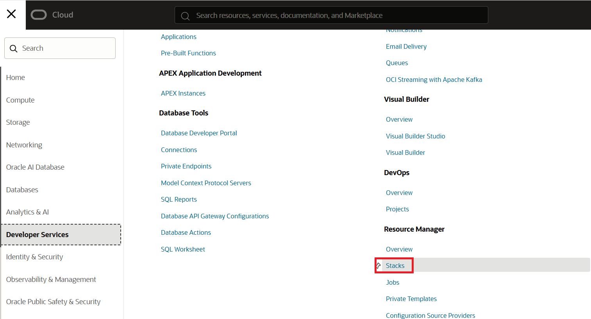
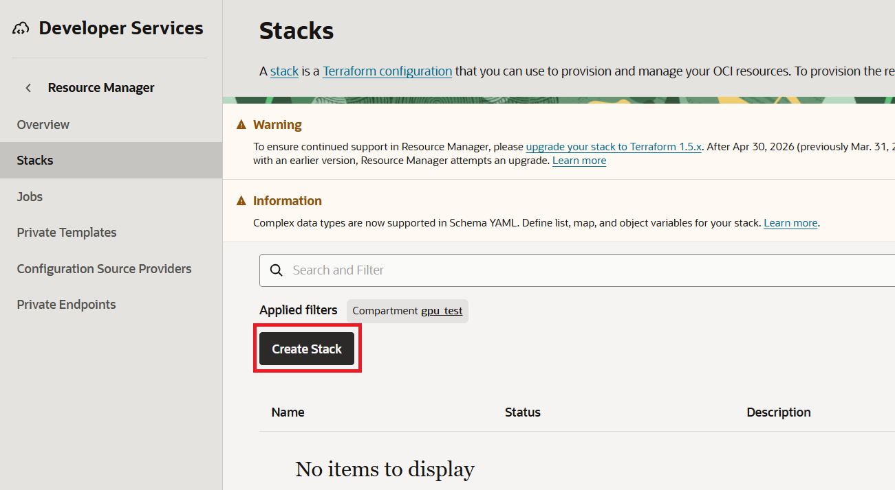
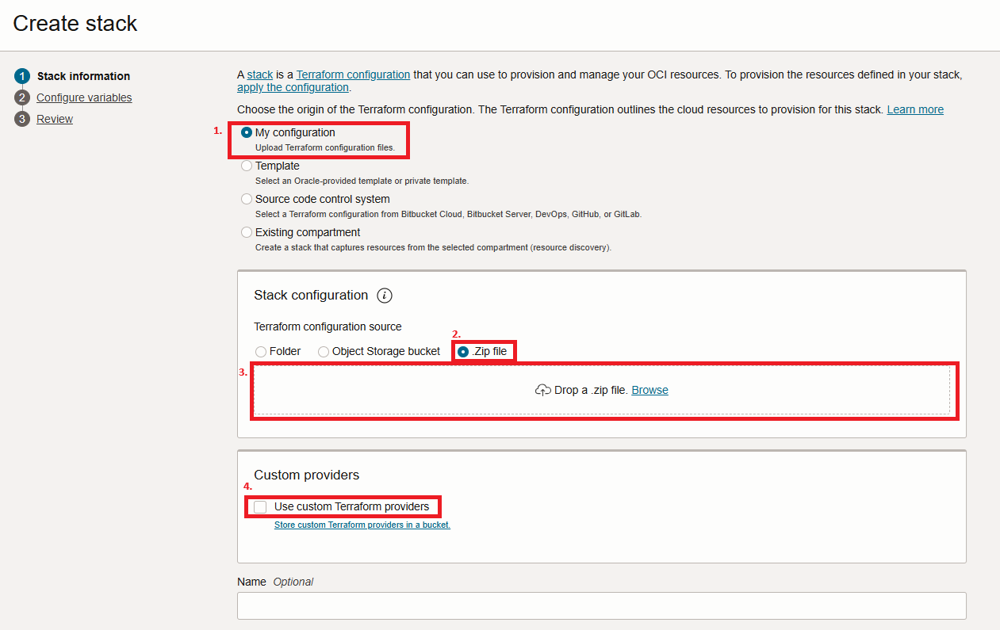
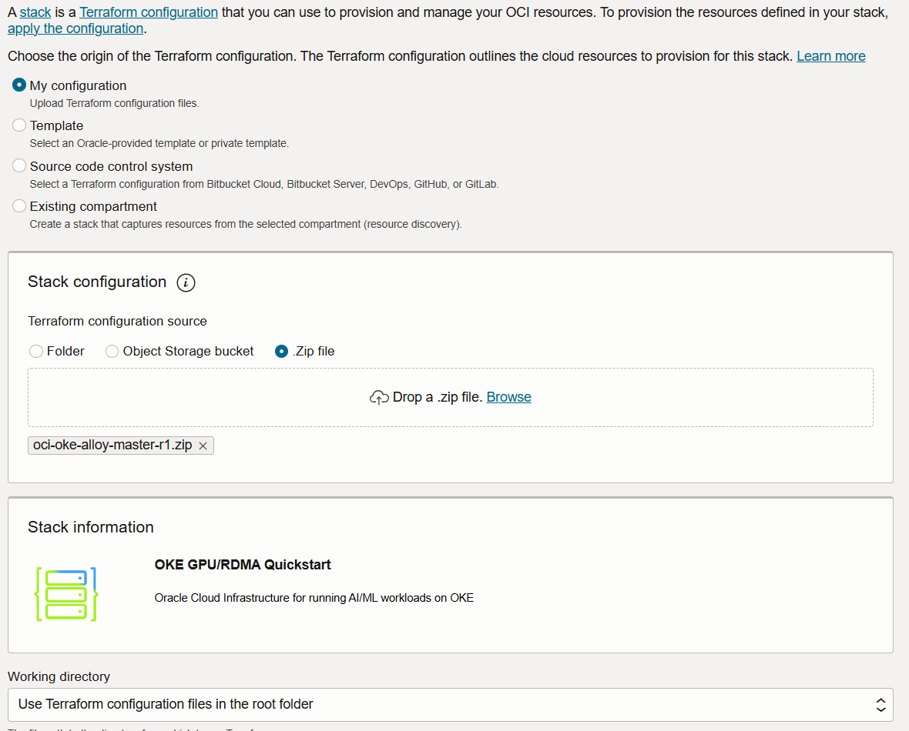

# 3. Creating a Resource Manager Stack and Loading the Configuration

Before configuring stack variables, create a Resource Manager stack using the deployment package. Select the target Alloy region and the compartment that will own the stack.

> [!WARNING]
> Use the deployment-approved oci-oke-alloy-master-r2.zip file. Do not substitute another archive.

## 3.1 Open Resource Manager and Create a Stack

Create a stack using Resource Manager as follows.

1. In the OCI Console, open the navigation menu at the upper left and select **Developer Services**.
2. Under **Developer Services**, select **Stacks** in the **Resource Manager** section.

    

3. On the Stacks page, select **Create Stack**.

    

## 3.2 Upload the Deployment Package

Upload the approved .zip file as the source for the Terraform configuration.

1. Select **My Configuration**. This option is required to use the supplied Terraform package.
2. Under **Stack Configuration**, select **.Zip File**.
3. Upload oci-oke-alloy-master-r1.zip to the upload area (Drop a .zip file). Wait for the upload to complete and confirm that the package has loaded before continuing.
4. Leave Use custom Terraform providers unselected. Select it only if the customer release instructions explicitly provide and require a custom provider package.
5. Select **Next** at the lower left.

## 3.3 Proceed to Configure Stack Variables

After the package loads, proceed to **Configuration variables**. Select the required deployment profile in Section 4, configure the inputs from Section 5 onward, and run Terraform Plan and Terraform Apply.

---

Previous: [2. Preparing and Importing Custom Images by URL](./02_prepare_custom_image.md) | Next: [4. Selecting a Deployment Profile](./04_select_deployment_profile.md)
