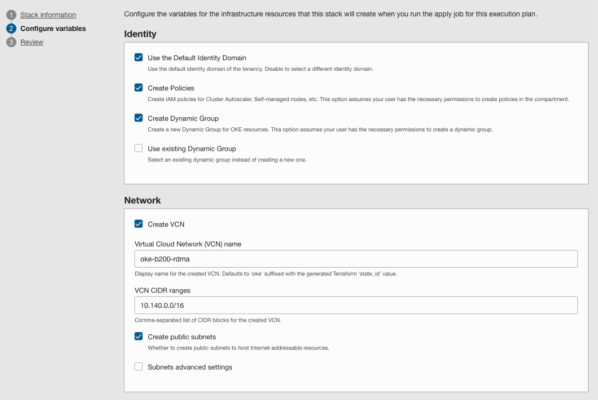

# 5. Identity and Network

Configure tenancy identity integration and the VCN used for deployment.

|Input|Controls|Guidance|
|---|---|---|
|Use the Default Identity Domain|Uses the default identity domain of the tenancy containing the resources created by the stack.|Enable unless another identity domain is required.|
|Create Policies|Creates IAM policies required for cluster and node automation.|Enable only if the stack user has permission to create policies.|
|Create Dynamic Group|Creates a dynamic group for OKE deployment resources.|Enable for a new deployment if the required IAM permissions are available.|
|Use existing Dynamic Group|Uses a previously created dynamic group instead of creating a new one.|Use instead of Create Dynamic Group. Do not enable both options.|
|Create VCN|Creates the VCN used by OKE, bastion, operator, workers, and load balancers.|Enable when creating a new network.|
|Virtual Cloud Network (VCN) name|Sets the display name of the VCN to create.|Apply the naming convention.|
|VCN CIDR ranges|Defines the VCN address space. Separate multiple CIDRs with commas.|Specify customer CIDRs that do not overlap other networks.|
|Create public subnets|Creates subnets for internet-accessible resources such as the bastion, public OKE endpoint, and public load balancer.|Enable for the public deployment profile.|
|Subnet advanced settings|Displays detailed subnet, routing, and security configuration inputs.|Enable only if a custom network design is required.|

---

[Previous: 4.3 OKE with CPU and RDMA-Capable GPU Workers](./07_profile_3.md) | [Next: 6. Cluster Access and Bastion](./09_cluster_access_and_bastion.md)
