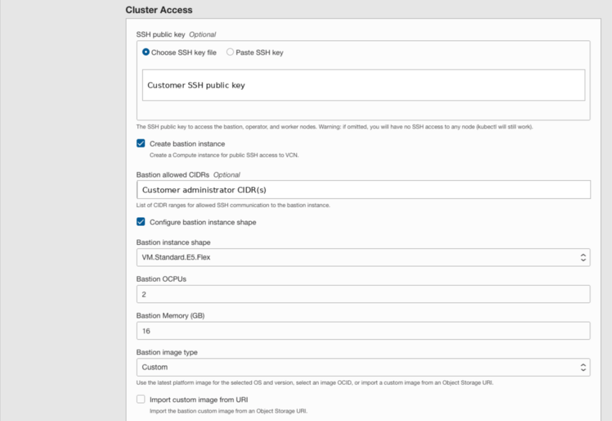

# 6. Cluster Access and Bastion

Configure SSH access and the public administrative host. The allowed CIDR values in the screenshot are examples configured for safe use.

|Input|Controls|Guidance|
|---|---|---|
|SSH public key|Assigns the SSH public key for bastion, operator, and worker nodes.|Enter the SSH public key.|
|SSH Key input method|Selects file upload or pasted key text.|Choose one method.|
|Create bastion instance|Creates a public administrative host for SSH access to the VCN.|Enable if direct administrative access is required.|
|Bastion allowed CIDRs|Restricts inbound SSH traffic to approved source networks.|Use VPN and administrator network CIDRs. Do not use 0.0.0.0/0.|
|Configure bastion instance Shape|Configures the bastion compute resource size.|Enable to use the values below.|
|Bastion instance shape|Selects the bastion compute shape.|Example: VM.Standard.E5.Flex|
|Bastion OCPUs|Sets the OCPU count assigned to the bastion with a Flex shape.|Example: 2|
|Bastion Memory (GB)|Sets the memory assigned to the bastion.|Example: 16 GB|
|Import custom image from URI|Imports an image directly from a URL during Terraform Apply instead of selecting an existing Custom Image.|Leave disabled. Import the approved Custom Image manually in Section 2, then select it from the customer image compartment.|

---

[Previous: 5. Identity and Network](./08_identity_network.md) | [Next: 7. Bastion and Operator Compute](./10_bastion_operator_compute.md)
