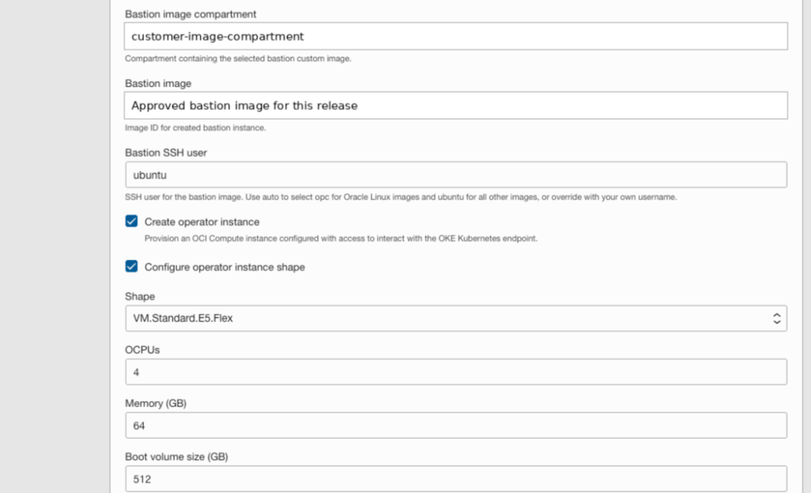

# 7. Bastion and Operator Compute

Select the approved bastion image and size the operator instance used for Terraform, Helm, and kubectl automation.

|Input|Controls|Guidance|
|---|---|---|
|Bastion image compartment|Specifies the compartment containing the approved bastion image.|Select the customer image compartment in the target region used in [Section 2, Preparing and Importing Custom Images by URL](./02_prepare_custom_image.md).|
|Bastion image|Selects the Custom Image used to create the bastion instance.|Select the imported, release-approved image and verify its regional OCID.|
|Bastion SSH user|Sets the operating system account used for SSH access.|Enter ubuntu when using the approved Ubuntu image.|
|Create operator instance|Creates an operator instance to run kubectl, Helm, OCI CLI, and deployment automation tools.|Enable in the validated deployment profile.|
|Configure operator instance shape|Allows explicit sizing of operator compute resources.|Enable to use the settings below.|
|Shape|Selects the compute shape for the operator instance.|Example: VM.Standard.E5.Flex|
|OCPUs|Sets the CPU resources assigned to the operator instance.|Example: 4 OCPUs|
|Memory (GB)|Sets the memory assigned to the operator instance.|Example: 64 GB|
|Boot Volume size (GB)|Sets the operator instance root volume capacity.|Example: 512 GB (adjust for workload requirements)|

---

[Previous: 6. Cluster Access and Bastion](./09_cluster_access_and_bastion.md) | [Next: 8. Operator Image, Tools, and Alloy Metadata](./11_operator_image_tools_alloy_metadata.md)
