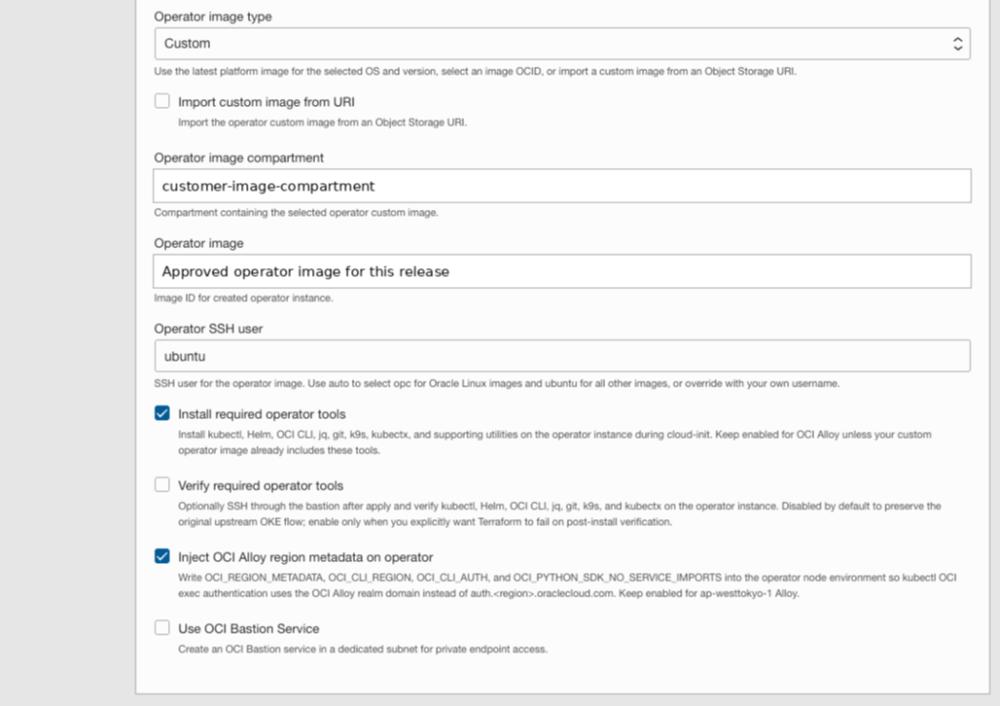

# 8. Operator Image, Tools, and Alloy Metadata

Select the approved operator image and enable the tools and Alloy metadata required for deployment.

|Input|Controls|Guidance|
|---|---|---|
|Operator image type|Selects how to use a platform image, OCID, or Custom Image for the operator.|Select Custom and the image prepared in [Section 2, Preparing and Importing Custom Images by URL](./02_prepare_custom_image.md).|
|Import custom image from URI|Imports an image directly from a URL during Terraform Apply instead of selecting an existing Custom Image.|Leave disabled. Import the approved Custom Image manually in Section 2, then select it from the customer image compartment.|
|Operator image compartment|Specifies the compartment containing the operator image.|Select the customer image compartment in the target region used in Section 2.|
|Operator SSH user|Sets the operating system account used for SSH.|Use ubuntu for Ubuntu images.|
|Install required operator tools|Installs kubectl, Helm, OCI CLI, jq, Git, k9s, kubectx, and supporting utilities during cloud-init.|Enable unless the image already contains these tools.|
|Verify required operator tools|Verifies tool availability after Terraform Apply. A verification failure can cause Terraform to fail.|Enable for formal validation. Optional for initial testing.|
|Inject OCI Alloy region metadata on operator|Writes the Alloy region, realm, endpoint, and SDK metadata required by OCI tools.|Enable for the target Alloy region.|
|Use OCI Bastion Service|Creates OCI Bastion Service for private endpoint access.|Leave disabled for the public endpoint profile.|

---

[Previous: 7. Bastion and Operator Compute](./10_bastion_operator_compute.md) | [Next: 9. Configuring the OKE Cluster](./12_configure_oke_cluster.md)
