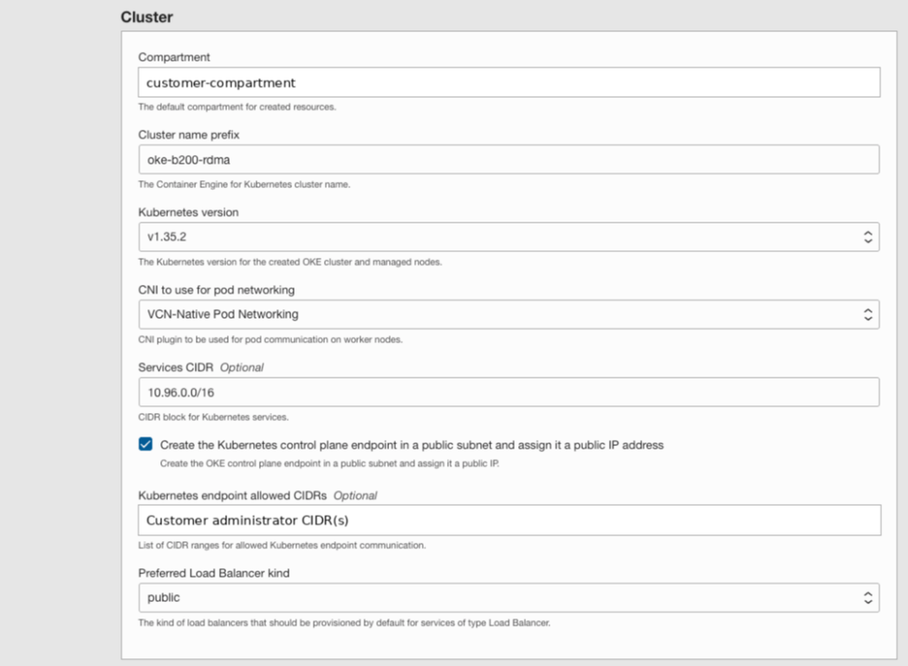

# 9. Configuring the OKE Cluster

Configure cluster placement, version, networking, API endpoint exposure, and default load balancer behavior.

|Input|Controls|Guidance|
|---|---|---|
|Compartment|Sets the default compartment for cluster resources.|Select the deployment compartment.|
|Cluster name prefix|Sets the name prefix for the OKE cluster and related resources.|Apply the naming convention.|
|Kubernetes version|Selects the Kubernetes version for the OKE control plane and managed nodes.|Use the version approved for the release.|
|CNI to use for pod networking|Selects the Kubernetes Pod networking implementation.|Use VCN-Native Pod Networking for this profile.|
|Services CIDR|Defines the virtual IP address range used by Kubernetes Services.|Use a CIDR that does not overlap other networks. Example: 10.96.0.0/16|
|Create the Kubernetes control plane endpoint in a public subnet and assign it a public IP address|Creates a public OKE API endpoint accessible over the internet for deployment and validation.|Enable for the recommended public deployment procedure.|
|Kubernetes endpoint allowed CIDRs|Restricts access to the public Kubernetes API endpoint.|Use approved administrator and VPN network CIDRs. Do not use 0.0.0.0/0.|
|Preferred Load Balancer Kind|Sets the default exposure preference for Kubernetes Services of type LoadBalancer.|Use Public for initial deployment unless a private-only configuration is required.|

---

[Previous: 8. Operator Image, Tools, and Alloy Metadata](./11_operator_image_tools_alloy_metadata.md) | [Next: 10. Cluster Components](./13_cluster_compoments.md)
