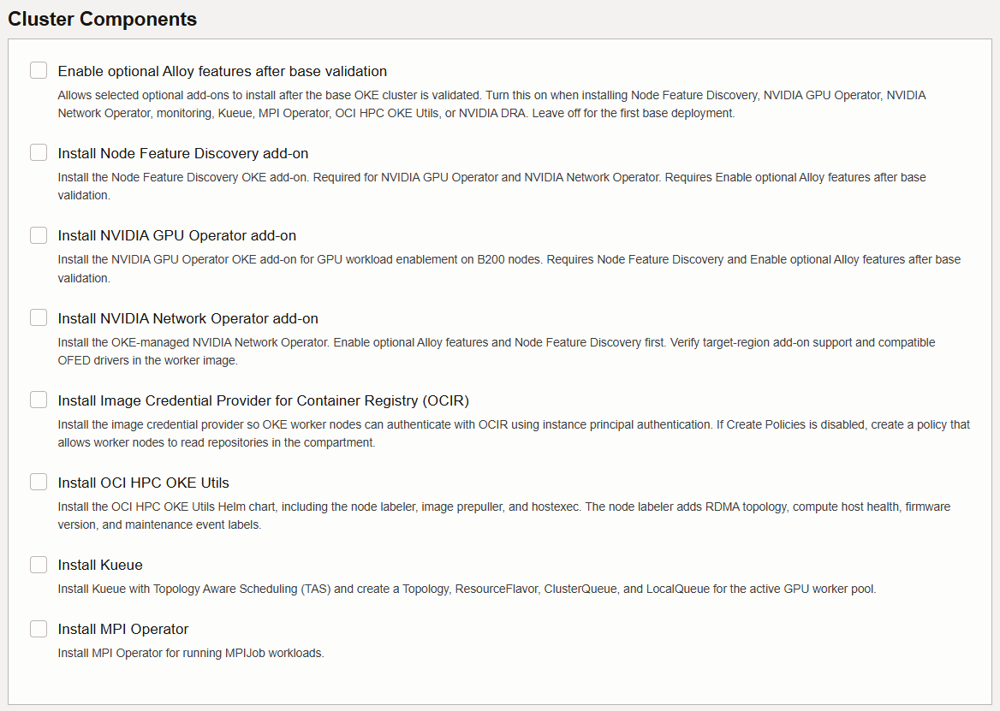
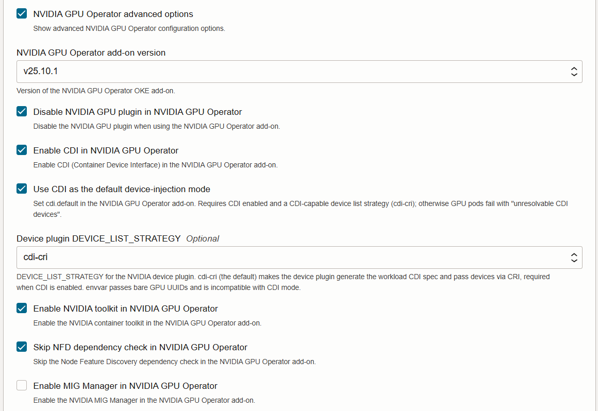
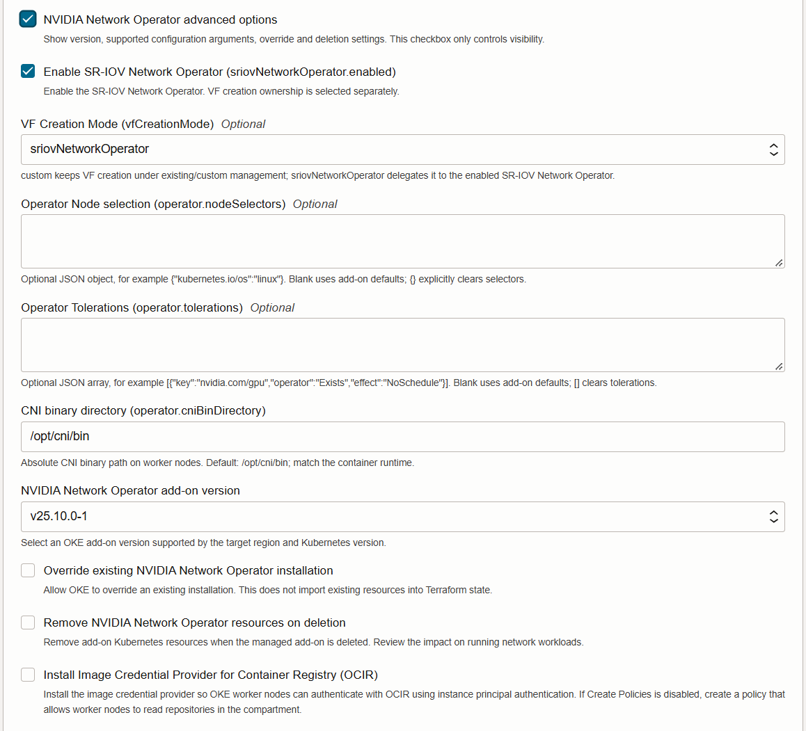

# 10. Cluster Components

Enable only the components required by the customer's workloads and operations. Managed NFD, NVIDIA GPU Operator, and NVIDIA Network Operator can be installed according to the selected profile and installation conditions.

|Input|Controls|Guidance|
|---|---|---|
|Enable optional Alloy features after base validation|Allows optional features to be added after base deployment validation. Enable according to the installation conditions when installing managed add-ons such as NFD, NVIDIA GPU Operator, and NVIDIA Network Operator.|- Profile 1: Disable. - Profiles 2 and 3: After validating the base cluster and worker nodes, enable according to the installation conditions for the selected managed NFD, GPU Operator, or Network Operator. Enabling this option alone does not automatically install add-ons. Select each Install option separately.|
|Install Node Feature Discovery add-on|Installs the OKE managed Node Feature Discovery (NFD) add-on.|- Profile 1: Disable. - Profiles 2 and 3: Enable when using managed NFD or satisfying the NFD installation conditions of the selected managed GPU Operator or Network Operator.|
|Install NVIDIA GPU Operator add-on|Controls installation of the OKE managed NVIDIA GPU Operator add-on.|- Profile 1: Disable. - Profiles 2 and 3: Enable when using managed NVIDIA GPU Operator. Also satisfy the parent feature gate and NFD installation conditions.|
|Install NVIDIA Network Operator add-on|Controls installation of the OKE managed NVIDIA Network Operator add-on.|- Profiles 1 and 2: Disable. - Profile 3: Enable when using managed NVIDIA Network Operator. Also satisfy the parent feature gate and NFD installation conditions.|
|Install Image Credential Provider for Container Registry (OCIR)|Allows worker nodes to authenticate to OCIR using instance principal credentials.|Enable if workloads pull private images from OCIR.|
|Install OCI HPC OKE Utils|Installs the RDMA topology labeler, image prepuller, host execution tools, and related utilities.|- Profile 1: Disable. - Profile 2: Leave disabled by default; enable only for approved utility functions. - Profile 3: Recommended when RDMA topology labeling, image prepulling, or host utilities are required.|
|Install Kueue|Installs Kueue and topology-aware scheduling resources.|- Profile 1: Disable. - Profiles 2 and 3: Enable only if queuing and topology-aware scheduling are required.|
|Install MPI Operator|Installs the operator used to run MPIJob workloads.|Profile 1: Disable. - Profiles 2 and 3: Enable only for MPIJob workloads.|

## 10.1 NVIDIA GPU Operator Advanced Options When Install NVIDIA GPU Operator add-on Is Selected

Selecting the Install option displays advanced options. Selecting advanced options displays the detailed settings below. The advanced options checkbox itself does not determine whether the add-on is installed.

|Setting|Description|
|---|---|
|NVIDIA GPU Operator add-on version|Specifies the OKE managed GPU Operator version to install.|
|Disable NVIDIA GPU plugin in NVIDIA GPU Operator|Disables the existing, separately installed OKE NVIDIA GPU plugin to prevent it from running alongside the device plugin managed by GPU Operator.|
|Enable CDI in NVIDIA GPU Operator|Enables GPU access in containers through CDI (Container Device Interface).|
|Use CDI as the default device-injection mode|Sets CDI as the default method for attaching GPUs to containers.|
|Device plugin DEVICE_LIST_STRATEGY|Sets how the GPU device plugin passes allocated GPU information to the container runtime.|
|Enable NVIDIA toolkit in NVIDIA GPU Operator|Configures GPU Operator to manage NVIDIA Container Toolkit components.|
|Skip NFD dependency check in NVIDIA GPU Operator|Requests that the OKE add-on skip the NFD dependency check. This setting can be used when a compatible NFD installation already exists.|
|Enable MIG Manager in NVIDIA GPU Operator|Determines whether to install MIG Manager.|

## 10.2 NVIDIA Network Operator Advanced Options When Install NVIDIA Network Operator add-on Is Selected

Selecting the Install option displays advanced options. Selecting advanced options displays the detailed settings below. The advanced options checkbox itself does not determine whether the add-on is installed.

|Setting|Description|
|---|---|
|Enable SR-IOV Network Operator|Determines whether to enable SR-IOV Network Operator alongside Network Operator.|
|VF Creation Mode|Selects how VFs are created and managed. - custom: Uses OKE's custom VF creation path. Check the VF creation settings supplied by the environment and the existing configuration. - sriovNetworkOperator: Delegates VF creation to SR-IOV Network Operator. When selecting sriovNetworkOperator, also enable Enable SR-IOV Network Operator.|
|Operator Node selection|Uses labels to specify the nodes on which Network Operator's own Pods are scheduled.|
|Operator Tolerations|Allows Network Operator Pods to tolerate specified node taints. A toleration alone does not guarantee placement on those nodes.|
|CNI binary directory|Specifies the directory on nodes in which CNI binaries managed by Network Operator are placed. It must match the path used by the worker container runtime.|
|NVIDIA Network Operator add-on version|Selects the OKE managed Network Operator add-on version to install. Use a version supported in the target region and Kubernetes version.|
|Override existing NVIDIA Network Operator installation|Specifies whether OKE may override an existing NVIDIA Network Operator installation. This does not import existing Kubernetes resources into Terraform state.|
|Remove NVIDIA Network Operator resources on delete|Specifies whether to remove related Kubernetes resources when the managed add-on is deleted. Review the impact on running network workloads before enabling.|

---

[Previous: 9. Configuring the OKE Cluster](./12_configure_oke_cluster.md) | [Next: 11. System Worker Pool](./14_system_worker_pool.md)
