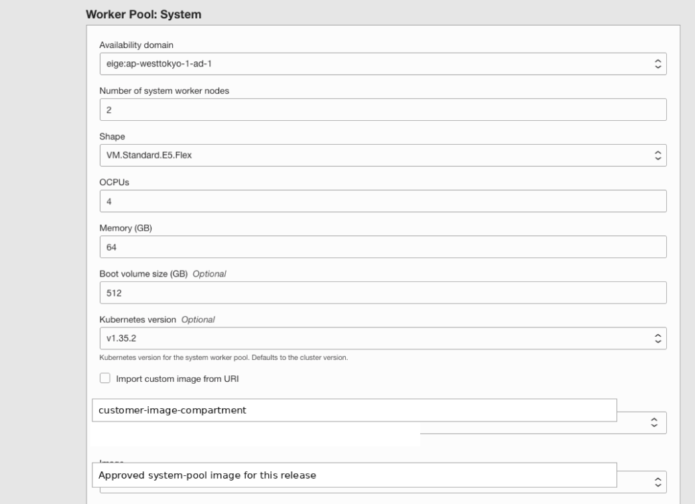

# 11. System Worker Pool

Configure the OKE system node pool that runs cluster services and operational workloads.

|Input|Controls|Guidance|
|---|---|---|
|Availability domain|Selects the availability domain for system worker nodes.|Use the validated Alloy availability domain (AD).|
|Number of system worker Nodes|Sets the system node pool node count.|Example: 2|
|Shape|Selects the system node compute shape.|Example: VM.Standard.E5.Flex|
|OCPUs|Sets the OCPU count per system node.|Example: 4|
|Memory (GB)|Sets the memory per system node.|Example: 64 GB|
|Boot volume size (GB)|Sets the root volume size per system node.|Example: 512 GB|
|Kubernetes version|Specifies the system node pool Kubernetes version or inherits the cluster version.|Use the version approved for the cluster.|
|Import custom image from URI|Imports an image directly from a URL during Terraform Apply instead of selecting an existing Custom Image.|Leave disabled. Import the approved Custom Image manually in Section 2, then select it from the customer image compartment.|
|Operational worker pool image compartment|Specifies the compartment containing the system node pool image.|Select the image compartment in the target region used in Section 2.|
|Image|Selects the Custom Image for system nodes.|Select the release-approved imported image and verify its regional OCID.|
