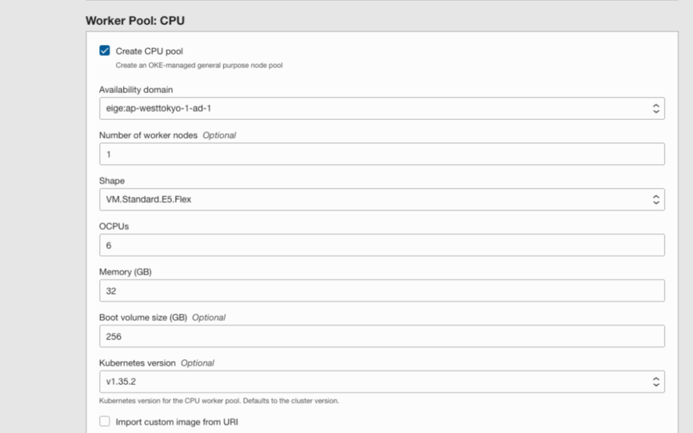

# 12. CPU Worker Pool – Compute Settings

Create and size the general-purpose CPU node pool.

|Input|Controls|Guidance|
|---|---|---|
|Create CPU pool|Creates an OKE managed general-purpose CPU worker pool.|Enable if resources are required for CPU workloads.|
|Availability domain|Selects the availability domain (AD) for CPU worker nodes.|Use the validated Alloy AD.|
|Number of worker nodes|Sets the CPU worker pool node count.|Example: 1 Increase the node count if higher availability is required.|
|Shape|Selects the compute shape for CPU worker nodes.|Example: VM.Standard.E5.Flex|
|OCPUs|Sets the OCPU count per CPU worker node.|Example: 6|
|Memory (GB)|Sets the memory per CPU worker node.|Example: 32|
|Boot volume size (GB)|Sets the root (boot) volume size per CPU worker node.|Example: 256|
|Kubernetes version|Specifies the CPU worker pool Kubernetes version or inherits the cluster version.|Use the Kubernetes version approved for the cluster.|
|Import custom image from URI|Imports an image directly from a URL during stack Apply instead of selecting an existing Custom Image.|Leave disabled. Import the approved Custom Image manually in Section 2, then select it from the customer image compartment.|

---

[Previous: 11. System Worker Pool](./14_system_worker_pool.md) | [Next: 13. CPU Worker Pool – Image Settings](./16_cpu_worker_pool.md)
