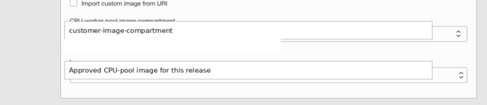

# 13. CPU Worker Pool – Image Settings

Select the release-approved CPU worker pool image from the image compartment.

|Input|Controls|Guidance|
|---|---|---|
|CPU worker pool image Compartment|Specifies the compartment containing the CPU worker image.|Specify the image compartment in the target region used in Section 2, Preparing and Importing Custom Images by URL.|
|Image|Selects the Custom Image for CPU workers.|Select the release-approved imported image and verify its regional OCID.|

---

[Previous: 12. CPU Worker Pool – Compute Settings](./15_cpu_worker_pool_compute.md) | [Next: 14. B200 GPU/RDMA Worker Pool](./17_b200_gpu_rdma_worker_pool.md)
