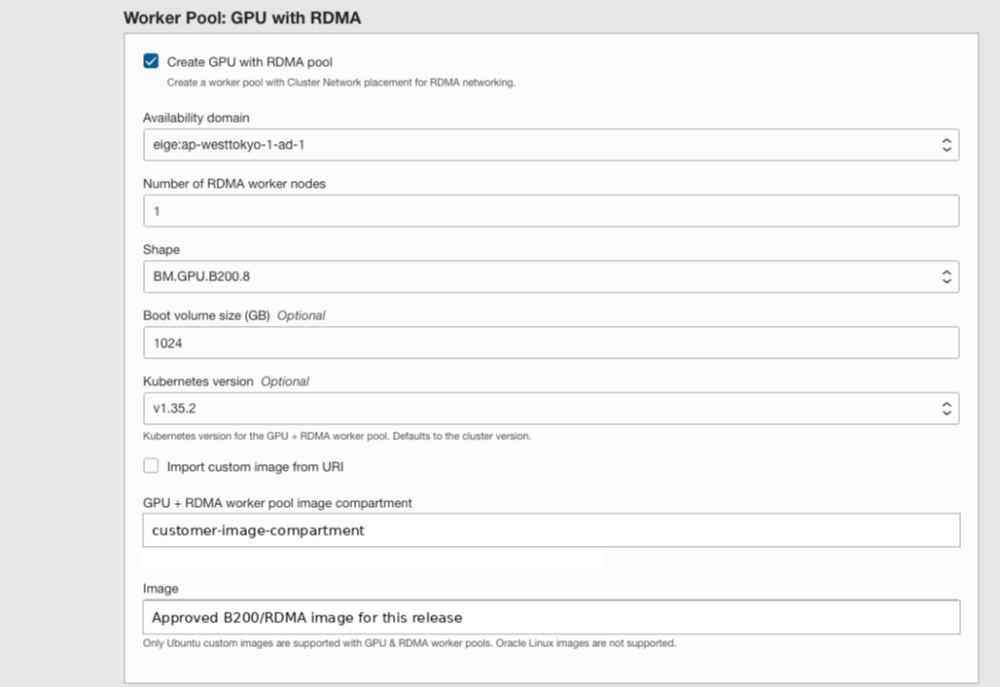

# 14. B200 GPU/RDMA Worker Pool

Create the BM.GPU.B200.8 worker pool and select the approved Ubuntu image containing the validated GPU, CUDA, and RDMA software stack.

|Input|Controls|Guidance|
|---|---|---|
|Create GPU with RDMA pool|Creates an RDMA-capable GPU worker pool using cluster network placement.|Enable for the B200 profile.|
|Availability domain|Selects the availability domain for GPU/RDMA workers.|Use a validated Alloy availability domain (AD) with confirmed resource capacity.|
|Number of RDMA worker nodes|Sets the GPU/RDMA node pool node count.|Use one node for basic checks and at least two nodes for multi-node validation.|
|Shape|Selects the bare metal GPU shape.|Use BM.GPU.B200.8 in this profile.|
|Boot volume size (GB)|Sets the root volume capacity per GPU node.|Example: 1024 GB|
|Kubernetes version|Specifies the GPU node pool Kubernetes version or inherits the cluster version.|Use the version approved for the cluster.|
|Import custom image from URI|Imports an image directly from a URL during Terraform Apply instead of selecting an existing Custom Image.|Leave disabled. Import the approved Custom Image manually in Section 2, then select it from the customer image compartment.|
|GPU + RDMA worker pool image compartment|Specifies the compartment containing the B200/RDMA image.|Select the customer image compartment in the target region used in Section 2.|
|Image|Selects the Ubuntu image containing the approved GPU, CUDA, and RDMA software stack.|Select the release-approved imported image and verify its regional OCID.|

---

[Previous: CPU Worker Pool – Image Settings](./16_cpu_worker_pool.md) | [Next: 15. GPU Memory Cluster and Storage](./18_gpu_memory_cluster_storage.md)
