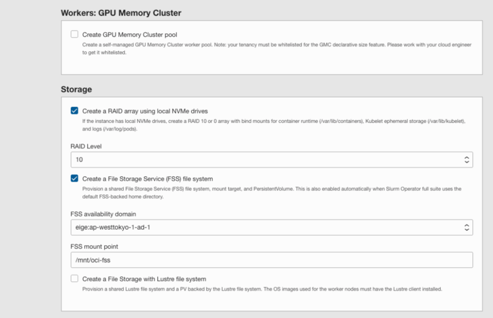

# 15. GPU Memory Cluster and Storage

Configure GPU Memory Cluster capacity, local NVMe RAID, FSS, and Lustre storage as required.

|Input|Controls|Guidance|
|---|---|---|
|Create GPU Memory Cluster pool|Creates a self-managed GPU Memory Cluster node pool.|Leave disabled unless the feature is enabled for the tenancy and required by the design.|
|Create a RAID array using local NVMe drives|Configures local RAID and bind mounts for container, Kubelet, and Pod log paths.|- Profile 1: Leave disabled by default. - Profile 2: Enable according to the selected shape and workload. - Profile 3: Enable with RAID 10 for the validated B200 profile.|
|RAID Level|Selects RAID 10 or RAID 0 for local NVMe devices.|Use 10 when redundancy is required and 0 when maximum throughput is required.|
|Create a File Storage Service (FSS) file system|Creates shared FSS storage, a mount target, and a Kubernetes PersistentVolume (PV).|- Profiles 1 and 2: Optionally enable if shared persistent storage is required. - Profile 3: Enable for the validated B200/RDMA profile.|
|FSS availability domain|Sets the availability domain for FSS resources.|Use the validated Alloy availability domain (AD).|
|FSS mount point|Sets the FSS mount path on worker nodes.|Example: /mnt/oci-fss|
|Create a File Storage with Lustre file system|Creates a Lustre shared file system, Kubernetes StorageClass, and PersistentVolume (PV).|Leave disabled unless Lustre is required and the image includes the Lustre client.|

---

[Previous: 14. B200 GPU/RDMA Worker Pool](./17_b200_gpu_rdma_worker_pool.md) | [Next: 16. Monitoring and Observability](./19_monitoring_observability.md)
