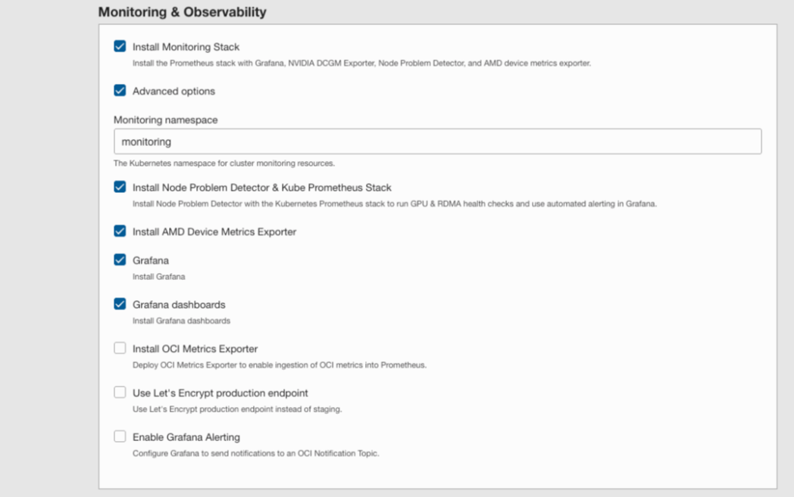

# 16. Monitoring and Observability

Install only the monitoring and observability components required by the customer. Configure DNS, certificates, and alert destinations before enabling production endpoints or alerting.

|Input|Controls|Guidance|
|---|---|---|
|Install Monitoring Stack|Installs the cluster monitoring stack and supporting exporters.|- Profile 1: Optional; normally disabled in the strict minimal profile. - Profiles 2 and 3: Recommended for GPU health checks and workload validation.|
|Advanced options|Displays detailed controls for monitoring components.|Enable to customize the selections below.|
|Monitoring namespace|Sets the Kubernetes namespace for monitoring resources.|Default/example: monitoring|
|Install Node Problem Detector & Kube Prometheus Stack|Installs node health detection, Prometheus, and related monitoring resources.|Enable for health checks and metrics collection.|
|Install AMD Device Metrics Exporter|Collects metrics for supported AMD devices on the node.|Disable for Profile 1 and NVIDIA GPU profiles, including BM.GPU.B200.8. Enable only for supported AMD GPU profiles.|
|Grafana|Installs Grafana for dashboards and visualization.|Enable if interactive dashboards are required.|
|Grafana dashboards|Installs the Grafana dashboards included in the package.|Enable with Grafana.|
|Install OCI Metrics Exporter|Collects OCI service metrics into Prometheus.|Optional; enable if OCI metrics are required.|
|Use Let's Encrypt production endpoint|Uses the production endpoint instead of the staging endpoint to issue certificates.|Enable only after the customer's DNS configuration is ready.|
|Enable Grafana Alerting|Configures Grafana alerts through an OCI Notifications topic.|Enable after configuring alert destinations.|

---

[Previous: 15. GPU Memory Cluster and Storage](./18_gpu_memory_cluster_storage.md) | [Next: 17. Stack Behavior, Preview Features, and Base Settings](./20_stack_behavior.md)
