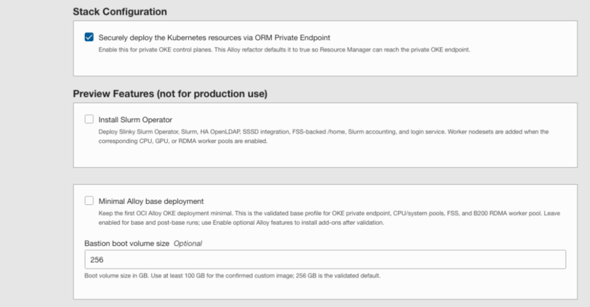

# 17. Stack Behavior, Preview Features, and Base Settings

Configure Resource Manager connectivity and feature mode to match the selected endpoint model. Leave preview services disabled unless explicitly approved.

## 17.1 Stack Configuration

|Input|Controls|Guidance|
|---|---|---|
|Securely deploy the Kubernetes resources via ORM Private Endpoint|Leave disabled for the public OKE endpoint deployment in this guide.|Enable for a separately validated configuration in which Resource Manager must access a private OKE endpoint.|

## 17.2 Preview Features (not for production use)

|Input|Controls|Guidance|
|---|---|---|
|Install Slurm Operator|Installs Slinky Slurm Operator and related Slurm services.|A preview feature; exclude from production deployments. Enable only in a separately approved preview validation environment.|

## 17.3 Base Settings

|Input|Controls|Guidance|
|---|---|---|
|Minimal Alloy base deployment|Deploys a base OKE profile without optional HPC, scheduling, monitoring, or GPU enablement services.|- Profile 1: Enable only for a strict CPU-only base OKE configuration with all optional services disabled. Otherwise, disable. - Profiles 2 and 3: Disable for GPU deployments using services. Control optional services individually.|
|require_ready_region_subscription|A deprecated compatibility input.|Ignore this input.|

---

[Previous: 16. Monitoring and Observability](./19_monitoring_observability.md) | [Next: 18. Plan, Apply, and Validation](./21_plan_apply_validation.md)
