# Appendix – Stack Creation Inputs

This document describes the settings that can be selected or entered when creating the HPC-OKE stack on Softbank Alloy.

## 1. Identity

| Setting | Description |
|---|----|
| Use the Default Identity Domain | Determines whether to use the tenancy's default identity domain. When selected, the stack uses the default identity domain and does not create a new one. |
| Create Policies | Creates IAM policies that allow OKE-related resources to call OCI services. Depending on the configuration, this package grants permissions for: - OKE clusters and node pools: cluster and worker management - Compute and volumes: instance and storage management - Networking: use of subnets, VNICs, and NSGs - File Storage: shared file system management - Monitoring: querying and publishing metrics such as GPU and RDMA metrics - Specific Kubernetes workloads: OCI API access subject to service account conditions |
| Create Dynamic Group | Creates a dynamic group that groups OCI instances as authentication principals. The matching rule includes all Compute instances in the compartment, not only the OKE instances created by this deployment. |
| Use existing Dynamic Group | Uses a dynamic group already created by an administrator instead of creating a new group. |

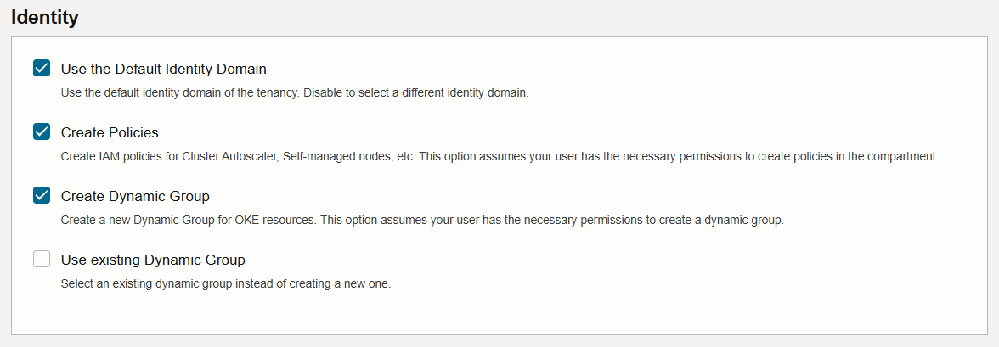

## 2. Network

| Setting | Description |
|---|----|
| Create VCN | Determines whether to create a new virtual network or use an existing one. - Selected: Terraform configures a new VCN and related network resources. - Cleared: Settings for selecting an existing VCN are displayed. |
| Virtual Cloud Network (VCN) name | Specifies the display name of the VCN that Terraform creates. Enter plain text. |
| VCN CIDR ranges | Specifies the private IPv4 address ranges used within the VCN. |
| Create public subnets | Allows public subnets for resources that use public IP addresses. Selecting this setting does not make all workers or the Kubernetes API public. |
| Subnets advanced settings | Allows explicit configuration of per-subnet address ranges or the use of existing subnets. - Cleared: Required subnets are configured using the package's default subnet allocation logic. - Selected: Per-subnet CIDR or existing subnet selection fields are displayed according to the other selected settings. |

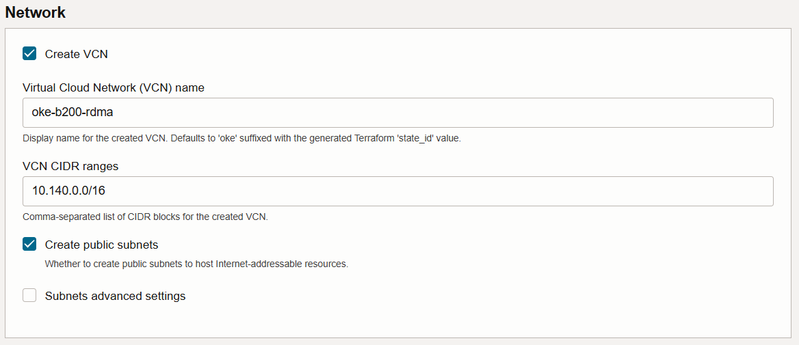

### 2-1 Subnets Advanced Settings (When Subnets advanced settings Is Selected)

| Setting | Description |
|---|----|
| Subnet CIDR for the bastion subnet | Subnet for the directly provisioned bastion VM. |
| Subnet CIDR for the bastion service subnet | Subnet for the private endpoint of the OCI-managed Bastion service. Separate from the bastion VM subnet. |
| Subnet CIDR for the operator subnet | Subnet for the administrative operator VM that runs tools such as kubectl and Helm. It is not a dedicated subnet for GPU Operator or Network Operator Pods. |
| Subnet CIDR for the internal load balancer subnet | Subnet containing private IP addresses for load balancers serving internal services. |
| Subnet CIDR for the public load balancer subnet | Subnet for load balancers that expose services externally. |
| Subnet CIDR for the OKE control plane subnet | Subnet connected to the Kubernetes API endpoint. This does not mean that all Oracle-managed control plane servers are placed in this subnet. |
| Subnet CIDR for the workers subnet | Subnet for the primary VNICs and IP addresses of System, CPU, GPU, and RDMA worker nodes. |
| Subnet CIDR for the FSS subnet | Subnet containing the mount target used to access FSS. |
| Subnet CIDR for the Lustre subnet | Subnet used for Lustre file system network connectivity. |
| Subnet CIDR for the pods subnet | Subnet that supplies Pod IP addresses in VCN-Native Pod Networking. Separate from the worker node IP range. |

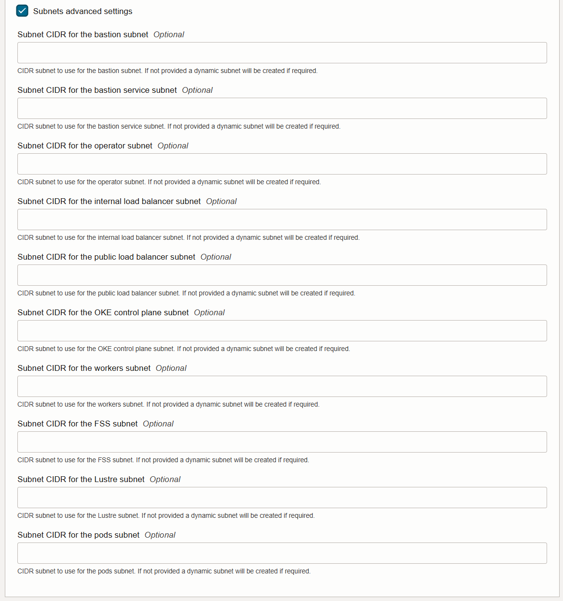

## 3. Cluster Access

| Setting | Description |
|---|----|
| SSH Public Key | Registers the public key used to log in to bastion, operator, and worker nodes over SSH. - Choose SSH key file: Upload a public key file from your PC, typically a `.pub` file. - Paste SSH key: Paste the public key string directly. |
| Create Bastion Instance | Determines whether to create a bastion VM as a jump host for access to the VCN. Enable **Create public subnets** under Network and retain the public bastion configuration to create a bastion with a public IP address. |
| Bastion allowed CIDRs | Specifies the source IP addresses allowed to access the bastion over SSH. Setting `0.0.0.0` allows access from all IP addresses. This value applies to the bastion VM; OCI Bastion Service has a separate CIDR setting. |
| Configure bastion instance shape | Displays detailed fields for selecting the bastion shape, CPU, and memory. When selected, the following settings can be specified directly: - Bastion instance shape - Bastion OCPUs - Bastion Memory Clearing this checkbox does not cancel bastion creation. Create bastion instance controls whether a bastion is created. |
| Bastion instance shape | Specifies the shape of the bastion VM to create. |
| Bastion OCPUs | Specifies the bastion VM OCPU count. |
| Bastion Memory | Specifies the bastion VM memory capacity. |
| Bastion image type | Specifies how to select the bastion VM boot image. This image is for the bastion and does not need GPU drivers or OFED. |
| Import custom image from URI | Imports an image file stored in Object Storage for use as a Custom Image. - Selected: Specify the Object Storage URI of the image file. - Cleared: Select a Custom Image already registered in the target environment. The URI must point to a machine image in a format that OCI can import, rather than a general installation ISO or container image URL. If cleared, select an existing image from the list below. |
| Bastion image compartment | Specifies the compartment containing the Custom Image resource. This setting determines where the image list is queried, rather than where the bastion VM is created. |
| Bastion image | Specifies the Custom Image to use. Verify that the image: - Is available in the target region - Has an architecture and shape compatible with `VM.Standard.E5.Flex` - Supports SSH access and public key configuration - Contains the SSH account specified below |
| Bastion SSH User | Specifies the Linux user account used to log in to the bastion operating system. - Ubuntu: ubuntu / Oracle Linux: opc / Corporate Custom Image: the account actually configured in the image This ZIP also supports auto. It selects opc for Oracle Linux images and ubuntu for other images. |
| Create operator instance | Determines whether to create a separate Compute VM for OKE administration. Selecting this option creates a VM separate from the bastion to run cluster management and installation tasks internally, and displays its creation settings. |
| Use OCI Bastion Service | Creates the OCI-managed access service separately from the directly managed bastion VM. |

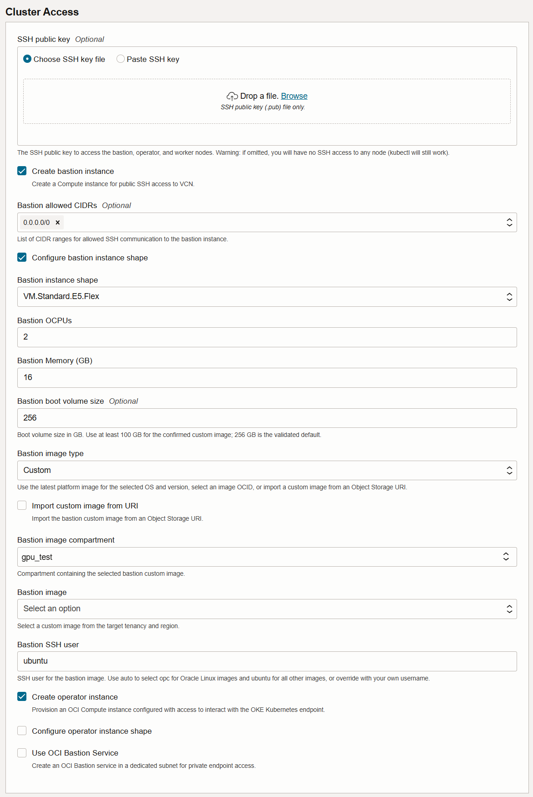

### 3-1 Import Custom Image from URI (When Import custom image from URI Is Selected)

Selecting Import custom image from URI hides Bastion image compartment and Bastion image and displays the following field.

| Setting | Description |
|---|----|
| Bastion image URI | Displays the URI of the image used to create the bastion. |

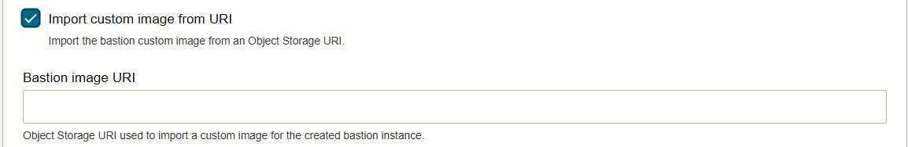

### 3-2 Operator Instance Settings (When Create operator instance Is Selected)

| Setting | Description |
|---|----|
| Configure operator instance shape | Controls whether detailed specification fields such as operator VM shape, CPU, and memory are displayed. Selecting Create operator instance also selects this setting and displays detailed operator instance settings. |
| Shape | Specifies the operator VM instance type. |
| OCPUs | Specifies the number of OCPUs allocated to each operator VM. |
| Memory (GB) | Specifies the operator VM memory capacity. |
| Boot volume size | Specifies the operator VM operating system disk size. |
| Operator image type | Specifies how to select the operator VM boot image. - `Platform`: Use the OCI platform image for the selected OS and version. - `Custom`: Select an existing Custom Image or import one from a URI. |
| Import custom image from URI | Determines whether to import an image file from Object Storage for the operator VM. |
| Operator image compartment | Specifies the compartment containing the Custom Image to select. |
| Operator image | Specifies the Custom Image to use. |
| Operator SSH user | Specifies the Linux account used to log in to the operator VM. - Ubuntu: ubuntu / Oracle Linux: opc / Corporate Custom Image: the account actually configured in the image This ZIP also supports auto. It selects opc for Oracle Linux images and ubuntu for other images. |
| Install required operator tools | Enables installation of management tools during operator VM cloud-init. - `kubectl`: Query and manage Kubernetes resources - `Helm`: Install Kubernetes applications - `OCI CLI`: Call OCI service APIs - `jq`: Process JSON - `Git`: Download and manage code and configuration - `k9s`: Terminal-based Kubernetes management interface - `kubectx`: Switch Kubernetes connection contexts |
| Verify required operator tools | After operator VM creation, Terraform connects over SSH through the bastion to verify the management tools. |
| Inject OCI Alloy region metadata on operator | Sets environment variables on the operator VM for the target Alloy region and realm. |

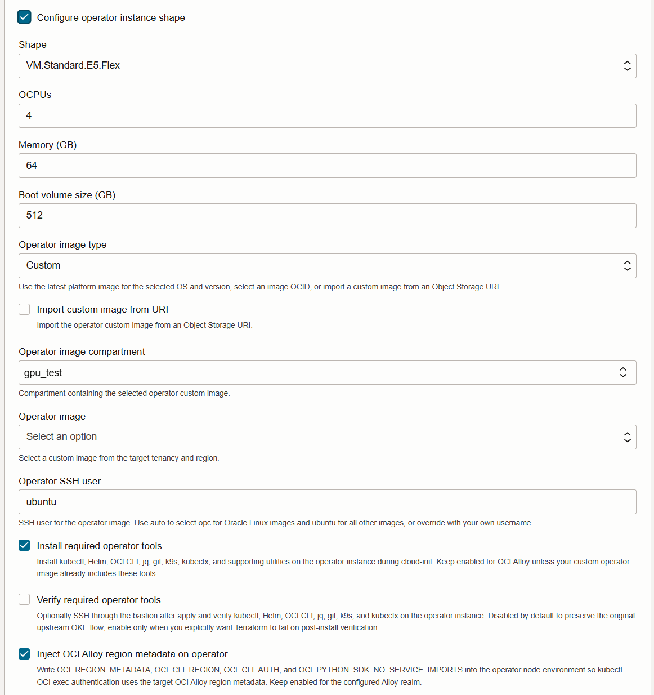

## 4. Cluster

| Setting | Description |
|---|----|
| Compartment | Specifies the default compartment for created resources such as the OKE cluster and workers. Not all resources are necessarily created here. For example, the code creates the IAM policies described earlier at the tenancy root, and existing VCNs or images can belong to other compartments. |
| Cluster name prefix | Specifies the OKE cluster name prefix. |
| Kubernetes version | Specifies the cluster Kubernetes version. This package uses the cluster version unless a separate worker pool version is specified. |
| CNI to use for pod networking | CNI is the plugin that configures Pod network interfaces and IP connectivity. Select one of the following: VCN-Native Pod Networking: Allocates IP addresses from the Pod subnet in the VCN. Flannel: Uses an overlay Pod network separate from VCN addresses. |
| Service CIDR | Specifies the Kubernetes Service IP range. |
| Create the Kubernetes control plane endpoint in a public subnet and assign it a public IP address | Determines whether to make the Kubernetes API endpoint public. If cleared, an access path such as the following is required: - VPN or FastConnect connected to the VCN - A tunnel through the bastion - An administrative operator VM inside the VCN - A Resource Manager private endpoint |
| Kubernetes endpoint allowed CIDRs | Specifies source IP ranges permitted to communicate with the Kubernetes API. Setting 0.0.0.0/0 does not expose the cluster to the internet while the API remains private. A network path to the API must first exist. |
| Preferred Load Balancer kind | Specifies the preferred default exposure when publishing applications through Kubernetes Services such as type: LoadBalancer. |

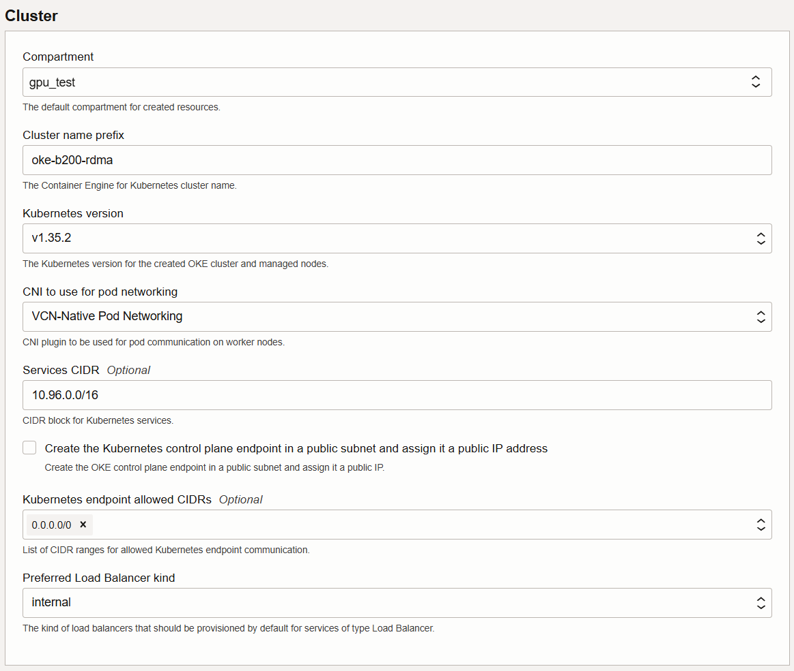

## 5. Cluster Components

| Setting | Description |
|---|----|
| Enable optional Alloy features after base validation | Allows optional features to be added after verifying the base cluster and system workers. Enable this setting to meet installation conditions for components such as NFD and GPU Operator. - Use the base cluster deployment stage first. - Optional features can then be enabled. Enabling this setting does not automatically install NFD, GPU Operator, Kueue, or other components. Select each installation option separately. |
| Install Node Feature Discovery add-on | Determines whether to install Node Feature Discovery (NFD). |
| Install NVIDIA GPU Operator add-on | Determines whether to install managed GPU Operator. Enable the NFD (Node Feature Discovery) option to install this component. Enabling this option installs NVIDIA GPU Operator and displays NVIDIA GPU Operator advanced options. |
| Install NVIDIA Network Operator add-on | Determines whether to install the OKE-managed NvidiaNetworkOperator add-on. Enable the NFD (Node Feature Discovery) option to install this component. Enabling this option installs NVIDIA Network Operator and displays NVIDIA Network Operator advanced options. |
| Install Image Credential Provider for Container Registry (OCIR) | Controls installation of the Credential Provider in the worker initialization script so workers can download private OCIR images using instance principal authentication. |
| Install OCI HPC OKE Utils | Determines whether to install the OCI HPC OKE Utils Helm chart. |
| Install Kueue | Determines whether to install the Kueue Helm chart. |
| Install MPI Operator | Determines whether to install MPI Operator. |

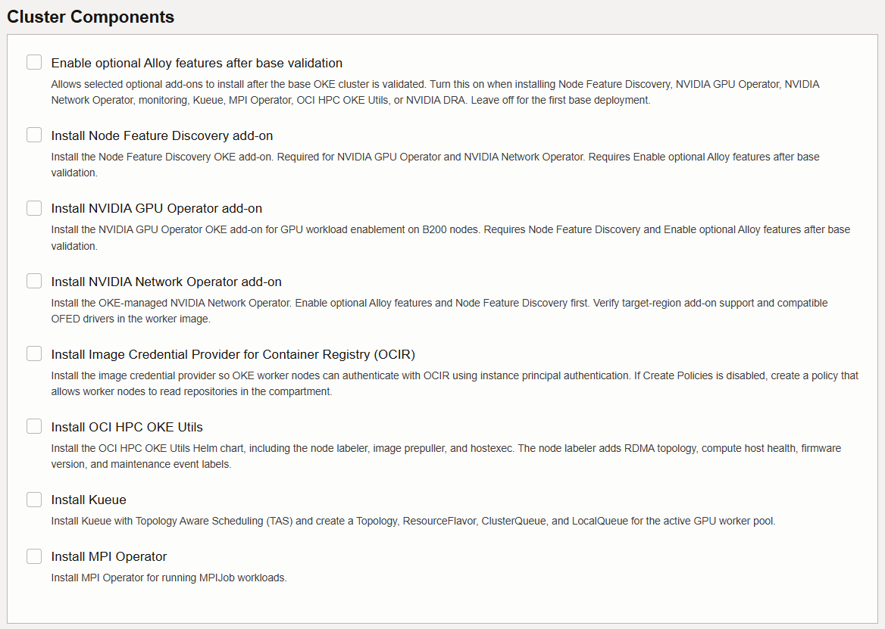

### 5.1 NVIDIA GPU Operator Advanced Options (When Install NVIDIA GPU Operator add-on Is Selected)

| Setting | Description |
|---|----|
| NVIDIA GPU Operator add-on version | Specifies the OKE-managed GPU Operator version to install. |
| Disable NVIDIA GPU plugin in NVIDIA GPU Operator | Disables the existing, separately installed OKE NVIDIA GPU plugin to prevent it from running alongside the device plugin managed by GPU Operator. |
| Enable CDI in NVIDIA GPU Operator | Enables GPU access for containers through CDI (Container Device Interface). |
| Use CDI as the default device-injection mode | Sets CDI as the default method for attaching GPUs to containers. |
| Device plugin DEVICE_LIST_STRATEGY | Configures how the GPU device plugin passes allocated GPU information to the container runtime. |
| Enable NVIDIA toolkit in NVIDIA GPU Operator | Allows GPU Operator to manage NVIDIA Container Toolkit components. |
| Skip NFD dependency check in NVIDIA GPU Operator | Requests that the OKE add-on skip its NFD dependency check. Used, for example, when a compatible NFD installation already exists. |
| Enable MIG Manager in NVIDIA GPU Operator | Determines whether to install MIG Manager. |

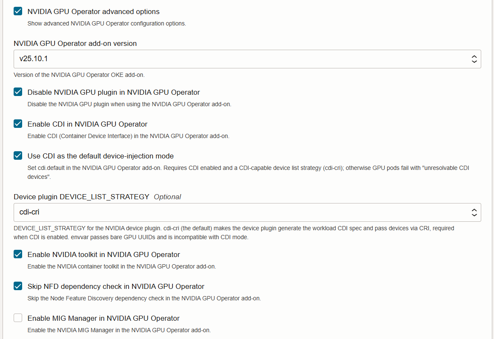

### 5.2 NVIDIA Network Operator Advanced Options (When Install NVIDIA Network Operator add-on Is Selected)

| Setting | Description |
|---|----|
| Enable SR-IOV Network Operator | Determines whether to enable SR-IOV Network Operator together with Network Operator. |
| VF Creation Mode | Selects how VFs are created and managed. - custom: Uses the OKE custom VF creation path. Check the VF creation settings supplied by the environment and the existing configuration. - sriovNetworkOperator: Uses SR-IOV Network Operator to manage VF creation. |
| Operator Node selection | Uses labels to specify which nodes host Network Operator's own Pods. |
| Operator Tolerations | Allows Network Operator Pods to tolerate node taints and run on nodes where those taints restrict ordinary Pod placement. |
| CNI binary directory | Specifies the directory on nodes in which CNI binaries managed by Network Operator are placed. It must match the path used by the worker container runtime. |
| NVIDIA Network Operator add-on version | Selects the OKE managed Network Operator add-on version to install. Use a version supported in the target region and Kubernetes version. |
| Override existing NVIDIA Network Operator installation | Specifies whether OKE may override an existing NVIDIA Network Operator installation. This does not import existing Kubernetes resources into Terraform state. |
| Remove NVIDIA Network Operator resources on delete | Specifies whether to remove related Kubernetes resources when the managed add-on is deleted. Review the impact on running network workloads before enabling. |

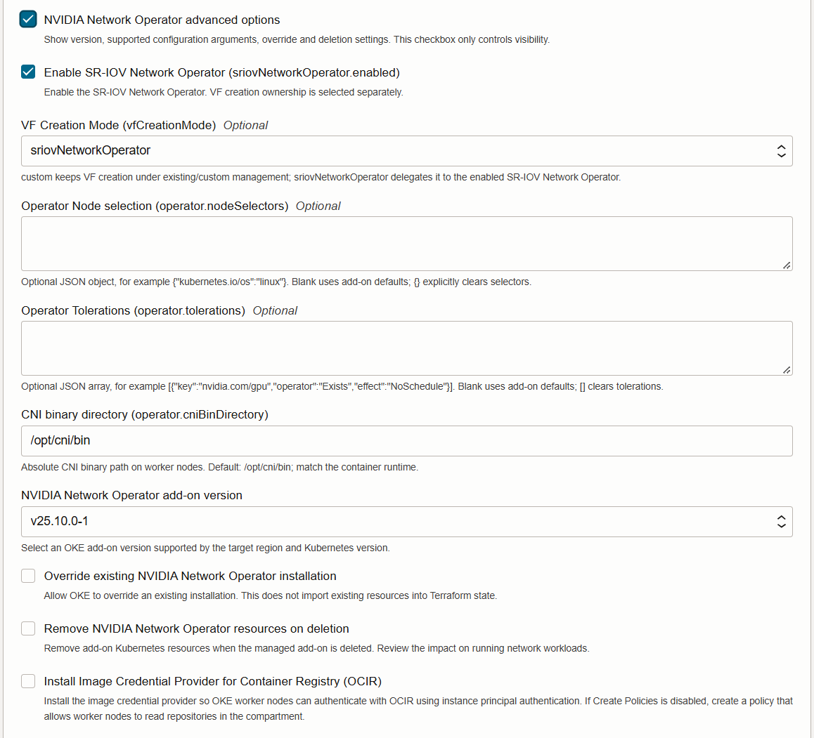

## 6. Worker Pool: System

Configure the specifications and image for oke-system, the CPU worker pool used for cluster operations.

| Setting | Description |
|---|----|
| Availability domain | Selects the **AD (Availability Domain)** in which to create system workers. |
| Number of system worker nodes | Specifies the number of system workers to create. |
| Shape | Specifies the system worker node shape. This shape has no GPUs. Configure GPU workload nodes in separate GPU or RDMA worker pools. |
| OCPUs | Specifies the OCPU count per system worker node, rather than the total across all nodes. |
| Memory (GB) | Specifies memory per system worker, rather than the total across all nodes. |
| Boot volume size (GB) | Specifies the size of the disk containing the node operating system. |
| Kubernetes version | Specifies the system worker Kubernetes version. |
| Import custom image from URI | Determines whether to import the system worker Custom Image from an Object Storage URI. |
| Operational worker pool image compartment | Specifies the compartment containing the system worker image. |
| Image | Selects a Custom Image containing the system worker VM operating system and initial software configuration. Image requirements include: - A compatible Ubuntu version, such as Ubuntu 22.04 targeted by the package - An x86-64 image compatible with VM.Standard.E5.Flex - Working cloud-init - An image and network environment that support installation of OKE packages for the selected Kubernetes version |

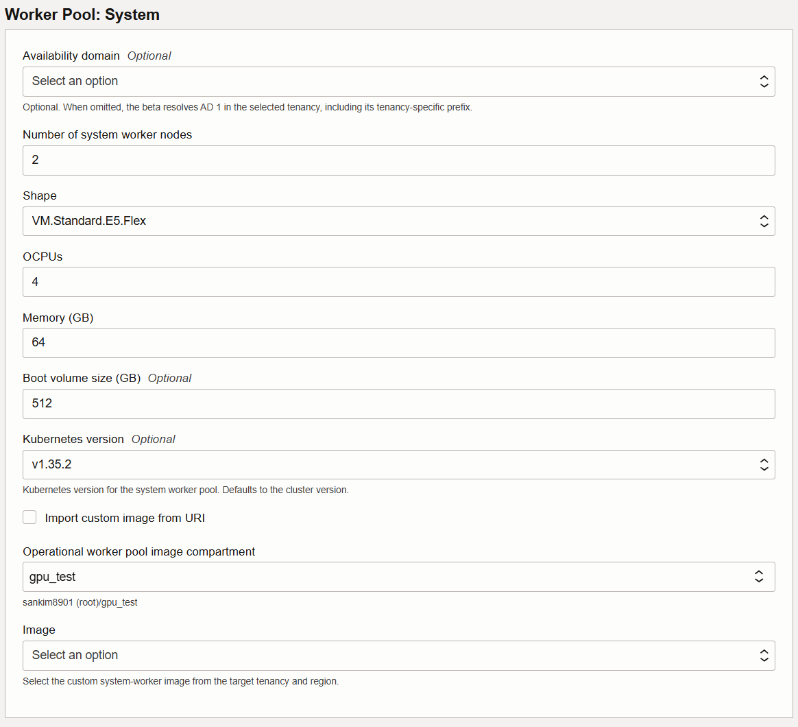

### 6.1 Import Custom Image from URI (When Import custom image from URI Is Selected)

Selecting Import custom image from URI hides Operational worker pool image compartment and image and displays the following field.

| Setting | Description |
|---|----|
| image URI | Displays the URI of the image used to create system workers. |

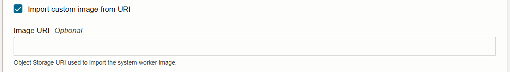

## 7. Worker Pool: CPU

| Setting | Description |
|---|----|
| Create CPU pool | Creates an additional OKE-managed worker pool, `oke-cpu`, for general CPU workloads. |

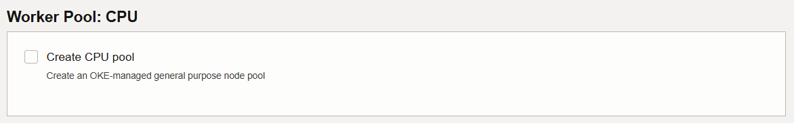

### 7.1 CPU Pool Settings (When Create CPU Pool Is Selected)

| Setting | Description |
|---|----|
| Availability domain | Specifies the AD for CPU workers. |
| Number of worker nodes | Sets the number of nodes to create in the CPU pool. |
| Shape | Sets the CPU worker Compute instance type. |
| OCPUs | Specifies the OCPU count allocated to each CPU worker. |
| Memory (GB) | Specifies the system memory per CPU worker. |
| Boot volume size (GB) | Specifies the boot disk size per CPU worker. |
| Kubernetes version | Specifies the Kubernetes version for the CPU worker pool. |
| Import custom image from URI | Determines whether to import the CPU worker VM image from Object Storage. - `Cleared`: Select a registered Custom Image from the list below. - `Selected`: Enter the image file's Object Storage URI. |
| CPU worker pool image compartment | Specifies the compartment containing the CPU worker Custom Image. |

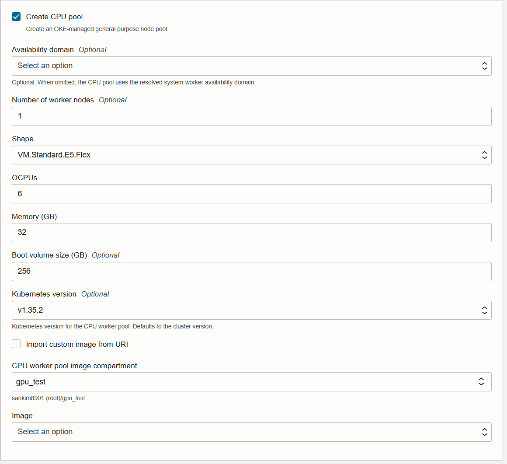

#### 7.1.1 Import Custom Image from URI (When Import custom image from URI Is Selected)

Selecting Import custom image from URI hides CPU worker pool image compartment and image and displays the following field.

| Setting | Description |
|---|----|
| image URI | Displays the URI of the image used to create CPU workers. |

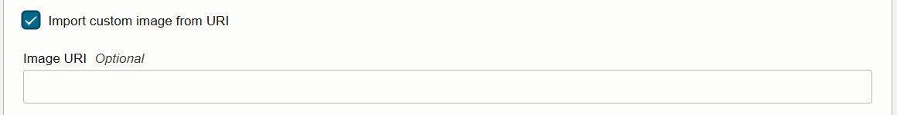

## 8. Worker Pool: GPU

| Setting | Description |
|---|----|
| Create GPU Pool | Creates an OKE-managed worker pool, `oke-gpu`, with GPUs. |

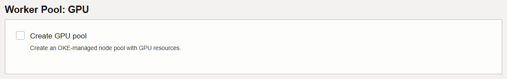

### 8.1 GPU Pool Settings (When Create GPU pool Is Selected)

| Setting | Description |
|---|----|
| Availability domain | Specifies the AD for CPU workers. |
| Number of worker nodes | Sets the number of nodes to create in the CPU pool. |
| Shape | Sets the CPU worker Compute instance type. |
| OCPUs | Specifies the OCPU count allocated to each CPU worker. |
| Memory (GB) | Specifies the system memory per CPU worker. |
| Boot volume size (GB) | Specifies the boot disk size per CPU worker. |
| Kubernetes version | Specifies the Kubernetes version for the CPU worker pool. |
| Import custom image from URI | Determines whether to import the CPU worker VM image from Object Storage. - `Cleared`: Select a registered Custom Image from the list below. - `Selected`: Enter the image file's Object Storage URI. |
| CPU worker pool image compartment | Specifies the compartment containing the CPU worker Custom Image. |

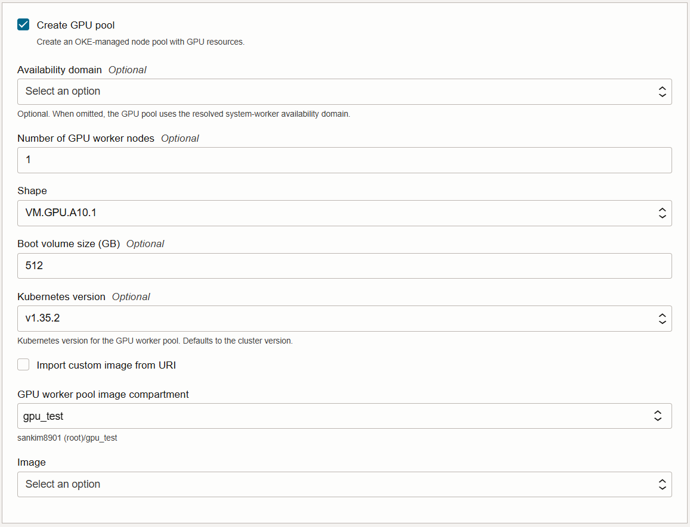

#### 8.1.1 Import Custom Image from URI (When Import custom image from URI Is Selected)

Selecting Import custom image from URI hides GPU worker pool image compartment and image and displays the following field.

| Setting | Description |
|---|----|
| image URI | Displays the URI of the image used to create GPU workers. |

## 9. Worker Pool: GPU with RDMA

| Setting | Description |
|---|----|
| Create GPU with RDMA Pool | Creates the `oke-rdma` worker pool for high-speed RDMA communication between GPU nodes. |

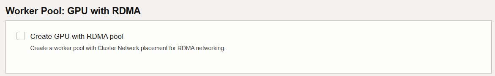

### 9.1 GPU with RDMA Pool Settings (When Create GPU with RDMA Pool Is Selected)

| Setting | Description |
|---|----|
| Availability domain | Sets the AD for RDMA workers. Unlike the System and CPU pools, this must be selected manually; AD 1 is not selected automatically. |
| Shape | Specifies the RDMA worker server type. The default is `BM.GPU.B200.8`. |
| Boot volume size (GB) | Sets the boot disk size per RDMA worker. |
| Kubernetes version | Specifies the Kubernetes version for the GPU+RDMA worker pool. |
| GPU + RDMA worker pool image compartment | Specifies the compartment containing the Custom Image. |
| Image | Specifies the Custom Image used for GPU+RDMA workers. |

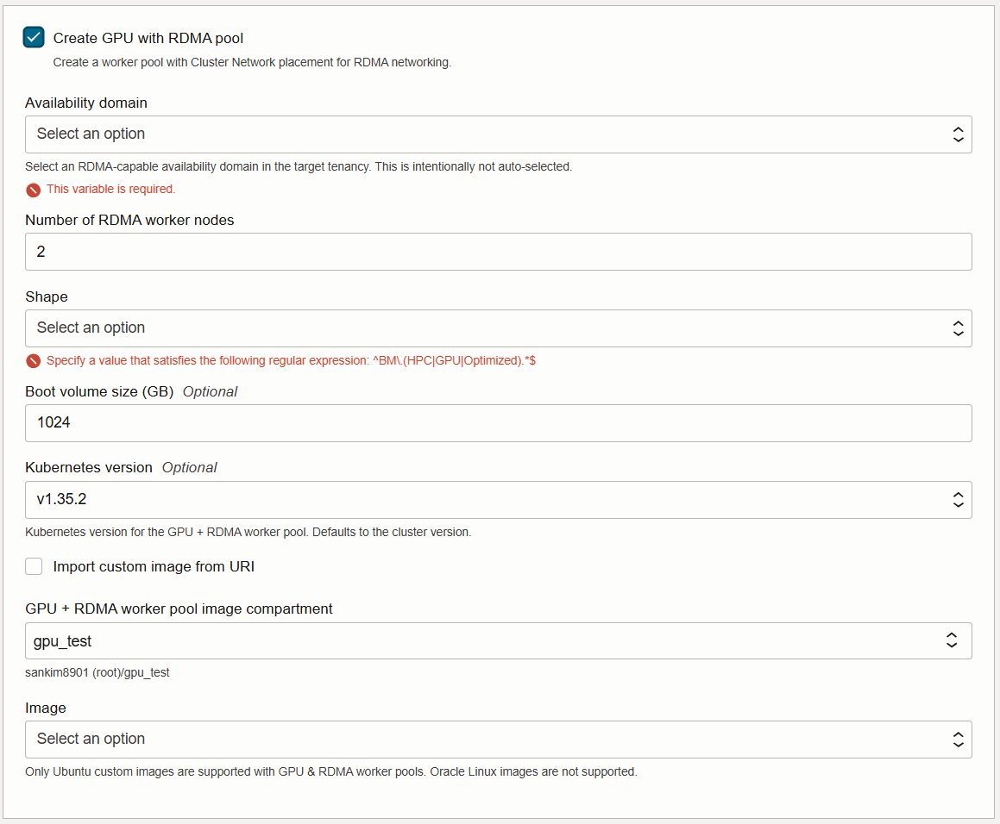

#### 9.1.1 Import Custom Image from URI (When Import custom image from URI Is Selected)

Selecting Import custom image from URI hides GPU + RDMA worker pool image compartment and image and displays the following field.

| Setting | Description |
|---|----|
| image URI | Displays the URI of the image used to create GPU+RDMA workers. |

## 10. Workers: GPU Memory Cluster

| Setting | Description |
|---|----|
| Create GPU Memory Cluster pool | Creates the self-managed `oke-gmc` pool using GPU Memory Fabric. |

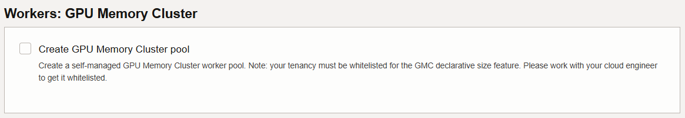

### 10.1 GPU Memory Cluster Pool Settings (When Create GPU Memory Cluster pool Is Selected)

| Setting | Description |
|---|----|
| Availability domain | Specifies the AD for GMC workers. Unlike the System and CPU pools, this must be selected manually; AD 1 is not selected automatically. |
| Shape | Specifies the RDMA worker server type. The default is `BM.GPU.B200-v3.4`. |
| GPU Memory Fabric OCIDs | Enter the OCIDs of the GPU Memory Fabrics on which to build the GMC. |
| Boot volume size (GB) | Specifies the boot disk size per GMC worker. |
| Kubernetes version | Specifies the Kubernetes version for GMC workers. |
| Image | Specifies the Custom Image for GMC workers. |
| GPU Memory Cluster advanced options | Displays GMC scaling settings. |

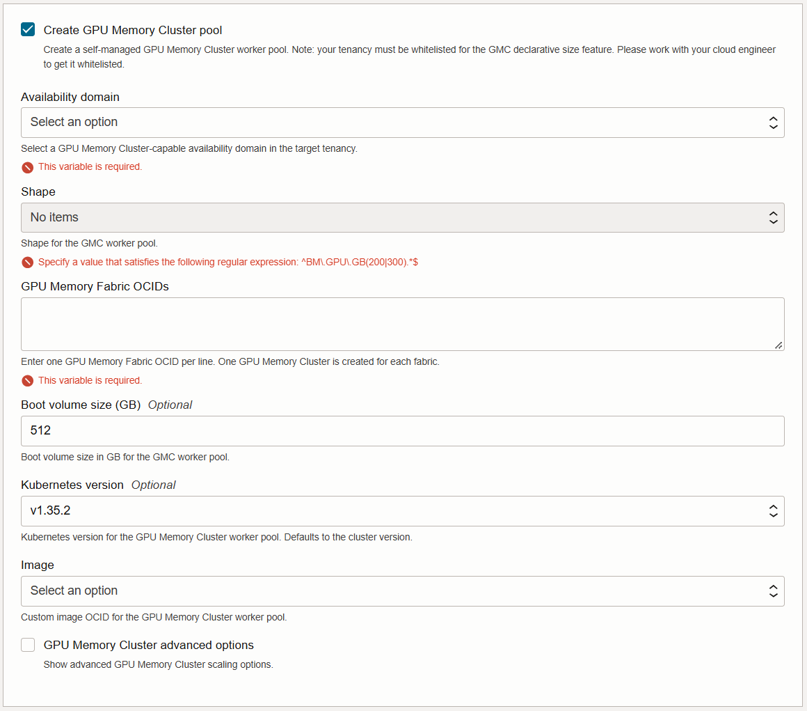

#### 10.1.1 GPU Memory Cluster Advanced Options (When GPU Memory Cluster advanced options Is Selected)

| Setting | Description |
|---|----|
| Target size | Specifies the target node count for each GPU Memory Cluster. |
| Enable upsizing | Determines whether OCI may increase the GMC size. |
| Enable downsizing | Determines whether OCI may decrease the GMC size. |

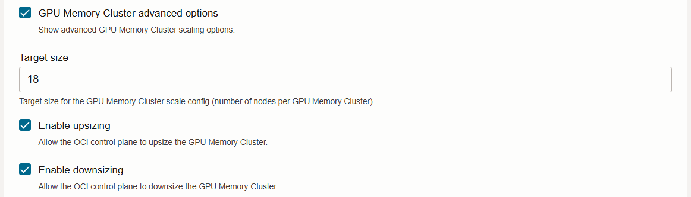

## 11. Storage

| Setting | Description |
|---|----|
| Create a RAID array using local NVMe drives | Enables initialization that combines local NVMe disks into a RAID array when workers have such disks. By default, this package mounts the array at `/mnt/home` and links these paths to that storage: `/var/lib/containers`: Container runtime data `/var/lib/kubelet`: Kubelet data and Pod ephemeral storage `/var/log/pods`: Pod logs |
| RAID Level | Selects how NVMe disks are combined. If there is only one disk, the configuration switches to RAID 0 regardless of the selected value. |
| Create a File Storage Service (FSS) file system | Creates an OCI File Storage shared file system used by multiple nodes. |
| Create a File Storage with Lustre file system | Creates shared Lustre storage, a high-performance parallel file system. |

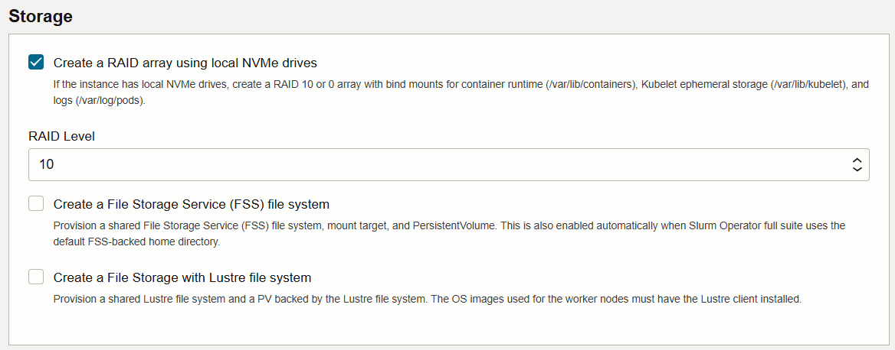

### 11.1 FSS Settings (When Create a File Storage Service (FSS) file system Is Selected)

| Setting | Description |
|---|----|
| FSS availability domain | Sets the AD for the FSS file system and mount target. If omitted, uses the System worker AD. |
| FSS mount point | Sets the local directory where the worker operating system mounts FSS. Once mounted, workers access shared files through this path. |

### 11.2 Lustre Settings (When Create a File Storage with Lustre file system Is Selected)

| Setting | Description |
|---|----|
| Create Lustre PV | Determines whether to create the PersistentVolume (PV) lustre-pv so Kubernetes can use the created Lustre file system. |
| Availability domain | Specifies the AD in which to create the Lustre file system. |
| Lustre file system size in TB | Specifies the total file system capacity, rather than capacity per node. |
| Lustre Performance Tier | Specifies the throughput tier per TB of capacity. |
| Lustre mount path | Specifies the local directory where the worker operating system mounts Lustre. |

## 12. Monitoring & Observability

| Setting | Description |
|---|----|
| Install Monitoring Stack | Parent setting that enables installation of monitoring components. |
| Advanced options | Displays detailed monitoring settings. |

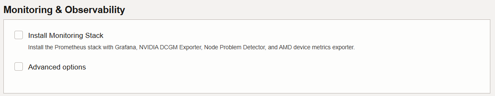

## 13. Stack Configuration

| Setting | Description |
|---|----|
| Securely deploy the Kubernetes resources via ORM Private Endpoint | Determines whether OCI Resource Manager connects to the private OKE API to deploy Kubernetes resources. |

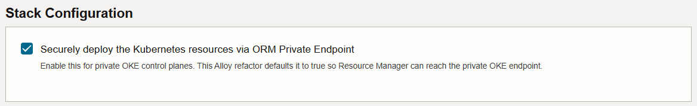

## 14. Preview Features (not for production use)

| Setting | Description |
|---|----|
| Install Slurm Operator | Installs a Slurm workload management environment using Slinky. This package includes a configuration path for Slurm, user authentication, FSS-backed home directories, accounting, and login services in addition to the operator. |

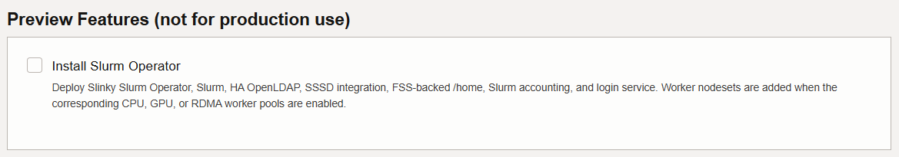

## 15. Other (Uncategorized)

| Setting | Description |
|---|----|
| Minimal Alloy base deployment | Controls restrictions on optional features in the base Alloy deployment. It is not a preset that selects an entire completed configuration. |
| require_ready_region_subscription | Deprecated compatibility input; ignored. |

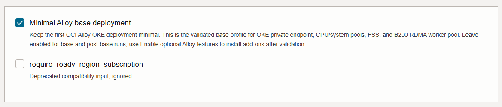
